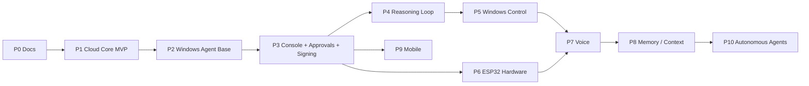

# Roadmap

## Cambios respecto al roadmap propuesto

| Cambio | Motivo |
|---|---|
| **Phase 2 incluye Permission Engine y ejecución determinista sin LLM.** | Antes de dar a un LLM la capacidad de actuar, el agente debe tener allowlist, deduplicación y aprobación local funcionando. Seguridad antes que inteligencia. |
| **Nueva Phase 3: Owner Console & Approvals.** | Un agente con LLM necesita un canal para pedir aprobación y un lugar donde el owner vea tareas/eventos. Se adelanta la UI mínima (web o Tauri) y el flujo de aprobación. |
| **Firma end-to-end de tareas en Phase 3**, antes de control real de Windows. | Mitiga el riesgo "VPS comprometido inyecta tareas" antes de que las tareas puedan causar daño real. |
| **ESP32 real se adelanta a antes de Voz.** | El protocolo ya estará probado con el simulador; botones/pantalla son de bajo riesgo. La voz puede apoyarse después en el micrófono del ESP32. |
| **Memory después de Voice y ESP32**, y como servicio separado del Cloud Core. | La memoria requiere decisiones de privacidad y almacenamiento propias; no bloquea el valor inicial. |

## Fases

### Phase 0 — Documentation
- **Objetivo:** decisiones arquitectónicas cerradas para Cloud Core.
- **Entregable:** `README.md` + `docs/**` (este repositorio).
- **Dependencias:** ninguna.
- **No construir:** código de ningún tipo.
- **Criterio para avanzar:** decisiones pendientes de [Scope](scope.md#supuestos) y de la lista en [docs/README.md](../README.md#decisiones-pendientes-antes-de-implementar) resueltas por el owner.

### Phase 1 — Cloud Core MVP
- **Objetivo:** transporte confiable, seguro y auditable de tareas entre devices.
- **Entregable:** API + Mosquitto + PostgreSQL + nginx desplegados en el VPS; simuladores Windows y ESP32; demo E2E.
- **Dependencias:** Phase 0; dominio y VPS disponibles.
- **No construir:** LLM, Windows Agent real, UI, firmware, Redis, memoria, aprobación remota.
- **Criterio para avanzar:** [MVP Definition](../09-backlog/mvp-definition.md) cumplida al 100 %.

### Phase 2 — Windows Agent Base (sin LLM)
- **Objetivo:** agente real en Windows que se conecta con el protocolo de Phase 1 y ejecuta tareas **deterministas** de una allowlist (`OPEN_APP` con apps permitidas, `SHOW_NOTIFICATION`).
- **Entregable:** servicio Windows (C# o Rust, decisión en esa fase) con inbox persistente (SQLite), deduplicación, Permission Engine (allowlist + reglas), aprobación local simple (diálogo), outbox de resultados, credencial en DPAPI/Windows Credential Manager.
- **Dependencias:** Phase 1.
- **No construir:** LLM, control de UI, navegador.
- **Criterio para avanzar:** 100 redeliveries forzadas sin doble ejecución; tareas no permitidas rechazadas con `NOT_PERMITTED`; sobrevive reinicios de la PC.

### Phase 3 — Owner Console, Approvals y Task Signing
- **Objetivo:** que el owner vea y controle Jarvis, y que el Cloud no pueda forjar tareas.
- **Entregable:** UI mínima (web o Tauri) sobre REST + SignalR; endpoint de aprobación remota ([HU-057](../09-backlog/stories/EPIC-05-task-management.md)); firma Ed25519 de tareas por el principal creador verificada por el agente.
- **Dependencias:** Phase 2.
- **No construir:** mobile nativo, LLM.
- **Criterio para avanzar:** una tarea con firma inválida es rechazada por el agente aunque el Cloud la entregue.

### Phase 4 — Reasoning Loop
- **Objetivo:** el agente interpreta instrucciones en lenguaje natural (`ASSISTANT_REQUEST`) y planifica acciones.
- **Entregable:** Agent Core con interfaz `IReasoningProvider`; adaptador Claude CLI; tool router con las tools deterministas de Phase 2; toda acción pasa por el Permission Engine.
- **Dependencias:** Phase 2, Phase 3.
- **No construir:** tools de UI Automation, voz, memoria persistente.
- **Criterio para avanzar:** cambiar de provider no requiere cambios en Cloud ni en el protocolo.

### Phase 5 — Windows Control
- **Objetivo:** tools de navegador, UI Automation, archivos y comandos con políticas por tool.
- **Dependencias:** Phase 4.
- **No construir:** ejecución sin aprobación de tools de riesgo alto.
- **Criterio para avanzar:** matriz de riesgo por tool aprobada; auditoría local y remota de cada acción.

### Phase 6 — ESP32 Hardware
- **Objetivo:** firmware ESP-IDF (ESP32-S3) con botones/pantalla que crea tareas y muestra resultados.
- **Dependencias:** Phase 1 (protocolo), Phase 3 recomendado.
- **No construir:** audio, OTA (salvo diseño).
- **Criterio para avanzar:** reemplaza al ESP32 Simulator en la demo E2E.

### Phase 7 — Voice
- **Objetivo:** entrada/salida de voz (en PC o ESP32). STT/TTS intercambiables.
- **Dependencias:** Phase 4, Phase 6 si se usa el micrófono del ESP32.

### Phase 8 — Memory / Context Engine
- **Objetivo:** memoria de largo plazo (proyectos, preferencias, dispositivos) consultable por el agente.
- **Dependencias:** Phase 4. Requiere ADR propio de privacidad y almacenamiento.

### Phase 9 — Mobile
- **Objetivo:** app mobile (React Native) como device + cliente UI. Ver [Future Mobile Contract](../07-integrations/future-mobile-contract.md).
- **Dependencias:** Phase 3.

### Phase 10 — Advanced Autonomous Agents
- **Objetivo:** tareas de larga duración, planificación multi-paso, sub-agentes, verificación autónoma.
- **Dependencias:** Phases 4, 5, 8.
