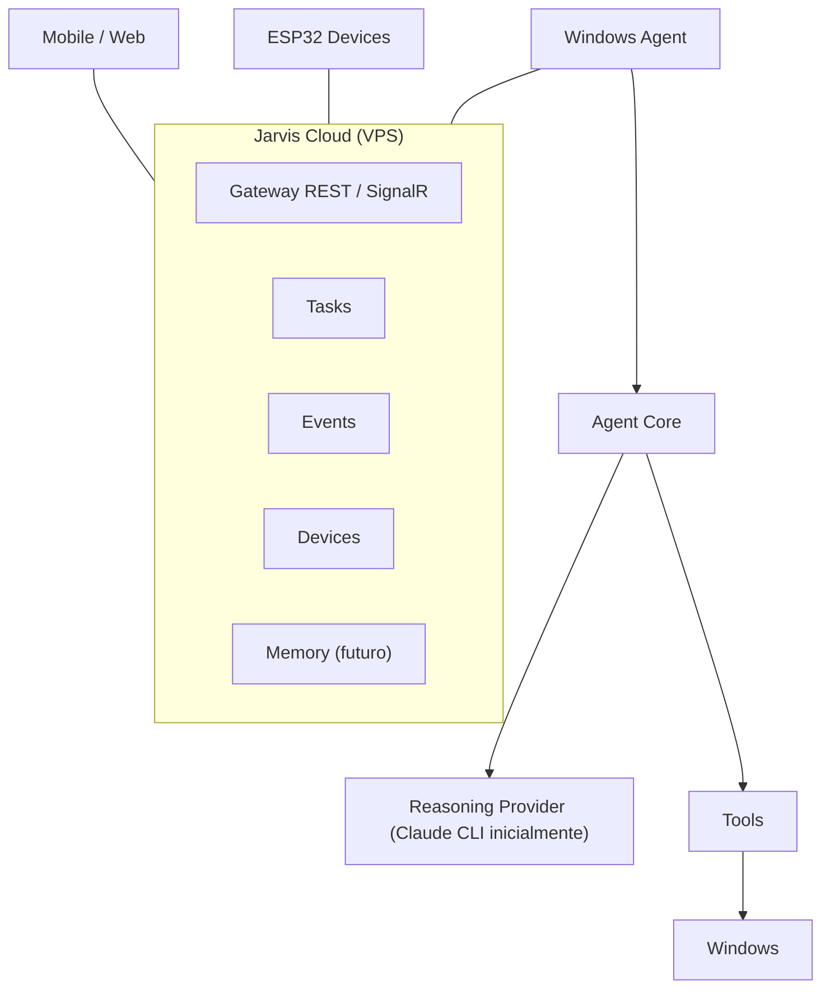

# Visión de Jarvis

## Propósito

Jarvis es un asistente personal **distribuido**: el usuario da instrucciones (texto, voz, botones físicos) desde cualquier dispositivo y Jarvis razona, decide y actúa sobre sus equipos, principalmente una PC Windows, verificando que la acción realmente terminó.

## Capacidades a largo plazo

- Controlar una PC Windows (aplicaciones, navegador, comandos, UI).
- Recibir instrucciones por texto y voz, localmente o de forma remota.
- Razonar antes de actuar; decidir cuándo responder y cuándo solo ejecutar.
- Ejecutar tareas de larga duración y verificar su finalización.
- Usar un motor de razonamiento intercambiable (inicialmente Claude CLI; después otros proveedores o modelos locales).
- Memoria de largo plazo: proyectos, dispositivos, preferencias.
- Usar ESP32 como interfaces físicas (botones, pantalla, micrófono, altavoz, sensores).
- Clientes web y mobile.

## Arquitectura objetivo (visión)

## Principios rectores

| Principio | Significado concreto |
|---|---|
| **Separación transporte / ejecución** | El Cloud transporta tareas estructuradas. Nunca ejecuta ni expone algo equivalente a `POST /execute-shell`. El dispositivo destino decide qué ejecuta. |
| **Zero trust entre dispositivos** | Cada dispositivo tiene su propia identidad y credencial. Un dispositivo solo puede publicar en sus propios topics y solo puede crear los tipos de tarea que el owner le concedió explícitamente. |
| **Independencia de proveedor LLM** | Ningún contrato del Cloud menciona modelos, prompts ni proveedores. Ver [ADR-010](../08-decisions/ADR-010-llm-independence.md). |
| **Independencia de dispositivo** | Un protocolo único (envelope JSON sobre MQTT + REST) para Windows, ESP32, mobile, web y futuros dispositivos. |
| **PostgreSQL como fuente de verdad** | MQTT, SignalR y memoria son transporte o caché; nada importante vive solo ahí. Ver [ADR-002](../08-decisions/ADR-002-postgresql-source-of-truth.md). |
| **Observabilidad de extremo a extremo** | Toda tarea es reconstruible: quién la creó, desde dónde, a quién se envió, cuándo se entregó, empezó y terminó, y con qué resultado. |
| **Simplicidad primero** | Un VPS, un proceso de API, sin Redis, sin microservicios, sin Event Sourcing. Se agregan piezas cuando un problema medido lo justifique. |

## Fase actual

La primera fase es **Jarvis Cloud Core**. Ver [Alcance](scope.md) y [Roadmap](roadmap.md).
