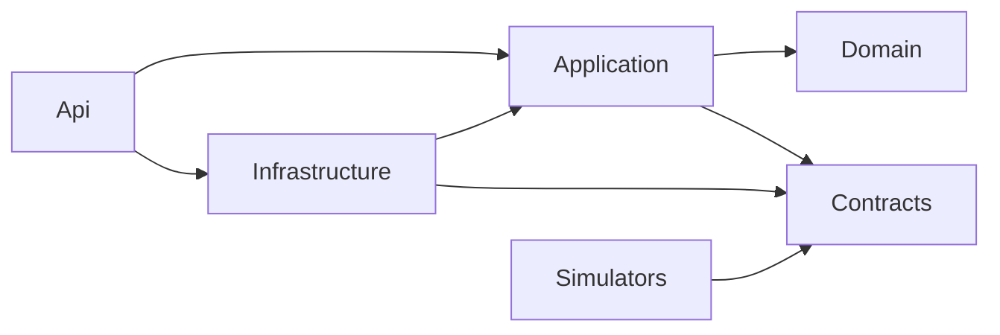

# Backend Architecture

## Estructura de la solución

```text
src/
  Jarvis.Domain/            # Modelo y reglas. Sin dependencias externas.
  Jarvis.Contracts/         # DTOs de protocolo MQTT y REST (compartidos con simuladores). Sin lógica.
  Jarvis.Application/       # Casos de uso, puertos, autorización de negocio.
  Jarvis.Infrastructure/    # EF Core, MQTTnet, Dynamic Security, JWT, hashing, reloj.
  Jarvis.Api/               # Host: Minimal APIs, SignalR hub, auth, ProblemDetails, health, hosted services.
tools/
  Jarvis.Simulators/        # Consola: modos "windows" y "esp32". Referencia solo Jarvis.Contracts.
tests/
  Jarvis.Domain.Tests/
  Jarvis.Application.Tests/
  Jarvis.IntegrationTests/  # WebApplicationFactory + Testcontainers (PostgreSQL, Mosquitto)
  Jarvis.E2ETests/          # Escenario MVP completo con simuladores
```

Reglas de dependencia:



`Jarvis.Contracts` existe para que los simuladores (y en el futuro un Windows Agent en C#) usen **exactamente** los mismos tipos de mensaje que la API, sin referenciar el dominio. Es la única adición respecto a las 4 capas pedidas y se justifica por el protocolo compartido.

## Responsabilidades por capa

### Jarvis.Domain
Contiene reglas que deben ser verdad sin importar el transporte.

| Pertenece | No pertenece |
|---|---|
| Entidades `User`, `Device`, `DeviceCredential`, `JarvisTask`, `DeviceTaskGrant`, `Event` | Atributos de EF Core, `DbContext` |
| Máquina de estados de `JarvisTask` (`Dispatch()`, `Acknowledge()`, `Start()`, `Complete()`, `Fail()`, `RequestCancel()`...) que lanza `InvalidTaskTransitionException` o devuelve resultado "ignorado" | Publicación MQTT |
| Cálculo de `DeviceStatus` a partir de admin state + presence + busy | Lectura de configuración |
| Value objects: `TaskType` (valida `^[A-Z][A-Z0-9_]{1,63}$`), `Capability`, `DeviceName` | Serialización JSON |
| Enums: `DeviceType`, `DeviceAdminState`, `PresenceState`, `TaskStatus`, `PrincipalType` | |
| Recolección de eventos de dominio en la entidad (`DomainEvents` list) | Envío a SignalR |

No hay "domain services" salvo que una regla involucre varias entidades sin dueño claro (p. ej. validar un grant: vive en Application porque requiere consulta).

### Jarvis.Application
Casos de uso como clases de handler simples, un archivo por caso de uso, agrupadas por feature:

```text
Devices/RegisterDevice.cs        Tasks/CreateTask.cs            Presence/HandleHello.cs
Devices/RotateCredential.cs      Tasks/HandleTaskUpdate.cs      Presence/HandleHeartbeat.cs
Devices/RevokeDevice.cs          Tasks/DispatchPendingTasks.cs  Presence/SweepPresence.cs
Auth/Login.cs                    Tasks/CancelTask.cs            Events/QueryEvents.cs
```

| Pertenece | No pertenece |
|---|---|
| Orquestación: cargar entidades, invocar dominio, guardar, emitir eventos | HTTP status codes, rutas |
| Autorización de negocio (owner scoping, grants) | Detalles de MQTTnet o SignalR |
| Puertos (interfaces) **solo** para efectos externos: `IDeviceMessagePublisher`, `IRealtimeNotifier`, `IBrokerCredentialAdmin`, `ISecretHasher`, `ITokenIssuer`, `IClock` | Interfaces para cosas que nunca se sustituyen |
| Acceso a datos vía `IJarvisDbContext` (expone `DbSet<>`) | Repositorios genéricos |

**Decisión pragmática:** Application depende de `Microsoft.EntityFrameworkCore` (abstracciones de `DbSet`/`IQueryable`). No se crean repositorios por entidad: `DbContext` ya es Unit of Work + Repository. Se crea una clase de consulta dedicada solo si una consulta se reutiliza o es SQL crudo (p. ej. `PendingTaskQueries.ClaimBatchAsync`). Los tests de Application usan PostgreSQL real vía Testcontainers, no mocks de `DbSet`.

**Sin MediatR ni pipelines genéricos.** Los endpoints llaman al handler inyectado directamente. Validación de entrada en el endpoint (Api); validación de reglas en Domain/Application.

### Jarvis.Infrastructure

| Pertenece |
|---|
| `JarvisDbContext`, configuraciones `IEntityTypeConfiguration`, migraciones, convención snake_case |
| `MqttCloudClient` (MQTTnet): conexión, reconexión, suscripción, publicación |
| `MosquittoDynsecAdmin`: implementa `IBrokerCredentialAdmin` vía `$CONTROL/dynamic-security/v1` |
| `HmacSecretHasher`, `PasswordHasher` (ASP.NET Core Identity `PasswordHasher<T>` v3 / PBKDF2), `JwtTokenIssuer` |
| `SystemClock` (usa `TimeProvider`) |

### Jarvis.Api

| Pertenece |
|---|
| `Program.cs`, composición de dependencias |
| Grupos de endpoints `/api/v1/...`, mapeo request/response ↔ Contracts, validación de forma |
| Autenticación JWT (esquemas User y Device), políticas de autorización |
| `EventsHub` (SignalR), `SignalRRealtimeNotifier` |
| Middleware: correlation id, ProblemDetails, forwarded headers, rate limiting |
| Health checks, hosted services (shell que llama a handlers de Application) |
| Comando de administración `bootstrap-owner` (mismo binario, argumento de línea de comandos) |

## Transacciones y eventos

Regla: **un caso de uso = una transacción**. El cambio de estado y su `Event` se insertan en la misma transacción. Después del commit:

1. Se publica la notificación SignalR (best effort).
2. Se publica el mensaje MQTT correspondiente (con redelivery respaldada por sweepers si falla).

No hay outbox separado: la tabla `tasks` actúa como outbox de dispatch (estado `Pending`) y la tabla `events` como fuente para catch-up realtime. Ver [Persistence Strategy](../04-data/persistence-strategy.md).

## Convenciones

- IDs: UUIDv7 (`Guid.CreateVersion7()`), generados en la aplicación.
- Tiempo: siempre UTC, `timestamptz` en BD, `TimeProvider` inyectado.
- JSON: `System.Text.Json`, camelCase, enums como string, `null` omitido en respuestas MQTT.
- Nullable reference types habilitado; warnings como errores.
- Paquetes centralizados (`Directory.Packages.props`).

## Lo que deliberadamente NO se hace

| Patrón | Motivo |
|---|---|
| Repositorio genérico `IRepository<T>` | Duplica EF Core y oculta capacidades de consulta. |
| CQRS con bases separadas | Volumen mínimo; una BD basta. |
| Event Sourcing | Se necesita auditoría, no reconstrucción de estado. Ver [Event Model](../02-domain/event-model.md). |
| Microservicios | Un proceso es más simple de operar y asegurar en un VPS. |
| AutoMapper | Mapeos explícitos son más legibles y seguros (evitan filtrar campos sensibles). |
