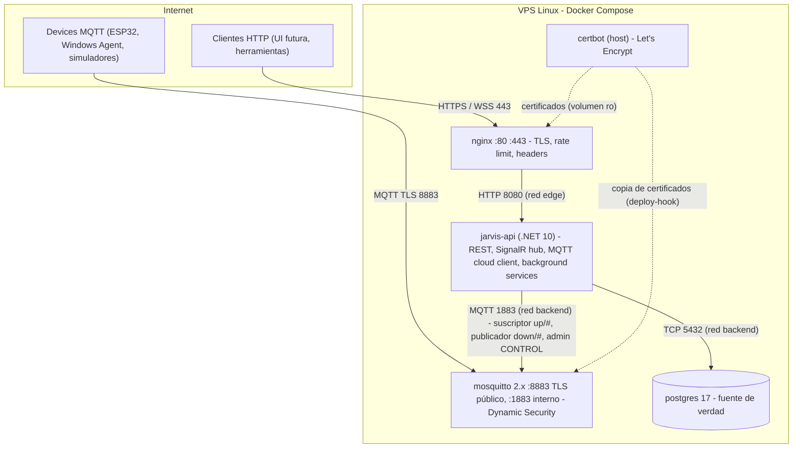

# Cloud Architecture

## Diagrama de contenedores

## Contenedores

| Contenedor | Responsabilidad | Expuesto a Internet |
|---|---|---|
| `nginx` | Terminación TLS HTTPS, proxy a la API, WebSocket para SignalR, rate limit perimetral, headers de seguridad, desafío ACME. | 80, 443 |
| `jarvis-api` | Todo el comportamiento de negocio: REST, SignalR, cliente MQTT, dispatcher, sweepers, administración de credenciales MQTT. Un solo proceso. | No |
| `mosquitto` | Broker MQTT. Autenticación y ACL por dispositivo vía Dynamic Security. No contiene lógica de negocio. | 8883 |
| `postgres` | Fuente de verdad: users, devices, credenciales (hash), tareas, grants, eventos. | No |
| certbot | Emisión/renovación de certificados. Corre en el host (paquete o contenedor efímero), no como servicio permanente. | No |

## Background services dentro de `jarvis-api`

| Servicio | Función | Frecuencia |
|---|---|---|
| `MqttCloudClient` | Mantiene la conexión MQTT del cloud client, recibe `up/#` y los enruta a casos de uso. | Continuo |
| `TaskDispatcher` | Toma tareas `Pending` de targets `Online` y `Active` (con `FOR UPDATE SKIP LOCKED`) y las publica. Reenvía `task.cancel` pendientes cada 60 s. Se despierta por señal en memoria o por polling. | Señal + cada 5 s |
| `DeliveryTimeoutSweeper` | `Dispatched` sin ACK tras 30 s → `Pending` (o `Failed DELIVERY_FAILED` al agotar intentos). | Cada 10 s |
| `TaskExpirySweeper` | `expires_at` vencido en `Pending`/`Dispatched` → `Expired`; `max_duration_seconds` vencido → cancel + `Failed EXECUTION_TIMEOUT`. | Cada 15 s |
| `PresenceSweeper` | Online → Stale → Offline según `last_seen_at`. | Cada 15 s |
| `RetentionJob` | Borra eventos y refresh tokens fuera de retención (rol `jarvis_maintenance`). | Diario |
| `BrokerReconciliationService` | Sincroniza Dynamic Security con el estado de devices en PostgreSQL (elimina huérfanos, aplica disable/enable; no puede recrear secretos). | Al arranque, cada 1 h, y cada 30 s mientras haya diferencias |

Todos usan PostgreSQL como coordinación; no hay estado crítico solo en memoria. Si en el futuro hay dos instancias de la API, `SKIP LOCKED` y actualizaciones condicionales (`WHERE status = ...`) mantienen la corrección. Ver [Persistence Strategy](../04-data/persistence-strategy.md).

## Análisis del stack propuesto

Para cada tecnología: problema que resuelve, alternativa, decisión.

### .NET 8 → **.NET 10 LTS**
- **Problema:** .NET 8 termina soporte el **10 de noviembre de 2026**. A la fecha de este documento (septiembre 2026) iniciar un proyecto en .NET 8 implica migrar en semanas.
- **Alternativa:** .NET 10 LTS (noviembre 2025, soporte hasta noviembre 2028).
- **Ventajas:** soporte largo, `Guid.CreateVersion7()`, validación integrada en Minimal APIs, mejoras de rendimiento y memoria en contenedores.
- **Desventajas:** algunas librerías de terceros pueden ir detrás; no relevante para las usadas aquí (EF Core, Npgsql, MQTTnet).
- **Decisión:** .NET 10 LTS. Ver [ADR-001](../08-decisions/ADR-001-backend-technology.md).

### ASP.NET Core Web API → **Minimal APIs** (mismo framework)
- Controllers añaden ceremonia sin valor para ~25 endpoints. Minimal APIs con `MapGroup` por recurso, filtros y validación integrada. Decisión en ADR-001.

### Entity Framework Core → **Sí**, con límites
- Productivo para CRUD y migraciones; Npgsql soporta `jsonb`, arrays `text[]`, `xmin` como concurrency token.
- Operaciones de coordinación (`FOR UPDATE SKIP LOCKED`, updates condicionales masivos) se escriben con SQL explícito (`FromSql`/`ExecuteUpdate`). No se usa lazy loading.

### PostgreSQL → **Sí** (17)
- ACID, `jsonb`, índices parciales, `SKIP LOCKED`, `citext`. Cabe holgado en el VPS. Ver [ADR-002](../08-decisions/ADR-002-postgresql-source-of-truth.md).

### Redis → **No en el MVP**
- Ninguno de sus usos (presencia, dedup, locks, backplane SignalR, rate limiting, caché) es necesario con una sola instancia y decenas de devices. Ver [ADR-008](../08-decisions/ADR-008-redis-decision.md).

### MQTT + Eclipse Mosquitto → **Sí**, con Dynamic Security
- **Problema:** los devices (especialmente ESP32) necesitan una conexión persistente, liviana, con push del servidor, keepalive y LWT. MQTT es el estándar de facto y ESP-IDF lo soporta nativamente (`esp-mqtt`).
- **Alternativas evaluadas:** broker embebido en la API (MQTTnet Server); EMQX; NATS; WebSocket propio.
- **Decisión:** Mosquitto 2.x + plugin Dynamic Security, administrado exclusivamente por la API. Análisis completo en [ADR-003](../08-decisions/ADR-003-mqtt-device-communication.md).

### SignalR → **Sí**, solo notificaciones a UIs
- Integrado en ASP.NET Core, reconexión automática en clientes JS/.NET. No se usa para devices ni como fuente de verdad. Ver [ADR-004](../08-decisions/ADR-004-rest-signalr-responsibilities.md).

### Docker + Compose → **Sí**
- Un host, cuatro servicios: Compose es suficiente. Kubernetes/Swarm serían sobrecarga.

### Nginx + Let's Encrypt → **Sí**
- Alternativa: Caddy (TLS automático, config más corta). **Ventaja** de Caddy: menos piezas. **Desventaja:** la experiencia del equipo y la documentación de rate limiting/WebSocket es más amplia en nginx; Mosquitto necesita los mismos certificados en disco, lo que con certbot es explícito. **Decisión:** nginx + certbot (webroot). Caddy queda como alternativa aceptable si se reevalúa.

### Clean Architecture + DDD pragmático → **Sí, en 4 proyectos y sin ceremonia**
- Sin repositorios genéricos, sin MediatR (licencia comercial desde 2025 y no aporta aquí), sin AutoMapper. Detalles en [Backend Architecture](backend-architecture.md).

## Presupuesto de recursos (VPS 4 vCPU / 8 GB)

| Servicio | Límite memoria | CPU | Notas |
|---|---|---|---|
| postgres | 2 GB | 2 | `shared_buffers=512MB`, `max_connections=50` |
| jarvis-api | 1 GB | 2 | Server GC con `DOTNET_GCHeapHardLimit` implícito por límite del contenedor |
| mosquitto | 256 MB | 1 | Miles de conexiones caben en < 100 MB |
| nginx | 128 MB | 0.5 | |
| Sistema + margen | ~4.5 GB | — | Margen para backups, builds y futuros servicios (Memory) |
