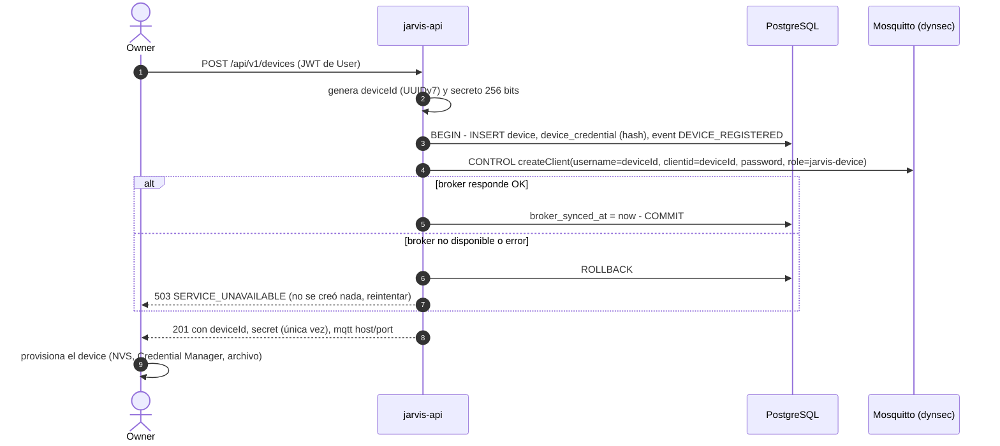
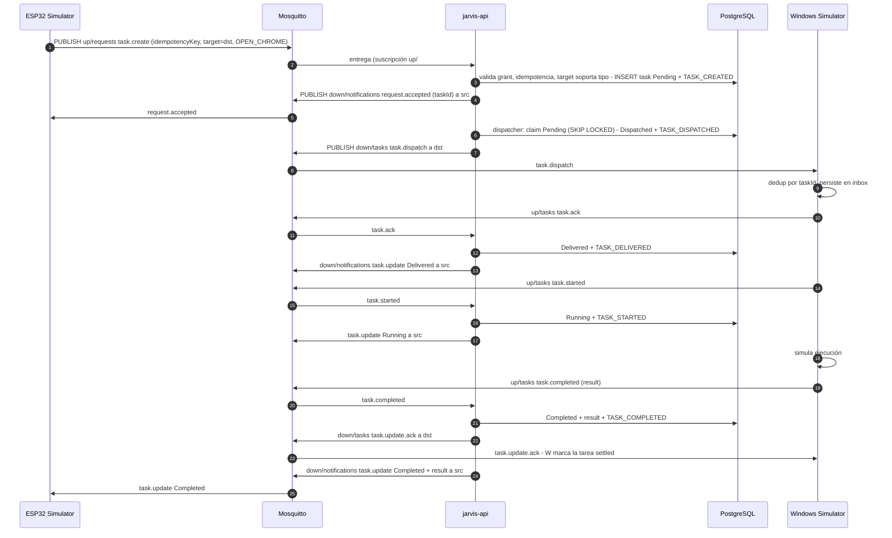
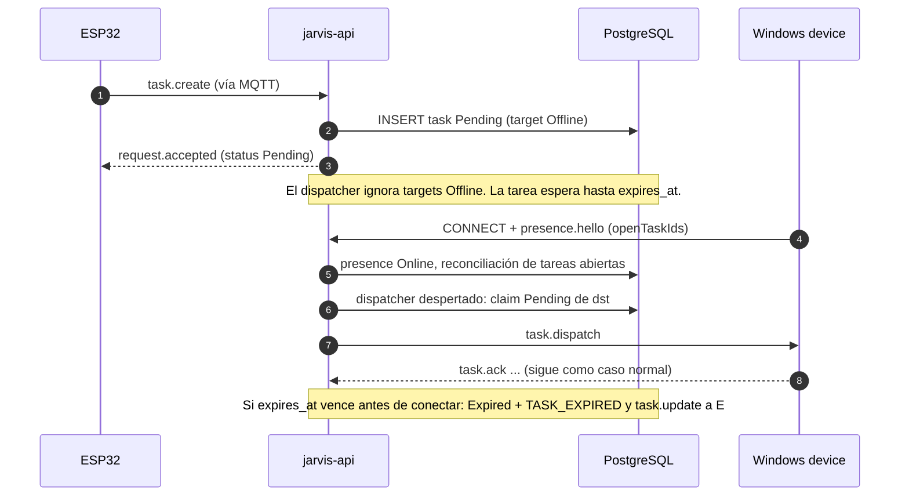
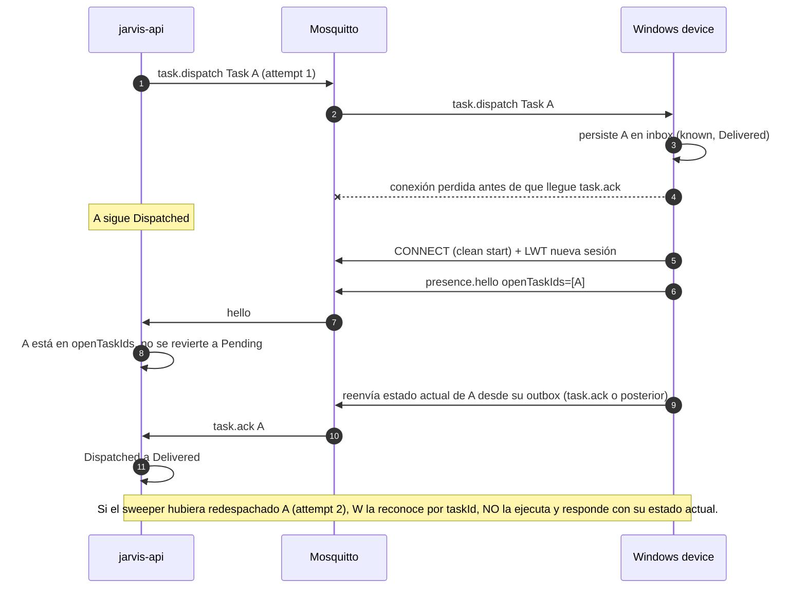

# Data Flow

Flujos principales de extremo a extremo. Los mensajes MQTT se detallan en [MQTT Protocol](../03-protocols/mqtt-protocol.md) y los estados en [Task State Machine](../02-domain/task-state-machine.md). En los diagramas, `{src}` y `{dst}` son los `deviceId` del ESP32 y del Windows device.

## 1. Registro de un device

## 2. Caso normal: ESP32 pide OPEN_CHROME al Windows device

En paralelo, cada cambio de estado emite una notificación SignalR al grupo del owner (no mostrado).

## 3. Target offline

## 4. Reconexión durante la entrega (evitar doble ejecución)

Garantía: **la doble ejecución se evita en el device** (consumidor idempotente con registro durable de `taskId`), no en el transporte. El Cloud solo garantiza at-least-once. Ver [ADR-006](../08-decisions/ADR-006-task-delivery-semantics.md).

## 5. Pérdida del device durante la ejecución

1. W reporta `task.started` (Running) y se apaga sin enviar resultado.
2. El broker publica el LWT → `DEVICE_DISCONNECTED`. La tarea **no** cambia (puede seguir corriendo si solo se cayó la red).
3. Al reconectar, W envía `presence.hello` con `openTaskIds`:
   - Si incluye A → el Cloud espera el resultado (W reenvía su outbox).
   - Si no incluye A → `Failed` con `error.code = DEVICE_LOST`.
4. Si W nunca vuelve y la tarea tiene `max_duration_seconds`, el `TaskExpirySweeper` la marca `Failed EXECUTION_TIMEOUT`. Sin `max_duration_seconds`, se aplica el máximo del sistema (24 h).

## 6. Cancelación

| Estado actual | Efecto de `POST /api/v1/tasks/{id}/cancel` |
|---|---|
| `Pending` | `Cancelled` inmediato. Si `attempt_count > 0` (fue despachada antes y revertida), además se publica `task.cancel` best effort: el device la registra como cancelada y rechaza cualquier redelivery; si ya la había ejecutado, su resultado llega como `late_terminal_update`. |
| `Dispatched`, `Delivered`, `Running`, `WaitingForApproval` | Se registra `cancel_requested_at`, evento `TASK_CANCEL_REQUESTED`, se publica `task.cancel`. El estado final lo decide el device: `task.cancelled` → `Cancelled`; si ya había terminado, su `task.completed`/`task.failed` prevalece. |
| Terminal | `409 INVALID_STATE_TRANSITION`. |

## 7. Trazabilidad

Cada flujo conserva un único `correlationId`: se genera (o se acepta del cliente) al crear la tarea, viaja en todos los envelopes MQTT, se guarda en `tasks.correlation_id` y en cada fila de `events`, y aparece en todos los logs. Con él se reconstruye: quién creó (`requested_by_*`), desde qué device (`source_device_id`), hacia cuál (`target_device_id`), y las marcas `created_at`, `dispatched_at`, `delivered_at`, `started_at`, `completed_at` más `result`/`error_*`.
