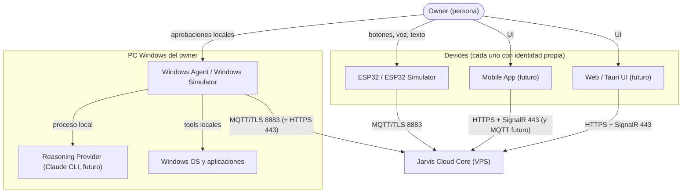

# System Context

## Diagrama de contexto

## Actores y sistemas

| Elemento | Rol | Relación con Cloud Core |
|---|---|---|
| Owner | Persona dueña de los devices. | Se autentica con email/contraseña vía REST (desde UI futura o herramientas HTTP). |
| ESP32 | Interfaz física: botones, pantalla, sensores. | Device MQTT: crea tareas, recibe notificaciones. |
| Mobile / Web / Tauri | Interfaces de usuario. | REST + SignalR autenticados como User; opcionalmente también como Device. |
| Windows Agent | Ejecutor de tareas en la PC. | Device MQTT: recibe tareas, reporta estado y resultados. |
| Reasoning Provider | LLM (Claude CLI al inicio). | **Ninguna.** El Cloud no sabe que existe. |
| Windows OS | Sistema controlado. | **Ninguna.** |

## Lo que el Cloud **sí** hace

- Identidad de users y devices; emisión y revocación de credenciales.
- Autorización: quién puede crear qué tarea hacia quién.
- Persistencia de tareas y su ciclo de vida; entrega at-least-once.
- Presencia de devices.
- Event log y auditoría; notificaciones realtime.

## Lo que el Cloud **nunca** hace

- Ejecutar comandos, scripts o código recibido.
- Exponer un endpoint genérico de ejecución (`/execute-shell` o similar).
- Interpretar la semántica de `TaskType` o del `payload` más allá de validar formato y tamaño.
- Conocer prompts, modelos, razonamiento, tools internas, Win32 o UI Automation.
- Aprobar por sí mismo acciones peligrosas (la decisión final es del device destino).

Ver [Cloud Architecture](cloud-architecture.md) para el nivel de contenedores.
