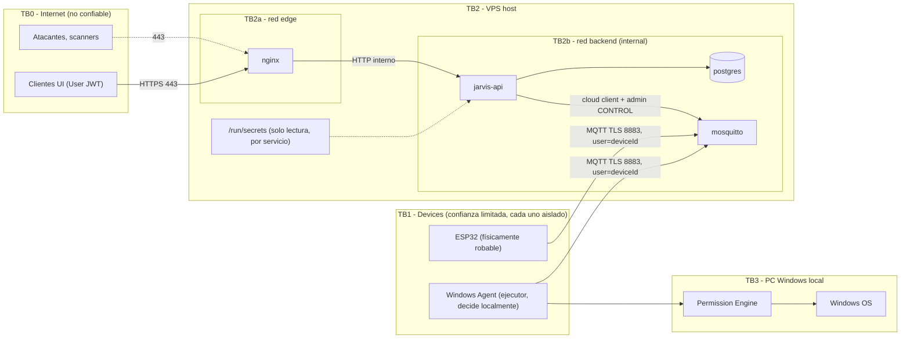

# Trust Boundaries

## Diagrama

## Fronteras y controles

| Frontera | Qué la cruza | Controles | Supuesto de confianza |
|---|---|---|---|
| TB0 → TB2a (Internet → nginx) | HTTPS/WSS | TLS 1.2+, rate limit, límite de body, headers, sin puertos extra | Todo es hostil. |
| TB0/TB1 → TB2b (Internet → Mosquitto 8883) | MQTT TLS | TLS, auth dynsec por device, ACL por `%u`, límites de paquete y conexiones | Un device autenticado puede estar comprometido. |
| TB2a → TB2b (nginx → API) | HTTP plano en red Docker | La API solo confía en `X-Forwarded-*` desde la subred edge; la API revalida toda autenticación | nginx no autoriza, solo filtra. |
| API → PostgreSQL | SQL | Rol `jarvis_app` sin DDL, sin `UPDATE/DELETE` en `events`; red interna | — |
| API → Mosquitto admin | `$CONTROL` MQTT | Usuario `jarvis-cloud` es el único con rol admin; listener 1883 solo en red backend | Quien controle la API controla el broker. |
| TB1 ↔ TB1 (device ↔ device) | Nada directo | Los devices nunca se hablan; todo pasa por el Cloud con grants | Zero trust entre devices. |
| TB2 → TB3 (Cloud → PC) | Tareas estructuradas | El Windows Agent valida tipo, payload, expiración, dedup y política local; en Phase 3 verifica firma | **El Cloud no es plenamente confiable para el agente.** |

## Principio clave: el Cloud no es la última línea de defensa

Aunque el Cloud esté comprometido, el Windows Agent debe:
1. Ejecutar solo `TaskType` de su allowlist local.
2. Validar `payload` contra su propio esquema.
3. Rechazar tareas expiradas o ya vistas.
4. Pedir aprobación local para tareas de riesgo.
5. (Phase 3) Rechazar tareas sin firma válida del principal creador.

Esto se refleja en el [Threat Model](../05-security/threat-model.md) y en el [Windows Agent Contract](../07-integrations/windows-agent-contract.md).
