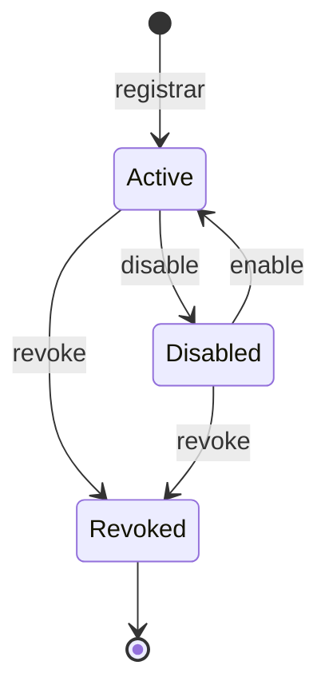

# Device Model

## Campos

| Campo | Tipo | Quién lo escribe | Notas |
|---|---|---|---|
| `Id` | UUIDv7 | Cloud | También es el `username` y `clientId` MQTT. |
| `OwnerId` | UUID | Cloud | Inmutable. |
| `Name` | string(1..64) | Owner | Único por owner. |
| `Type` | `DeviceType` | Owner (al registrar) | `Windows`, `ESP32`, `Mobile`, `Web`, `Unknown`. Inmutable. |
| `AdminState` | `DeviceAdminState` | Owner | `Active`, `Disabled`, `Revoked`. |
| `PresenceState` | `PresenceState` | Cloud (presence) | `Online`, `Stale`, `Offline`. |
| `ReportedBusy` | bool | Device (heartbeat) | |
| `CurrentSessionId` | string(64)? | Device (`presence.hello`) | Para ignorar LWT de sesiones anteriores. |
| `Capabilities` | text[] | Device (`presence.hello`) | Descriptivo. |
| `SupportedTaskTypes` | text[] | Device (`presence.hello`) | Usado para validar creación de tareas. |
| `ReportedInfo` | jsonb | Device (`presence.hello`) | `softwareVersion`, `protocolVersion`, `platform`, `hardware`... estructura variable por tipo de device. |
| `LastSeenAt` | timestamptz? | Cloud | Último mensaje MQTT de cualquier tipo recibido del device. |
| `LastConnectedAt`, `LastDisconnectedAt` | timestamptz? | Cloud | |
| `BrokerSyncedAt` | timestamptz? | Cloud | Última sincronización exitosa con Mosquitto dynsec. Nulo = pendiente. |
| `CreatedAt`, `UpdatedAt` | timestamptz | Cloud | |
| `DisabledAt`, `RevokedAt` | timestamptz? | Cloud | |

Campos descartados de la propuesta: `Status` **no se persiste**, se calcula (ver abajo). Persistirlo mezclaría tres fuentes distintas (owner, conexión, device) y generaría inconsistencias.

## Estados

Tres dimensiones independientes:

| Dimensión | Valores | Fuente |
|---|---|---|
| Admin state | `Active`, `Disabled` (reversible), `Revoked` (irreversible) | Owner vía REST |
| Presence state | `Online`, `Stale`, `Offline` | Cloud a partir de MQTT |
| Busy | `true` / `false` | Reportado por el device |

### `DeviceStatus` calculado

Precedencia (el primero que aplique):

| # | Condición | `DeviceStatus` |
|---|---|---|
| 1 | `AdminState ∈ {Disabled, Revoked}` | `Disabled` |
| 2 | `PresenceState = Offline` | `Offline` |
| 3 | `PresenceState = Stale` | `Stale` |
| 4 | `ReportedBusy = true` | `Busy` |
| 5 | resto | `Online` |

La API expone además `adminState` y `presenceState` por separado para no perder información (un device `Revoked` se muestra `Disabled` en `status` pero `adminState = Revoked`).

Detalle del cálculo de presencia: [MQTT Protocol — Presence](../03-protocols/mqtt-protocol.md#6-presence).

## Capabilities: decisión de modelado

Opciones evaluadas:

| Opción | Ventajas | Desventajas |
|---|---|---|
| Enum C# | Tipado fuerte | Agregar una capability requiere desplegar el Cloud; contradice "device independence". |
| Flags (bitmask) | Compacto | Ilegible, límite de bits, mismo problema de despliegue. |
| Tabla `capabilities` + tabla de unión | Normalizado, consultable | Sobrecarga: son etiquetas descriptivas sin atributos propios. |
| JSONB | Flexible | Consultas y validación más débiles para una simple lista. |
| **`text[]` de PostgreSQL** | Lista simple, índice GIN, consulta `@>`, sin tabla extra | Sin FK de catálogo. |

**Decisión: `text[]`**, con validación de formato en el dominio (`^[a-z][a-z0-9-]{1,31}$`, máximo 32 elementos). Un catálogo de capabilities **conocidas** vive en código solo como documentación/constantes; valores desconocidos se aceptan. Lo mismo aplica a `SupportedTaskTypes` (formato `TaskType`, máx. 64 elementos).

Las capabilities **no otorgan permisos**. La autorización se basa en grants ([Authorization](../05-security/authorization.md)); las capabilities solo describen hardware/software para UIs y enrutamiento futuro.

### Catálogo inicial conocido

| Capability | Significado |
|---|---|
| `agent` | Ejecuta tareas (tiene inbox/outbox, soporta `down/tasks`). |
| `task-requester` | Puede originar tareas (botones, voz, UI). |
| `display` | Tiene pantalla (muestra notificaciones/resultados). |
| `microphone` | Captura audio. |
| `speaker` | Reproduce audio. |
| `notifications` | Puede mostrar notificaciones al usuario. |
| `windows-control` | Puede controlar un sistema Windows. |
| `sensor` | Reporta lecturas de sensores. |
| `buttons` | Tiene entradas físicas. |

## Ciclo de vida administrativo

| Acción | Efecto en credencial | Efecto en broker | Efecto en tareas |
|---|---|---|---|
| Disable | Sin cambio | `disableClient` (desconecta inmediatamente) | Tareas `Pending` hacia el device permanecen hasta expirar; no se crean nuevas (`TARGET_DEVICE_UNAVAILABLE`). |
| Enable | Sin cambio | `enableClient` | Dispatcher reanuda al conectar. |
| Revoke | Credencial → `Revoked` | `deleteClient` | Tareas no terminales donde es target → `Cancelled` (`error_code = DEVICE_REVOKED`); grants donde es source o target se eliminan. |
| Rotate credential | Anterior → `Revoked`, nueva `Active` | `setClientPassword` + desconexión | Ninguno. |

## Tipos de device y rol esperado

| Type | Capabilities típicas | Usa MQTT | Usa REST | Usa SignalR |
|---|---|---|---|---|
| `Windows` | `agent`, `windows-control`, `notifications` | Sí | Opcional | No |
| `ESP32` | `task-requester`, `display`, `buttons`, `speaker` | Sí | No (MVP) | No |
| `Mobile` | `task-requester`, `notifications`, `microphone` | Opcional | Sí | Sí (como User) |
| `Web` | `task-requester` | No | Sí | Sí (como User) |
| `Unknown` | — | Sí | Sí | No |
