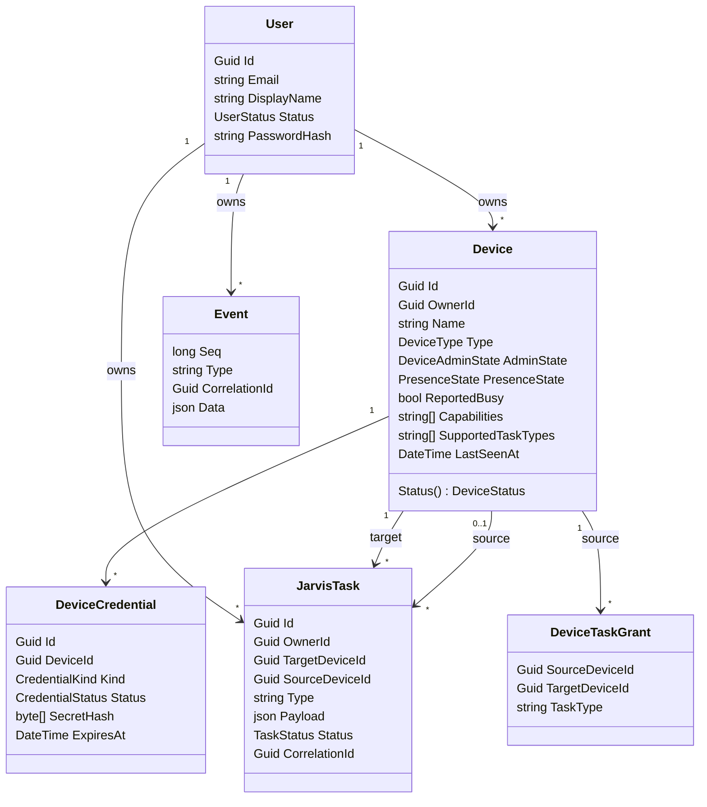

# Domain Model

## Agregados

| Agregado (raíz) | Contiene | Invariantes principales |
|---|---|---|
| `User` | `RefreshToken` (colección) | Email único (case-insensitive). Solo `Active` puede autenticarse. |
| `Device` | `DeviceCredential` (colección) | Pertenece a un solo owner, inmutable. Máximo **una** credencial `Active`. `Revoked` es irreversible. |
| `JarvisTask` | — | Transiciones solo según [Task State Machine](task-state-machine.md). `target_device_id` y `owner_id` inmutables. Target y source pertenecen al mismo owner. |
| `DeviceTaskGrant` | — | Source y target del mismo owner que el grant; `(source, target, task_type)` único. |
| `Event` | — | Append-only; nunca se modifica ni borra (salvo retención). |

## User / Owner

| Campo | Tipo | Notas |
|---|---|---|
| `Id` | UUIDv7 | |
| `Email` | citext | Único. Login. |
| `DisplayName` | string(100) | |
| `PasswordHash` | string | Formato de `PasswordHasher<T>` de ASP.NET Core Identity (PBKDF2-HMAC-SHA512, 100 000 iteraciones). |
| `Status` | `Active` \| `Disabled` | |
| `FailedLoginCount`, `LockedUntil` | int, timestamptz | Lockout: 5 fallos → 15 min. |
| `LastLoginAt`, `CreatedAt`, `UpdatedAt` | timestamptz | |

**Multi-user sin complejidad:** no existen organizaciones, roles ni invitaciones. Cada recurso tiene `owner_id` y toda consulta filtra por el `owner_id` del principal. No hay "usuario global": el primer owner se crea con el comando `bootstrap-owner` ([HU-008](../09-backlog/stories/EPIC-02-identity-devices.md)). Ver [ADR-009](../08-decisions/ADR-009-multi-tenant-preparation.md).

## Device

Ver [Device Model](device-model.md).

## DeviceCredential

| Campo | Tipo | Notas |
|---|---|---|
| `Id` | UUIDv7 | |
| `DeviceId` | UUID | FK |
| `Kind` | `Secret` \| `ClientCertificate` | Solo `Secret` en MVP; `ClientCertificate` reservado. |
| `SecretHash` | bytea(32) | `HMAC-SHA256(pepper, secret)`. Nulo para certificados. |
| `SecretHint` | string(4) | Últimos 4 caracteres, solo para UI. |
| `CertificateThumbprint` | string | Reservado (SHA-256 del certificado). |
| `Status` | `Active` \| `Revoked` | |
| `CreatedAt`, `ExpiresAt?`, `RevokedAt?`, `RevokedReason?`, `LastUsedAt?` | | `ExpiresAt` nulo = no expira (MVP). |

Ciclo de vida y formato del secreto: [Device Authentication](../05-security/device-authentication.md).

## JarvisTask

| Campo | Tipo | Notas |
|---|---|---|
| `Id` | UUIDv7 | También identifica la tarea en el device (clave de deduplicación). |
| `OwnerId` | UUID | |
| `RequestedByType` | `User` \| `Device` | Quién la pidió. |
| `RequestedByUserId` | UUID? | Si `User`. |
| `SourceDeviceId` | UUID? | Si `Device`. Exactamente uno de los dos. |
| `TargetDeviceId` | UUID | |
| `Type` | `TaskType` | `^[A-Z][A-Z0-9_]{1,63}$`. Opaco para el Cloud. |
| `Payload` | jsonb | Objeto JSON, ≤ 16 KiB serializado. Opaco para el Cloud. |
| `Status` | `TaskStatus` | |
| `StatusReason` | string? | Texto corto para transiciones sistémicas (p. ej. `ack_timeout`). |
| `CorrelationId` | UUID | Provisto o generado. |
| `IdempotencyKey` | string(1..100)? | Única por solicitante. |
| `RequestHash` | bytea(32)? | SHA-256 de (type, target, payload canónico) para detectar reutilización de key con otro contenido. |
| `AttemptCount` | int | Número de dispatches realizados. |
| `MaxAttempts` | int | Default 5. |
| `ExpiresAt` | timestamptz | Límite para ser **entregada**. Default `created_at + 10 min`, máx. 7 días. |
| `MaxDurationSeconds` | int? | Límite de ejecución desde `delivered_at`. Máx. 86 400. |
| `CreatedAt`, `DispatchedAt?`, `DeliveredAt?`, `StartedAt?`, `CompletedAt?` | timestamptz | `CompletedAt` = momento en que alcanzó **cualquier** estado terminal. `DispatchedAt` = último dispatch. |
| `CancelRequestedAt?` | timestamptz | |
| `LastUpdateAt` | timestamptz | Último mensaje del device sobre la tarea. |
| `ProgressPercent?`, `ProgressMessage?` | smallint, string(200) | Último progreso reportado. |
| `Result` | jsonb? | Solo con `Completed`. ≤ 32 KiB. |
| `ErrorCode`, `ErrorMessage` | string?, string(500)? | Con `Failed`, `Cancelled` o `Expired`. |

Se descartó `QueuedAt` de la propuesta: el estado `Queued` se reemplazó por `Dispatched` (ver [Task State Machine](task-state-machine.md#análisis-de-los-estados-propuestos)).

## DeviceTaskGrant

Permiso explícito: *el device `SourceDeviceId` puede crear tareas `TaskType` para `TargetDeviceId`*. Sin grant, un device no puede crear tareas. Los Users (owner) no necesitan grants para sus propios devices. `TaskType = "*"` **no** está permitido: los permisos son siempre explícitos por tipo.

## Event

Ver [Event Model](event-model.md).

## Futuras entidades (no MVP)

| Entidad | Fase | Propósito |
|---|---|---|
| `TaskApproval` | 3 | Registro de solicitudes y decisiones de aprobación remota. |
| `DeviceSigningKey` / `UserSigningKey` | 3 | Clave pública Ed25519 para firma end-to-end de tareas. |
| `PairingCode` | 6 | Registro de ESP32 sin copiar secretos manualmente. |
| `MemoryItem` | 8 | Fuera de Cloud Core, servicio separado. |
