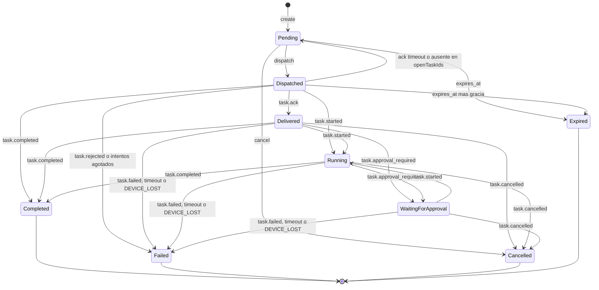

# Task State Machine

## Estados finales

| Estado | Rango | Terminal | Significado |
|---|---|---|---|
| `Pending` | 0 | No | Persistida en PostgreSQL, esperando dispatch (target offline, recién creada o redelivery). |
| `Dispatched` | 1 | No | Publicada al broker para el target; sin ACK todavía. |
| `Delivered` | 2 | No | El target confirmó (`task.ack`) que la persistió localmente. |
| `Running` | 3 | No | El target reportó que empezó a ejecutar. |
| `WaitingForApproval` | 3 | No | El target pausó la ejecución esperando aprobación (local en MVP; remota desde Phase 3). |
| `Completed` | 4 | Sí | Terminó con éxito; `result` presente. |
| `Failed` | 4 | Sí | Terminó sin éxito; `error_code` presente. |
| `Cancelled` | 4 | Sí | Cancelada antes de salir del Cloud o confirmada por el target. |
| `Expired` | 4 | Sí | No se entregó antes de `expires_at`. |

## Análisis de los estados propuestos

| Propuesto | Decisión | Motivo |
|---|---|---|
| `Pending` | Se mantiene | |
| `Queued` | **Reemplazado por `Dispatched`** | "Queued" es ambiguo (¿cola de BD o del broker?). Lo que importa operativamente es "publicado sin confirmación", que es exactamente cuándo aplica el ACK timeout. |
| `Delivered` | Se mantiene, con significado estricto | Solo por `task.ack` del device (o implícito por un mensaje posterior). El PUBACK del broker **no** cuenta como entrega. |
| `Running` | Se mantiene | |
| `WaitingForApproval` | Se mantiene | Ya en el modelo para no cambiar el protocolo en Phase 3. |
| `Completed` / `Failed` / `Cancelled` / `Expired` | Se mantienen | `Expired` solo para tareas **no entregadas**. Una tarea entregada que excede su duración termina `Failed` con `EXECUTION_TIMEOUT`, porque pudo haber tenido efectos. |
| `Cancelling` (no propuesto) | **No se agrega como estado** | Se modela con `cancel_requested_at`. Evita duplicar cada estado activo en una variante "cancelando". |

## Diagrama

`Dispatched` también acepta `task.failed`/`task.cancelled`, y `WaitingForApproval` acepta `task.completed` (regla de avance monótono, abajo); se omiten del diagrama por legibilidad.

## Transiciones válidas

| # | Desde | Hacia | Disparador | Actor | Efectos |
|---|---|---|---|---|---|
| T1 | — | `Pending` | Crear tarea válida | User/Device (REST o MQTT) | `TASK_CREATED` |
| T2 | `Pending` | `Dispatched` | Dispatcher publica | System | `attempt_count++`, `dispatched_at`, `TASK_DISPATCHED {attempt}` |
| T3 | `Pending` | `Cancelled` | Cancel | Owner / device solicitante | `TASK_CANCELLED` |
| T4 | `Pending` | `Expired` | `now > expires_at` | System | `TASK_EXPIRED` |
| T5 | `Dispatched` | `Pending` | Sin ACK en 30 s, o `presence.hello` del target sin la tarea en `openTaskIds` | System | `status_reason = ack_timeout` o `not_on_device`. Sin evento propio (el siguiente `TASK_DISPATCHED` lleva `attempt`). |
| T6 | `Dispatched` | `Failed` | `attempt_count >= max_attempts` al vencer el ACK | System | `error_code = DELIVERY_FAILED`, `TASK_FAILED` |
| T7 | `Dispatched` | `Failed` | `task.rejected` | Target | `error_code` del device, `TASK_FAILED` |
| T8 | `Dispatched` | `Expired` | `now > expires_at + 30 s` | System | `TASK_EXPIRED`. El device también rechaza tareas expiradas al recibirlas (`EXPIRED_ON_ARRIVAL`). |
| T9 | `Dispatched` | `Delivered` | `task.ack` | Target | `delivered_at`, `TASK_DELIVERED` |
| T10 | `Delivered`, `WaitingForApproval` (y `Dispatched` implícito) | `Running` | `task.started` | Target | `started_at` (si nulo), `TASK_STARTED`; si venía de `WaitingForApproval`, `APPROVAL_GRANTED` |
| T11 | `Delivered`, `Running` | `WaitingForApproval` | `task.approval_required` | Target | `APPROVAL_REQUESTED` |
| T12 | cualquier no terminal con rango ≥ 1 | `Completed` | `task.completed` | Target | `result`, `completed_at`, `TASK_COMPLETED` |
| T13 | cualquier no terminal con rango ≥ 1 | `Failed` | `task.failed` | Target | `error_*`, `completed_at`, `TASK_FAILED` |
| T14 | cualquier no terminal con rango ≥ 1 | `Cancelled` | `task.cancelled` | Target | `TASK_CANCELLED`; si `reason = APPROVAL_DENIED`, también `APPROVAL_DENIED` |
| T15 | `Delivered`, `Running`, `WaitingForApproval` | `Failed` | `presence.hello` del target sin la tarea en `openTaskIds` | System | `error_code = DEVICE_LOST`, `TASK_FAILED` |
| T16 | `Delivered`, `Running`, `WaitingForApproval` | `Failed` | `now > delivered_at + max_duration_seconds` (o 24 h) | System | Publica `task.cancel`; `error_code = EXECUTION_TIMEOUT`, `TASK_FAILED` |
| T17 | cualquier no terminal con rango ≥ 1 | (sin cambio) | Cancel solicitado | Owner / device solicitante | `cancel_requested_at`, `TASK_CANCEL_REQUESTED`, publica `task.cancel` |

Cuando un mensaje salta estados (p. ej. `task.started` estando `Dispatched`), se rellena `delivered_at` y se emite `TASK_DELIVERED`, porque cualquier mensaje posterior al ack prueba la entrega. **No** se inventa `TASK_STARTED` al pasar de `Delivered`/`Dispatched` directamente a un terminal: no hay evidencia de inicio y `started_at` queda nulo.

## Regla de avance monótono (idempotencia)

Todos los mensajes de estado del device se procesan así:

1. Si la tarea es **terminal** → ignorar (log `task_update_ignored`, reason `terminal`). Si el mensaje recibido también es terminal, responder `task.update.ack` igualmente para que el device la marque *settled*.
2. Si `rango(nuevo) < rango(actual)` → ignorar (mensaje viejo o duplicado).
3. Si `rango(nuevo) == rango(actual)`:
   - mismo estado → duplicado; solo se actualizan `last_update_at` y progreso si es `task.progress`.
   - `Running` ↔ `WaitingForApproval` → transición válida.
4. Si `rango(nuevo) > rango(actual)` → aplicar.

La actualización en BD es condicional para evitar carreras: `UPDATE tasks SET ... WHERE id = @id AND status = @expected` (o `xmin` como concurrency token). Si afecta 0 filas, se recarga la tarea y se reevalúa.

Consecuencia: recibir el mismo mensaje N veces produce exactamente un cambio de estado y un evento.

## Transiciones inválidas (ejemplos)

| Intento | Resultado |
|---|---|
| Cancelar una tarea terminal vía REST | `409` `INVALID_STATE_TRANSITION` |
| `task.ack` sobre `Running` | Ignorado (rango menor). |
| `task.completed` sobre `Cancelled` | Ignorado (terminal); se responde `task.update.ack`; log `Warning` `late_terminal_update` con ambos estados. |
| Mensaje `up/tasks` de un device que no es el target | Rechazado: evento `SECURITY_VIOLATION` (`not_task_target`; `unknown_task` si el `taskId` no existe), log `Warning`, la tarea no cambia. |
| Mensaje sobre una tarea en `Pending` | Rechazado como `SECURITY_VIOLATION` (`task_not_dispatched`): un device no puede conocer una tarea no despachada. Excepción: si `attempt_count > 0` (fue despachada antes y revertida por T5), el mensaje se procesa normalmente como si estuviera `Dispatched`. |
| Cualquier transición desde un estado terminal | Imposible. |

## Tiempos por defecto

| Parámetro | Default | Configurable por tarea | Máximo |
|---|---|---|---|
| ACK timeout | 30 s | No | — |
| `max_attempts` | 5 | No (config global) | — |
| `expires_at` | creación + 10 min | Sí (`expiresInSeconds`) | 7 días |
| Gracia de expiración en `Dispatched` | 30 s | No | — |
| `max_duration_seconds` | nulo → 24 h del sistema | Sí | 86 400 |
