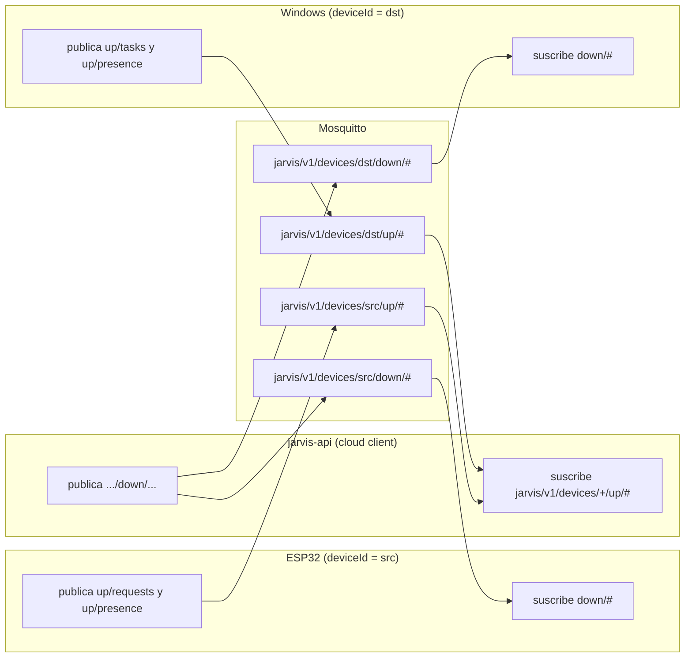

# MQTT Protocol — v1

Protocolo entre devices y Jarvis Cloud. Independiente del lenguaje (C#, Rust, ESP-IDF, React Native) y de cualquier LLM. Decisión de tecnología: [ADR-003](../08-decisions/ADR-003-mqtt-device-communication.md). Semántica de entrega: [ADR-006](../08-decisions/ADR-006-task-delivery-semantics.md).

## 1. Análisis de la propuesta inicial de topics

Propuesta: `jarvis/v1/devices/{deviceId}/commands|results|events|status`.

| Problema | Consecuencia | Corrección |
|---|---|---|
| La dirección no es explícita en el nombre (`status`, `events` podrían ir en ambos sentidos). | ACL complejas y propensas a errores; un device podría publicar donde solo debería publicar el Cloud. | Separar por dirección: `down/*` (Cloud → device) y `up/*` (device → Cloud). Una ACL de dos líneas cubre todo. |
| `results` separado de los ACK/progreso. | Mensajes del ciclo de vida de una tarea en topics distintos pierden orden relativo. | Un solo topic `up/tasks` para todo el ciclo de vida de una tarea. |
| No hay lugar para que un device **pida** tareas ni reciba el resultado de lo que pidió. | El ESP32 necesitaría HTTPS además de MQTT (doble TLS en un microcontrolador). | `up/requests` y `down/notifications`. |
| `status` retained como presencia. | Retained puede quedar obsoleto y no distingue sesiones. | Presencia por `hello`/heartbeat/LWT con `sessionId`, sin retained. |

## 2. Topics

Prefijo: `jarvis/v1/devices/{deviceId}/` donde `{deviceId}` es el UUID del device en minúsculas con guiones.

| Topic (sufijo) | Dirección | Publisher | Subscriber | QoS | Retained | Tipos de mensaje |
|---|---|---|---|---|---|---|
| `down/tasks` | Cloud → device | Cloud | Target device (capability `agent`) | 1 | No | `task.dispatch`, `task.cancel`, `task.update.ack` |
| `down/notifications` | Cloud → device | Cloud | Device | 1 | No | `request.accepted`, `request.rejected`, `task.update` |
| `down/control` | Cloud → device | Cloud | Device | 1 | No | `presence.hello.ack` (y futuros `control.*`) |
| `up/tasks` | device → Cloud | Target device | Cloud | 1 | No | `task.ack`, `task.rejected`, `task.started`, `task.progress`, `task.approval_required`, `task.completed`, `task.failed`, `task.cancelled` |
| `up/requests` | device → Cloud | Device | Cloud | 1 | No | `task.create`, `task.get`, `task.cancel_request` |
| `up/presence` | device → Cloud | Device (y broker vía LWT) | Cloud | 1 (heartbeat: 0) | No | `presence.hello`, `presence.heartbeat`, `presence.goodbye`, `presence.offline` (LWT) |
| `up/events` | device → Cloud | Device | Cloud | 1 | No | **Reservado** (`device.event`: botones, sensores). En MVP el Cloud lo recibe, registra en log `Debug` y descarta. |

Un device se suscribe con un solo filtro: `jarvis/v1/devices/{self}/down/#`.
El Cloud se suscribe con: `jarvis/v1/devices/+/up/#`.



Los devices **nunca** se comunican directamente entre sí: la ACL lo impide.

## 3. Envelope

Todo payload es un documento JSON UTF-8 con esta estructura:

```json
{
  "v": 1,
  "id": "0192a6f4-8b1e-7c3a-9d2e-5f1a2b3c4d5e",
  "type": "task.create",
  "ts": "2026-09-19T15:04:05.123Z",
  "deviceId": "0192a6f0-1111-7aaa-8bbb-000000000001",
  "correlationId": "0192a6f4-8b1e-7c3a-9d2e-aaaaaaaaaaaa",
  "causationId": null,
  "data": { }
}
```

| Campo | Requerido | Descripción |
|---|---|---|
| `v` | Sí | Versión mayor del envelope. Siempre `1` en esta versión. |
| `id` | Sí | UUID del mensaje (v7 recomendado, v4 aceptado). Único por emisor. |
| `type` | Sí | Tipo de mensaje, `lower.dot_case`. |
| `ts` | Sí | Hora del emisor en ISO-8601 UTC. |
| `deviceId` | Sí | En mensajes `up`: el device emisor (**debe** coincidir con el topic). En `down`: el device destinatario. |
| `correlationId` | Condicional | Requerido en mensajes relacionados con tareas. En `task.create` el device puede enviarlo; si falta, el Cloud lo genera. |
| `causationId` | No | `id` del mensaje que provocó éste (p. ej. `request.accepted` → `id` del `task.create`). |
| `data` | Sí | Objeto específico del `type`. |

Reglas de validación del Cloud (mensajes `up`):

1. Tamaño ≤ 64 KiB (límite del broker: `max_packet_size 65536`).
2. JSON válido con campos requeridos; si no → descartar, log `Warning` `mqtt_invalid_envelope`, sin respuesta (no hay a quién confiar el error).
3. `deviceId` del envelope == `{deviceId}` del topic; si no → `SECURITY_VIOLATION` (`topic_device_mismatch`), descartar.
4. `v` distinto de 1 → descartar, log `Warning`.
5. `type` desconocido para ese topic → descartar, log `Information` (compatibilidad hacia adelante).
6. Campos desconocidos → ignorar (compatibilidad hacia adelante).
7. En `up/requests`, `ts` debe estar dentro de ±5 min de la hora del servidor; si no → `request.rejected` `STALE_MESSAGE` (anti-replay).

El Cloud confirma el PUBACK de un mensaje `up` **después** de confirmar la transacción en PostgreSQL (MQTTnet con acknowledgement manual). Si la API cae antes, el broker lo reentrega (sesión persistente del cloud client).

## 4. Mensajes

### 4.1 `up/requests` — `task.create`

```json
{
  "v": 1,
  "id": "0192a6f4-8b1e-7c3a-9d2e-5f1a2b3c4d5e",
  "type": "task.create",
  "ts": "2026-09-19T15:04:05.123Z",
  "deviceId": "0192a6f0-1111-7aaa-8bbb-000000000001",
  "correlationId": "0192a6f4-8b1e-7c3a-9d2e-aaaaaaaaaaaa",
  "data": {
    "idempotencyKey": "btn1-000042",
    "targetDeviceId": "0192a6f0-2222-7aaa-8bbb-000000000002",
    "type": "OPEN_CHROME",
    "payload": { "url": "https://example.com" },
    "expiresInSeconds": 300,
    "maxDurationSeconds": 120
  }
}
```

`idempotencyKey` es **obligatorio** por MQTT (un device reintenta a ciegas tras reconectar). Mismas reglas de validación que `POST /api/v1/tasks` ([REST API](rest-api.md#post-apiv1tasks)).

### 4.2 `down/notifications` — `request.accepted` / `request.rejected`

```json
{
  "v": 1,
  "id": "0192a6f4-9000-7c3a-9d2e-000000000010",
  "type": "request.accepted",
  "ts": "2026-09-19T15:04:05.300Z",
  "deviceId": "0192a6f0-1111-7aaa-8bbb-000000000001",
  "correlationId": "0192a6f4-8b1e-7c3a-9d2e-aaaaaaaaaaaa",
  "causationId": "0192a6f4-8b1e-7c3a-9d2e-5f1a2b3c4d5e",
  "data": {
    "requestType": "task.create",
    "taskId": "0192a6f4-9000-7c3a-9d2e-00000000a001",
    "status": "Pending",
    "duplicate": false
  }
}
```

`duplicate: true` indica que la `idempotencyKey` ya existía con el mismo contenido y se devuelve la tarea original.

```json
{
  "v": 1,
  "id": "0192a6f4-9000-7c3a-9d2e-000000000011",
  "type": "request.rejected",
  "ts": "2026-09-19T15:04:05.300Z",
  "deviceId": "0192a6f0-1111-7aaa-8bbb-000000000001",
  "correlationId": "0192a6f4-8b1e-7c3a-9d2e-aaaaaaaaaaaa",
  "causationId": "0192a6f4-8b1e-7c3a-9d2e-5f1a2b3c4d5e",
  "data": {
    "requestType": "task.create",
    "error": { "code": "TASK_NOT_GRANTED", "message": "Device is not allowed to create OPEN_CHROME tasks for the target." }
  }
}
```

Códigos: [Error Model](error-model.md).

### 4.3 `down/tasks` — `task.dispatch`

```json
{
  "v": 1,
  "id": "0192a6f4-9100-7c3a-9d2e-000000000020",
  "type": "task.dispatch",
  "ts": "2026-09-19T15:04:05.400Z",
  "deviceId": "0192a6f0-2222-7aaa-8bbb-000000000002",
  "correlationId": "0192a6f4-8b1e-7c3a-9d2e-aaaaaaaaaaaa",
  "data": {
    "taskId": "0192a6f4-9000-7c3a-9d2e-00000000a001",
    "type": "OPEN_CHROME",
    "payload": { "url": "https://example.com" },
    "attempt": 1,
    "createdAt": "2026-09-19T15:04:05.250Z",
    "expiresAt": "2026-09-19T15:09:05.250Z",
    "maxDurationSeconds": 120,
    "requestedBy": { "type": "Device", "id": "0192a6f0-1111-7aaa-8bbb-000000000001" },
    "cancelRequested": false,
    "signature": null
  }
}
```

`signature` es la firma Ed25519 del cliente que originó la tarea, o `null` si no la firmó ([ADR-012](../08-decisions/ADR-012-end-to-end-task-signing.md)). Cuando viene, tiene esta forma y el Cloud la retransmite **verbatim**: no la produce ni la verifica, porque no tiene la clave pública.

```json
"signature": { "alg": "Ed25519", "keyId": "owner-laptop-1", "value": "<64 bytes en base64>" }
```

Un device que no soporte firmas puede ignorar el campo; uno que sí las soporte decide por política a partir de qué riesgo la exige. Qué se firma exactamente está en [§12](#12-firma-end-to-end-adr-012).

### 4.3.1 `down/tasks` — `task.approval_decision`

Decisión de una tarea que el device dejó en `WaitingForApproval`, firmada por el cliente del owner (HU-057). El Cloud la registra y la retransmite; **no aprueba nada por su cuenta**.

```json
{
  "v": 1,
  "id": "0192a6f4-9100-7c3a-9d2e-000000000031",
  "type": "task.approval_decision",
  "ts": "2026-09-19T15:06:10.500Z",
  "deviceId": "0192a6f0-2222-7aaa-8bbb-000000000002",
  "correlationId": "0192a6f4-8b1e-7c3a-9d2e-aaaaaaaaaaaa",
  "data": {
    "taskId": "0192a6f4-9000-7c3a-9d2e-00000000a001",
    "decision": "GRANTED",
    "decidedBy": { "type": "User", "id": "0192a6f0-0000-7aaa-8bbb-0000000000aa" },
    "decidedAt": "2026-09-19T15:06:10.000Z",
    "nonce": "b6d0f1a2c3e44f5a",
    "signature": { "alg": "Ed25519", "keyId": "owner-laptop-1", "value": "<64 bytes en base64>" }
  }
}
```

- `decision`: `GRANTED` o `DENIED`.
- `nonce`: único por decisión; el device lo consume una sola vez, de modo que una decisión capturada no se puede reenviar.
- `decidedAt`: la hora que firmó el cliente. El device descarta lo que caiga fuera de su ventana de frescura (5 minutos).
- El device **vuelve a verificar** firma, nonce y frescura antes de aplicarla. Una decisión sin firma válida no hace nada: la aprobación sigue pendiente.

### 4.4 `up/tasks` — ciclo de vida

Todos llevan `correlationId` de la tarea y `data.taskId`.

| `type` | `data` adicional | Transición |
|---|---|---|
| `task.ack` | — | → `Delivered` |
| `task.rejected` | `error: { code, message }` | → `Failed` |
| `task.started` | `startedAt` | → `Running` |
| `task.progress` | `percent` (0-100, opcional), `message` (≤ 200) | sin cambio de estado |
| `task.approval_required` | `reason` (≤ 200) | → `WaitingForApproval` |
| `task.completed` | `completedAt`, `result` (objeto, ≤ 32 KiB) | → `Completed` |
| `task.failed` | `error: { code, message, retryable }` | → `Failed` |
| `task.cancelled` | `reason`: `USER_REQUEST` \| `APPROVAL_DENIED` \| `LOCAL_POLICY` | → `Cancelled` |

Ejemplo `task.completed`:

```json
{
  "v": 1,
  "id": "0192a6f4-9300-7c3a-9d2e-000000000031",
  "type": "task.completed",
  "ts": "2026-09-19T15:04:07.000Z",
  "deviceId": "0192a6f0-2222-7aaa-8bbb-000000000002",
  "correlationId": "0192a6f4-8b1e-7c3a-9d2e-aaaaaaaaaaaa",
  "data": {
    "taskId": "0192a6f4-9000-7c3a-9d2e-00000000a001",
    "completedAt": "2026-09-19T15:04:06.950Z",
    "result": { "outcome": "SUCCESS", "message": "Chrome opened (simulated)" }
  }
}
```

Ejemplo `task.failed`:

```json
{
  "v": 1,
  "id": "0192a6f4-9300-7c3a-9d2e-000000000032",
  "type": "task.failed",
  "ts": "2026-09-19T15:04:07.000Z",
  "deviceId": "0192a6f0-2222-7aaa-8bbb-000000000002",
  "correlationId": "0192a6f4-8b1e-7c3a-9d2e-aaaaaaaaaaaa",
  "data": {
    "taskId": "0192a6f4-9000-7c3a-9d2e-00000000a001",
    "error": { "code": "NOT_PERMITTED", "message": "Task type not allowed by local policy", "retryable": false }
  }
}
```

### 4.5 `down/tasks` — `task.update.ack` y `task.cancel`

`task.update.ack` confirma que el Cloud persistió un estado **terminal**. El device marca la tarea *settled* y deja de reenviarla.

```json
{
  "v": 1,
  "id": "0192a6f4-9400-7c3a-9d2e-000000000040",
  "type": "task.update.ack",
  "ts": "2026-09-19T15:04:07.100Z",
  "deviceId": "0192a6f0-2222-7aaa-8bbb-000000000002",
  "correlationId": "0192a6f4-8b1e-7c3a-9d2e-aaaaaaaaaaaa",
  "causationId": "0192a6f4-9300-7c3a-9d2e-000000000031",
  "data": { "taskId": "0192a6f4-9000-7c3a-9d2e-00000000a001", "status": "Completed" }
}
```

`data.status` es el estado terminal **que quedó en el Cloud** (puede diferir del reportado si llegó tarde, p. ej. `Expired`).

`task.cancel`:

```json
{
  "v": 1,
  "id": "0192a6f4-9500-7c3a-9d2e-000000000050",
  "type": "task.cancel",
  "ts": "2026-09-19T15:04:06.000Z",
  "deviceId": "0192a6f0-2222-7aaa-8bbb-000000000002",
  "correlationId": "0192a6f4-8b1e-7c3a-9d2e-aaaaaaaaaaaa",
  "data": { "taskId": "0192a6f4-9000-7c3a-9d2e-00000000a001", "reason": "USER_REQUEST" }
}
```

El device responde `task.cancelled` si pudo detenerla, o su estado terminal real si ya había terminado. Si no conoce la tarea, la registra como cancelada (para rechazar un `task.dispatch` posterior) y responde `task.cancelled`.

### 4.6 `down/notifications` — `task.update`

Enviado al **device origen** (`source_device_id`) en cada cambio de estado de sus tareas, y como respuesta a `task.get`.

```json
{
  "v": 1,
  "id": "0192a6f4-9600-7c3a-9d2e-000000000060",
  "type": "task.update",
  "ts": "2026-09-19T15:04:07.150Z",
  "deviceId": "0192a6f0-1111-7aaa-8bbb-000000000001",
  "correlationId": "0192a6f4-8b1e-7c3a-9d2e-aaaaaaaaaaaa",
  "data": {
    "taskId": "0192a6f4-9000-7c3a-9d2e-00000000a001",
    "type": "OPEN_CHROME",
    "targetDeviceId": "0192a6f0-2222-7aaa-8bbb-000000000002",
    "status": "Completed",
    "updatedAt": "2026-09-19T15:04:07.050Z",
    "progress": null,
    "result": { "outcome": "SUCCESS", "message": "Chrome opened (simulated)" },
    "error": null
  }
}
```

Las notificaciones son **best effort** (si el origen está offline se pierden). Un device que necesita el estado final lo consulta con `task.get` al reconectar.

### 4.7 `up/requests` — `task.get` y `task.cancel_request`

```json
{ "v": 1, "id": "…", "type": "task.get", "ts": "…", "deviceId": "…src…",
  "data": { "taskId": "0192a6f4-9000-7c3a-9d2e-00000000a001" } }
```

Respuesta: `task.update` (o `request.rejected` con `NOT_FOUND` si el device no es origen ni target).

```json
{ "v": 1, "id": "…", "type": "task.cancel_request", "ts": "…", "deviceId": "…src…",
  "data": { "taskId": "0192a6f4-9000-7c3a-9d2e-00000000a001" } }
```

Solo el device origen puede cancelar por MQTT. Respuesta: `request.accepted` o `request.rejected`.

### 4.8 `up/presence` y `down/control`

`presence.hello` (primer mensaje tras cada `CONNECT`):

```json
{
  "v": 1,
  "id": "0192a6f4-9700-7c3a-9d2e-000000000070",
  "type": "presence.hello",
  "ts": "2026-09-19T15:00:00.000Z",
  "deviceId": "0192a6f0-2222-7aaa-8bbb-000000000002",
  "data": {
    "sessionId": "s-7f3a9c21e4b0",
    "protocolVersion": "1.0",
    "softwareVersion": "windows-simulator/0.1.0",
    "platform": "windows",
    "capabilities": ["agent", "windows-control", "notifications"],
    "supportedTaskTypes": ["OPEN_CHROME", "SHOW_NOTIFICATION"],
    "openTaskIds": ["0192a6f4-9000-7c3a-9d2e-00000000a001"],
    "busy": false
  }
}
```

`presence.hello.ack` (en `down/control`):

```json
{
  "v": 1,
  "id": "…",
  "type": "presence.hello.ack",
  "ts": "2026-09-19T15:00:00.050Z",
  "deviceId": "0192a6f0-2222-7aaa-8bbb-000000000002",
  "causationId": "0192a6f4-9700-7c3a-9d2e-000000000070",
  "data": {
    "sessionId": "s-7f3a9c21e4b0",
    "serverTime": "2026-09-19T15:00:00.050Z",
    "heartbeatIntervalSeconds": 30,
    "maxMessageBytes": 65536
  }
}
```

`presence.heartbeat` (QoS 0, cada `heartbeatIntervalSeconds`):

```json
{ "v": 1, "id": "…", "type": "presence.heartbeat", "ts": "…", "deviceId": "…",
  "data": { "sessionId": "s-7f3a9c21e4b0", "busy": true, "openTaskCount": 1 } }
```

`presence.goodbye` (antes de un `DISCONNECT` limpio):

```json
{ "v": 1, "id": "…", "type": "presence.goodbye", "ts": "…", "deviceId": "…",
  "data": { "sessionId": "s-7f3a9c21e4b0", "reason": "shutdown" } }
```

LWT `presence.offline` (configurado en el `CONNECT`, topic `up/presence`, QoS 1, retain `false`):

```json
{ "v": 1, "id": "0192a6f4-9800-7c3a-9d2e-000000000080", "type": "presence.offline",
  "ts": "2026-09-19T15:00:00.000Z", "deviceId": "0192a6f0-2222-7aaa-8bbb-000000000002",
  "data": { "sessionId": "s-7f3a9c21e4b0" } }
```

## 5. Conexión

| Parámetro | Devices | Cloud client |
|---|---|---|
| Host / puerto | `${JARVIS_DOMAIN}:8883` (TLS) | `mosquitto:1883` (red backend) |
| Versión MQTT | 5.0 preferido; 3.1.1 soportado (el protocolo no depende de features v5) | 5.0 |
| `clientId` | `{deviceId}` (obligatorio, dynsec lo fija) | `jarvis-cloud-{instanceId}` |
| `username` / `password` | `{deviceId}` / secreto del device | `jarvis-cloud` / secreto de `/run/secrets` |
| Clean start | `true` (el Cloud redespacha desde PostgreSQL; evita comandos viejos encolados en el broker) | `false`, session expiry 24 h (el broker retiene mensajes `up` si la API reinicia) |
| Keepalive | 60 s | 30 s |
| LWT | `up/presence`, `presence.offline`, QoS 1, no retained | — |
| TLS | TLS 1.2+, valida certificado y hostname contra CA raíz de Let's Encrypt (ISRG Root X1 y X2 embebidas) | No (red interna) |

### Secuencia de conexión del device

1. `CONNECT` con LWT que contiene un `sessionId` nuevo (aleatorio, ≥ 64 bits).
2. `SUBSCRIBE jarvis/v1/devices/{self}/down/#` QoS 1.
3. `PUBLISH presence.hello` con el mismo `sessionId` y `openTaskIds`.
4. Esperar `presence.hello.ack` (timeout 10 s → desconectar y reintentar).
5. Reenviar desde el outbox local el último estado de cada tarea abierta.
6. Heartbeat cada `heartbeatIntervalSeconds`.

### Reconexión

Backoff exponencial con jitter: 1 s, 2 s, 4 s … máximo 60 s, ±20 % aleatorio. Tras un rechazo de autenticación (`CONNACK` 0x86/0x87 o 4/5 en 3.1.1): backoff mínimo 5 min y señalización local (LED/pantalla/log) porque probablemente la credencial fue revocada o rotada.

## 6. Presence

Reglas del Cloud (ver también [Device Model](../02-domain/device-model.md)):

| Evento de entrada | Condición | Efecto |
|---|---|---|
| `presence.hello` | — | `current_session_id = sessionId`, `presence_state = Online`, `last_connected_at`, `last_seen_at`, actualizar `capabilities`/`supportedTaskTypes`/`reported_info`, `DEVICE_CONNECTED`, `presence.hello.ack`, reconciliación de tareas abiertas, despertar dispatcher. |
| Cualquier mensaje `up` | `sessionId` (si lo trae) == actual | `last_seen_at = now`; si estaba `Stale` → `Online`; si estaba `Offline` → `Online` + `DEVICE_CONNECTED` (`reason: recovered`). |
| `presence.heartbeat` | idem | además `reported_busy = busy`. |
| `presence.goodbye` / `presence.offline` | `sessionId == current_session_id` | `Offline`, `last_disconnected_at`, `DEVICE_DISCONNECTED` (`goodbye` / `lwt`). |
| `presence.goodbye` / `presence.offline` | `sessionId` distinto | Ignorar (LWT de una sesión anterior tras reconexión rápida). |
| PresenceSweeper | `Online` y `now - last_seen_at > 75 s` | `Stale` (notificación `device.stale`, sin evento). |
| PresenceSweeper | `Stale` y `now - last_seen_at > 180 s` | `Offline`, `DEVICE_DISCONNECTED` (`heartbeat_timeout`). |
| Disable / Revoke | — | `Offline` inmediato, `DEVICE_DISCONNECTED` (`disabled`), broker desconecta. |

Umbrales: heartbeat 30 s → Stale a 2.5 intervalos, Offline a 6 intervalos. El LWT normalmente llega antes (keepalive 60 s × 1.5 = 90 s).

**Retained no se usa** (`retain_available false` en el broker). La presencia autoritativa está en PostgreSQL; los clientes UI la consultan por REST y reciben cambios por SignalR.

El dispatcher solo despacha a devices `Online` y `AdminState = Active`.

### Reconciliación en `presence.hello`

Para cada tarea del device (como target) en estado no terminal con rango ≥ 1:

| Estado en Cloud | ¿Está en `openTaskIds`? | Acción |
|---|---|---|
| `Dispatched` | Sí | Nada; el device reenviará su estado desde el outbox. |
| `Dispatched` | No | → `Pending` (`not_on_device`); se redespacha. Seguro: el device no la conoce. |
| `Delivered` / `Running` / `WaitingForApproval` | Sí | Nada. |
| `Delivered` / `Running` / `WaitingForApproval` | No | → `Failed` `DEVICE_LOST` (el device perdió su estado local). |

`openTaskIds` incluye las tareas no terminales **y** las terminales cuyo resultado aún no recibió `task.update.ack`, así que un resultado pendiente de reenvío nunca provoca `DEVICE_LOST`. Máximo 256 ids; si el device tiene más, está fuera de diseño y debe reportar los 256 más recientes.

## 7. Entrega, duplicados e idempotencia

Resumen (detalle en [ADR-006](../08-decisions/ADR-006-task-delivery-semantics.md)):

| Riesgo | Mecanismo |
|---|---|
| El device no recibe la tarea | ACK timeout 30 s → `Pending` → redispatch (hasta `max_attempts`). |
| El device recibe la tarea dos veces | **Obligación del device:** registro durable de `taskId` vistos (≥ 8 días, más que la expiración máxima). Un `task.dispatch` con `taskId` conocido **no se ejecuta**; se responde con el último estado conocido. |
| El Cloud recibe un estado dos veces | Regla de avance monótono ([Task State Machine](../02-domain/task-state-machine.md#regla-de-avance-monótono-idempotencia)). |
| El resultado final se pierde | Outbox del device reenvía hasta `task.update.ack`. |
| El device origen reintenta `task.create` | `idempotencyKey` obligatorio; la segunda vez devuelve la misma tarea (`duplicate: true`). |
| Tarea vieja entregada tarde | El device rechaza si `now > expiresAt` (`task.rejected` `EXPIRED_ON_ARRIVAL`). |

**Orden de persistencia en el device** (obligatorio para no ejecutar dos veces): persistir `taskId` en inbox → publicar `task.ack` → persistir "iniciando" → ejecutar → persistir resultado en outbox → publicar resultado.

## 8. Autenticación, autorización y ACL

- Autenticación: plugin **Dynamic Security** de Mosquitto. Cada device es un *client* dynsec con `username = clientId = deviceId`. La API es la única que administra dynsec. Ver [Device Authentication](../05-security/device-authentication.md).
- `allow_anonymous false`. Sin listeners sin TLS expuestos.

ACL por defecto (`setDefaultACLAccess`): `publishClientSend`, `publishClientReceive` y `subscribe` **deny**; `unsubscribe` allow.

Rol dynsec **por device** `jarvis-device-{deviceId}` (creado por la API junto con el client y borrado con él). Se usan topics **literales** en lugar de un rol compartido con `%u`: es el fallback previsto en [ADR-003](../08-decisions/ADR-003-mqtt-device-communication.md), adoptado porque no depende de la sustitución de patrones de la versión desplegada.

| Tipo ACL | Topic | Permiso |
|---|---|---|
| `publishClientSend` | `jarvis/v1/devices/{deviceId}/up/#` | allow |
| `subscribeLiteral` / `subscribePattern` | `jarvis/v1/devices/{deviceId}/down/#` | allow |
| `publishClientReceive` | `jarvis/v1/devices/{deviceId}/down/#` | allow |
| default | todo lo demás | deny |

Rol `jarvis-cloud` (solo el cloud client, creado por `jarvis-api broker-bootstrap`):

| Tipo ACL | Topic | Permiso |
|---|---|---|
| `publishClientSend` | `jarvis/v1/devices/+/down/#` | allow |
| `subscribeLiteral` / `subscribePattern` | `jarvis/v1/devices/+/up/#` | allow |
| `publishClientReceive` | `jarvis/v1/devices/+/up/#` | allow |
| `publishClientSend` | `$CONTROL/dynamic-security/#` | allow |
| `subscribePattern` / `publishClientReceive` | `$CONTROL/dynamic-security/#` | allow |

La prueba de integración `BrokerAclTests` verifica que un device **no** puede publicar ni suscribirse a topics de otro device, ni publicar en `down/#` ni en `$CONTROL`.

Defensa en profundidad: aunque la ACL falle, el Cloud valida `deviceId` del envelope contra el topic y que el emisor de `up/tasks` sea el target de la tarea.

## 9. Límites

| Límite | Valor | Dónde se aplica |
|---|---|---|
| Tamaño de mensaje | 64 KiB | Broker (`max_packet_size`) y Cloud |
| `payload` de tarea | 16 KiB | Cloud |
| `result` | 32 KiB | Cloud (mayor → la tarea se marca `Failed` `RESULT_TOO_LARGE`) |
| Mensajes en vuelo por cliente | 20 | Broker (`max_inflight_messages`) |
| Cola por cliente | 1000 | Broker (`max_queued_messages`) |
| `task.create` por device | 30/min | Cloud (rate limiter por `deviceId`); exceso → `request.rejected` `RATE_LIMITED` |
| Conexiones totales | 500 | Broker (`max_connections` en listener 8883) |

## 10. Versionado

- **Topic** `jarvis/v1`: versión mayor del layout de topics. Un cambio incompatible crea `jarvis/v2/...`; el Cloud se suscribe a ambos durante la migración.
- **Envelope** `v`: versión mayor del envelope. Cambios compatibles (campos opcionales nuevos, tipos de mensaje nuevos) **no** cambian `v`.
- **`protocolVersion`** en `presence.hello` (`"1.0"`, `"1.1"`…): permite al Cloud saber qué tipos opcionales soporta el device. El Cloud no envía tipos que el device no soporta.
- Regla para receptores: ignorar campos y tipos desconocidos; nunca fallar por ellos.

## 11. Plan B: puerto 8883 bloqueado

Si una red bloquea 8883, se habilitará un listener MQTT sobre WebSocket en Mosquitto expuesto vía nginx en `wss://${JARVIS_DOMAIN}/mqtt`. Mismos topics, envelope y autenticación. No forma parte del MVP.

## 12. Firma end-to-end (ADR-012)

La firma va **del cliente que origina la petición al device que la ejecuta**. El Cloud solo transporta: no tiene claves privadas ni públicas, y comprueba únicamente la forma (`alg = "Ed25519"`, `keyId` de 1–64 caracteres `[A-Za-z0-9_.:-]`, `value` base64 de exactamente 64 bytes). Quien verifica es el device, contra las claves que el owner declaró en su política local.

### Qué se firma

No se firma el JSON del mensaje —el orden de las claves o los espacios lo cambiarían— sino una **cadena canónica explícita**, con `
` como separador y sin salto final:

```text
jarvis.task-signature/1
taskId=<uuid>
type=<TASK_TYPE>
payloadSha256=<hex>
requestedBy=<User|Device>:<uuid>
expiresAt=<RFC3339 UTC con milisegundos>
```

```text
jarvis.approval-decision/1
taskId=<uuid>
decision=<GRANTED|DENIED>
payloadSha256=<hex>
nonce=<texto>
decidedAt=<RFC3339 UTC con milisegundos>
```

- **`payloadSha256`**: SHA-256 en hexadecimal minúscula del **payload de la tarea** en forma canónica ([RFC 8785](https://www.rfc-editor.org/rfc/rfc8785) restringido a los tipos del protocolo): claves de objeto ordenadas por unidades UTF-16, sin espacios, escapes mínimos y no-ASCII literal. En la decisión de aprobación es el hash del payload de *esa* tarea, así que una firma no vale para el mismo `taskId` con otro input.
- **Marcas de tiempo**: siempre con milisegundos y `Z` (`2026-09-23T10:00:00.000Z`).
- **`expiresAt` y `taskId` los elige el cliente** al firmar, porque forman parte de la cadena: el Cloud no puede generarlos sin invalidar la firma. Van en el `POST /api/v1/tasks` junto a `signature`.
- Lo que **no** se firma: `attempt` y `cancelRequested`, que cambian entre reenvíos de la misma tarea.

### Vectores de prueba

[`signature-vectors.json`](signature-vectors.json) es normativo: canonicalización, hashes, cadenas firmadas y una firma de ejemplo con su clave pública. Cualquier cliente nuevo (Owner Console, móvil, ESP32) debería pasarlos antes de dar por buena su implementación. El agente los verifica en cada `cargo test`.
