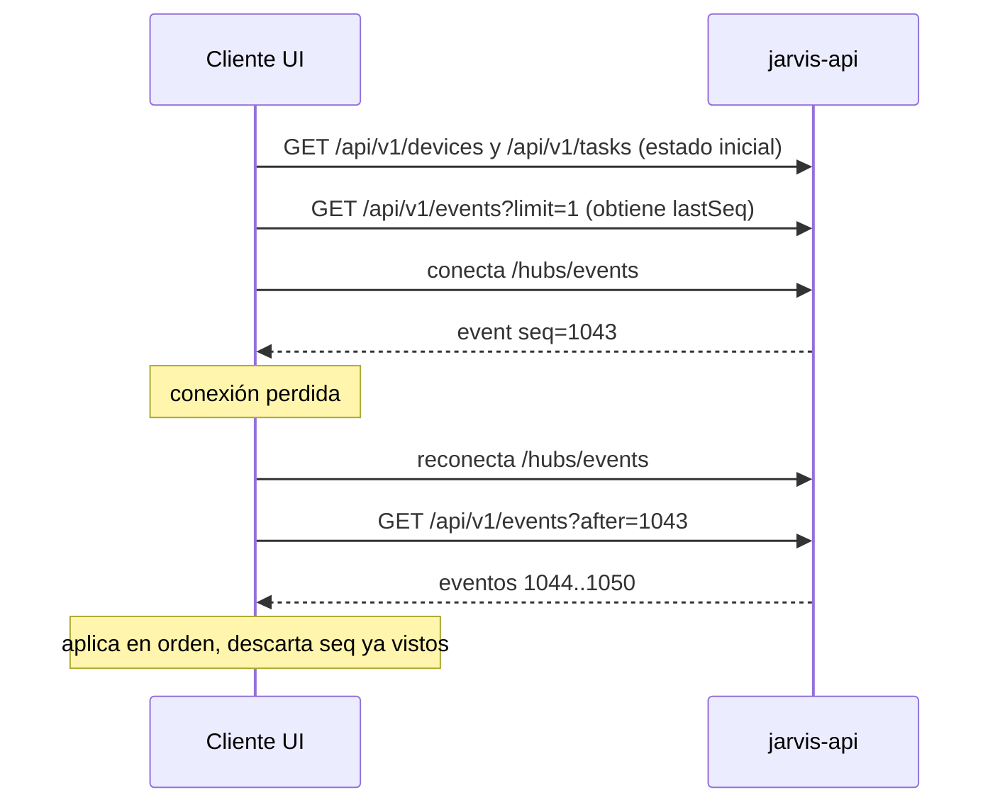

# Realtime Protocol (SignalR)

Decisión: [ADR-004](../08-decisions/ADR-004-rest-signalr-responsibilities.md).

## Rol

- SignalR notifica a **clientes UI** (web, mobile, Tauri) que algo cambió.
- **No** es fuente de verdad: toda notificación corresponde a datos ya confirmados en PostgreSQL.
- **No** se usa para devices ESP32 ni para el Windows Agent (usan MQTT).
- **No** acepta comandos: el hub no expone métodos que modifiquen estado. Las acciones van por REST.

## Endpoint y autenticación

| Tema | Decisión |
|---|---|
| URL | `wss://${JARVIS_DOMAIN}/hubs/events` |
| Transporte | WebSockets (Long Polling como fallback automático; Server-Sent Events deshabilitado) |
| Protocolo | JSON (MessagePack innecesario por volumen) |
| Auth | JWT de **User**. En WebSocket el navegador no puede enviar headers, así que se acepta `?access_token=` **solo** en la ruta `/hubs/events`. nginx y la API no registran query strings en esa ruta. |
| Expiración | El servidor cierra la conexión cuando expira el JWT (`CloseOnAuthenticationExpiration`); el cliente reconecta con un token nuevo y hace catch-up. |
| Principal Device | Rechazado en MVP (`403`). |

## Groups

| Group | Miembros | Uso |
|---|---|---|
| `owner:{ownerId}` | Todas las conexiones del user | Único group en MVP. Toda notificación se envía al group del owner del recurso. |

Al conectar, el servidor agrega la conexión a `owner:{ownerId}` con el `ownerId` del token. El cliente **no** elige groups (impide suscribirse a otro owner). Filtros finos (por device o tarea) se hacen en el cliente; el volumen lo permite. Si en el futuro se necesitan groups por tarea, se agregarán con validación de propiedad en el servidor.

## Mensajes servidor → cliente

Un único método de cliente: `event`. Payload:

```json
{
  "seq": 1042,
  "name": "task.completed",
  "occurredAt": "2026-09-19T15:04:06.950Z",
  "correlationId": "0192a6f4-8b1e-7c3a-9d2e-aaaaaaaaaaaa",
  "deviceId": "0192a6f0-2222-7aaa-8bbb-000000000002",
  "taskId": "0192a6f4-9000-7c3a-9d2e-00000000a001",
  "data": { "status": "Completed" }
}
```

| `name` | Origen | `data` |
|---|---|---|
| `device.registered` | `DEVICE_REGISTERED` | `{ "name", "type" }` |
| `device.updated` | `DEVICE_UPDATED/DISABLED/ENABLED/REVOKED` | `{ "adminState", "name" }` |
| `device.online` | `DEVICE_CONNECTED` | `{ "presenceState": "Online" }` |
| `device.stale` | transición a Stale (sin evento) | `{ "presenceState": "Stale" }` — `seq` = `null` |
| `device.offline` | `DEVICE_DISCONNECTED` | `{ "presenceState": "Offline", "reason" }` |
| `task.created` | `TASK_CREATED` | `{ "status": "Pending", "type", "targetDeviceId" }` |
| `task.dispatched` | `TASK_DISPATCHED` | `{ "status": "Dispatched", "attempt" }` |
| `task.delivered` | `TASK_DELIVERED` | `{ "status": "Delivered" }` |
| `task.started` | `TASK_STARTED` | `{ "status": "Running" }` |
| `task.completed` | `TASK_COMPLETED` | `{ "status": "Completed" }` |
| `task.failed` | `TASK_FAILED` | `{ "status": "Failed", "errorCode" }` |
| `task.cancelled` | `TASK_CANCELLED` | `{ "status": "Cancelled" }` |
| `task.expired` | `TASK_EXPIRED` | `{ "status": "Expired" }` |
| `approval.requested` | `APPROVAL_REQUESTED` | `{ "status": "WaitingForApproval", "reason" }` |
| `approval.resolved` | `APPROVAL_GRANTED/DENIED` | `{ "decision": "Granted" \| "Denied" }` |

Las notificaciones **no** incluyen `payload` ni `result`: el cliente los obtiene por REST (`GET /api/v1/tasks/{id}`). Esto evita duplicar reglas de autorización y exposición de datos en dos canales.

## Relación con PostgreSQL y catch-up

1. Toda notificación con `seq` corresponde a una fila de `events`.
2. Se publica **después** del commit. Si la API cae entre commit y envío, la notificación se pierde, pero el evento existe.
3. Por eso el cliente implementa catch-up:



Reglas del cliente:
- Guardar el mayor `seq` procesado.
- Tras (re)conectar: `GET /api/v1/events?after={lastSeq}` hasta `hasMore = false`.
- Deduplicar por `seq` (puede recibir el mismo evento por hub y por catch-up).
- Si estuvo desconectado más de la retención de eventos, recargar estado completo por REST.
- Notificaciones sin `seq` (`device.stale`) son informativas; el estado autoritativo se obtiene por REST.

## Reconexión

Clientes oficiales de SignalR con `withAutomaticReconnect([0, 2000, 5000, 10000, 30000])` y después reintento cada 30 s. Tras reconectar, siempre catch-up.

## Escalado futuro

Una sola instancia: sin backplane. Con más instancias: backplane (Redis o PostgreSQL `LISTEN/NOTIFY`) según [ADR-008](../08-decisions/ADR-008-redis-decision.md).
