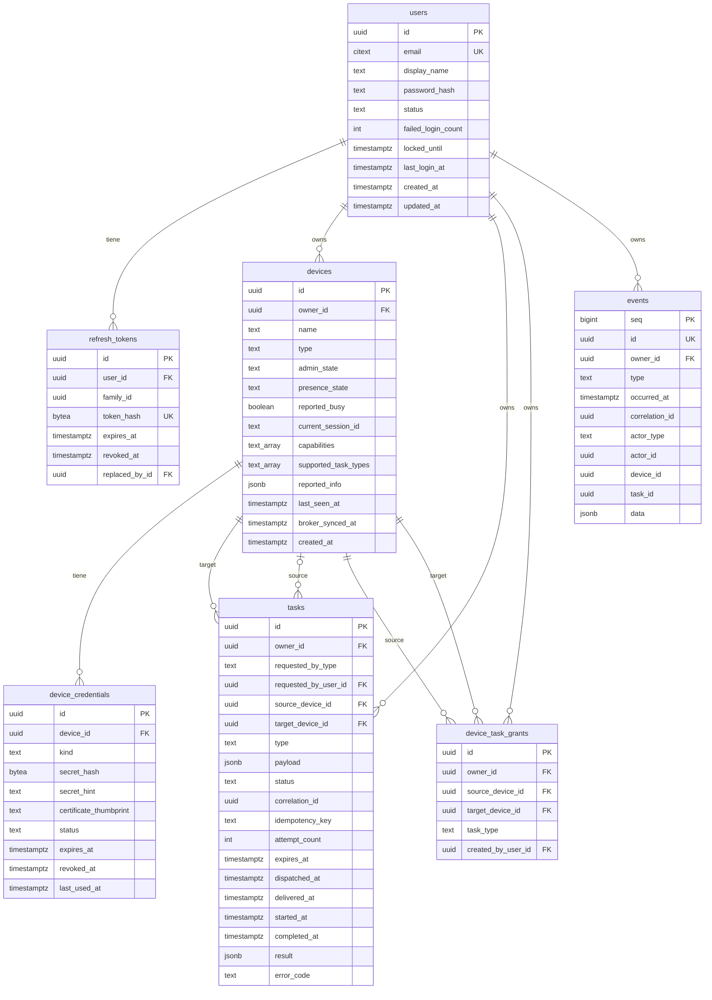

# ERD

Detalle de columnas, constraints e índices: [Database Design](database-design.md).

`events.device_id` y `events.task_id` no tienen FK a propósito (ver [Database Design](database-design.md#events)); el diagrama no dibuja esas relaciones.
