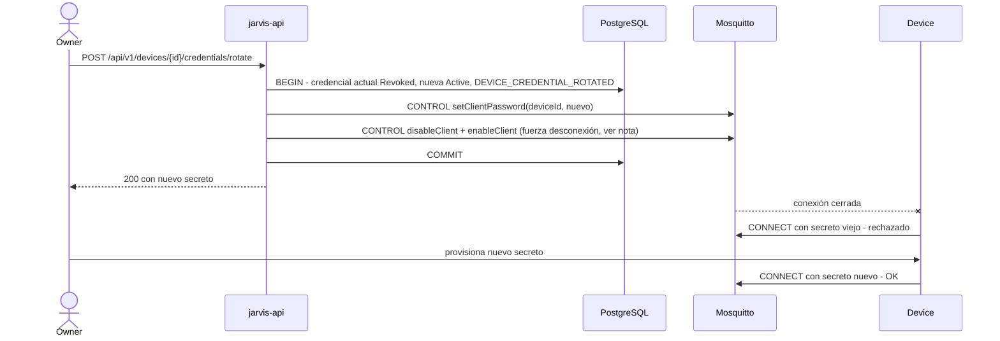

# Device Authentication

Decisión: [ADR-005](../08-decisions/ADR-005-device-authentication.md).

## Credencial

| Aspecto | Decisión |
|---|---|
| Tipo | Secreto aleatorio (`kind = Secret`) |
| Entropía | 256 bits de `RandomNumberGenerator` |
| Formato | `jdv_` + base64url sin padding (43 caracteres) → 47 caracteres. El prefijo permite detectar secretos filtrados con escáneres (p. ej. GitHub secret scanning con patrón propio). |
| Identificador | `deviceId` (UUID), público. Se usa como `username`/`clientId` MQTT y en `device-token`. |
| Almacenamiento Cloud | `secret_hash = HMAC-SHA256(pepper, secret)` en PostgreSQL. El `pepper` (32 bytes) vive en `/run/secrets/device_secret_pepper`, **no** en la BD. |
| Almacenamiento broker | Dynsec guarda su propio hash PBKDF2-SHA512 con sal (formato interno de Mosquitto). |
| Visualización | Solo en la respuesta de registro y de rotación (`Cache-Control: no-store`). Después solo `secretHint` (últimos 4). |

¿Por qué HMAC y no Argon2/bcrypt? Los algoritmos lentos protegen secretos de **baja entropía** (contraseñas humanas). Un secreto de 256 bits no es adivinable por fuerza bruta, así que un hash rápido es seguro y evita coste de CPU por request. El `pepper` agrega defensa: un dump de la BD sin el archivo de secrets no permite ni siquiera verificar secretos candidatos.

## Canales

| Canal | Cómo se autentica | Quién verifica |
|---|---|---|
| MQTT (8883) | `username = deviceId`, `password = secret`, `clientId = deviceId` | Mosquitto dynsec |
| REST | `POST /api/v1/auth/device-token` con `deviceId + secret` → JWT (10 min, `typ=device`) | API (HMAC + comparación en tiempo constante) |

Un device que solo usa MQTT (ESP32) nunca necesita REST.

## Registro

Secuencia completa: [Data Flow §1](../01-architecture/data-flow.md#1-registro-de-un-device).

```text
Owner autenticado → POST /api/v1/devices
  → generar deviceId + secreto
  → BEGIN: INSERT device + credential(hash) + DEVICE_REGISTERED
  → dynsec createClient(deviceId, secreto, rol jarvis-device)   (falla → ROLLBACK, 503)
  → COMMIT
  → 201 con secreto (única vez)
```

Provisión del secreto en el device (fuera del Cloud):

| Device | Almacenamiento recomendado |
|---|---|
| Windows Agent | Windows Credential Manager / DPAPI (ámbito de la cuenta de servicio) |
| ESP32 | Partición NVS cifrada (NVS encryption + flash encryption) |
| Simuladores | Archivo local fuera del repo (`%APPDATA%/jarvis-sim/…`) o variable de entorno de la sesión; nunca en git |
| Mobile | Keychain (iOS) / Keystore (Android) |

## Rotación



Nota: cambiar la contraseña en dynsec no desconecta sesiones existentes. Para forzarlo, la API hace `disableClient` seguido de `enableClient` (dynsec desconecta al deshabilitar). La HU correspondiente debe verificarlo con un test de integración.

Rotación **sin periodo de gracia** en MVP: dynsec admite una sola contraseña por client. Rotación con solapamiento (dos credenciales activas) requiere certificados o un auth plugin propio → futuro.

## Revocación y deshabilitación

| Operación | PostgreSQL | Dynsec | JWT de device vigentes |
|---|---|---|---|
| Disable | `admin_state = Disabled` | `disableClient` (desconecta) | Rechazados en ≤ 30 s (caché de estado) |
| Enable | `admin_state = Active` | `enableClient` | — |
| Revoke | `admin_state = Revoked`, credenciales `Revoked` | `deleteClient` (desconecta) | Rechazados en ≤ 30 s |

Si el broker no está disponible durante disable/revoke, la operación en BD **se confirma igual** (la seguridad no puede depender de que el broker esté arriba para *quitar* acceso) y el `BrokerReconciliationService` aplica el cambio en cuanto el broker vuelve (reintento cada 30 s mientras haya diferencias). Mientras tanto el device no puede conectar de todos modos (broker caído).

## Expiración (futuro)

`device_credentials.expires_at` existe pero es nulo en MVP. Cuando se active: el `device-token` rechaza credenciales expiradas y un job deshabilita el client dynsec al vencer. Requiere rotación iniciada por el device (`POST /api/v1/devices/me/credentials/rotate`, Phase 2).

## Certificados de cliente (futuro)

`kind = ClientCertificate` + `certificate_thumbprint` reservados. Plan: CA privada de Jarvis, CSR generado en el device (la clave privada nunca sale), Mosquitto con `require_certificate true` y `use_identity_as_username true` en un listener adicional. Ventajas: rotación con solapamiento, clave no exportable (TPM en Windows, eFuse/HMAC peripheral en ESP32-S3). Se evaluará en Phase 6.
