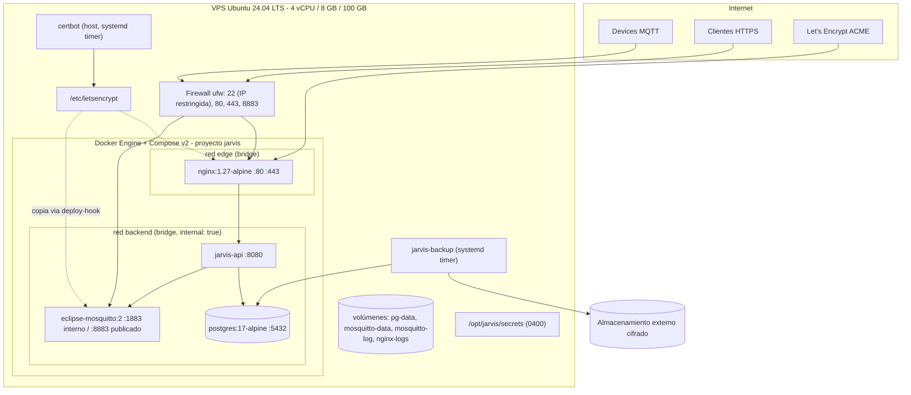

# Deployment Architecture

> **Producción (ADR-011):** PostgreSQL y nginx son **nativos** en el host; Docker solo ejecuta `jarvis-api` (red del host, escucha en 127.0.0.1), `jarvis-worker` (jobs, sin puertos; [ADR-016](../08-decisions/ADR-016-worker-and-scheduled-jobs.md)) y `mosquitto`. Despliegue en un VPS compartido (Contabo): [contabo-deployment.md](contabo-deployment.md). Ver [ADR-011](../08-decisions/ADR-011-native-postgres-nginx.md) y [Runbooks](runbooks.md). Las secciones que describen nginx/PostgreSQL en contenedores quedan como referencia del diseño original y siguen aplicando a desarrollo/pruebas.

## Diagrama de despliegue

`jarvis-api` está conectado a **ambas** redes (edge para recibir de nginx, backend para PostgreSQL/Mosquitto). Mosquitto está en backend y publica 8883 en el host (Docker permite publicar puertos de un contenedor en una red `internal` solo si también tiene una red no interna; por eso Mosquitto se conecta además a una red `mqtt-public` dedicada — ver [Networking](networking.md)).

## Host

| Tema | Decisión |
|---|---|
| SO | Ubuntu Server 24.04 LTS |
| Acceso | SSH solo con llave, `PermitRootLogin no`, puerto 22 restringido por IP si es posible; `fail2ban` |
| Actualizaciones | `unattended-upgrades` para parches de seguridad |
| Firewall | `ufw` default deny incoming; allow 22 (restringido), 80, 443, 8883. **Atención:** Docker publica puertos saltándose ufw; por eso solo se publican 80/443 (nginx) y 8883 (mosquitto) y nada más |
| Usuario de despliegue | `jarvis` (grupo `docker`), sin sudo general |
| Directorio | `/opt/jarvis/` → `compose/`, `secrets/`, `config/`, `backups/` |
| Zona horaria | UTC |

## Procedimiento de despliegue (a implementar en EPIC 11)

1. `docker compose pull` (imagen de la API construida en CI o localmente con tag de versión).
2. `docker compose run --rm jarvis-api migrate` (rol `jarvis_migrator`).
3. `docker compose up -d` (recrea solo lo que cambió).
4. Verificar `/health/ready` desde el host y `/health/live` desde fuera.
5. Rollback: volver al tag anterior y `up -d` (las migraciones son compatibles hacia atrás, ver [Persistence Strategy](../04-data/persistence-strategy.md#migraciones)).

Downtime esperado: segundos (una instancia). Los devices reconectan solos; las tareas no se pierden.

## Entornos

| Entorno | Dónde | Diferencias |
|---|---|---|
| Local dev | PC del desarrollador | Compose con postgres + mosquitto (TLS con certificado autofirmado o sin TLS en `localhost`); API con `dotnet run` |
| Test (CI) | Testcontainers | Contenedores efímeros por suite |
| Producción | VPS | Este documento |

No hay staging en MVP; la demo E2E se ejecuta contra producción con devices simulados y luego se revocan o se mantienen según decida el owner.
