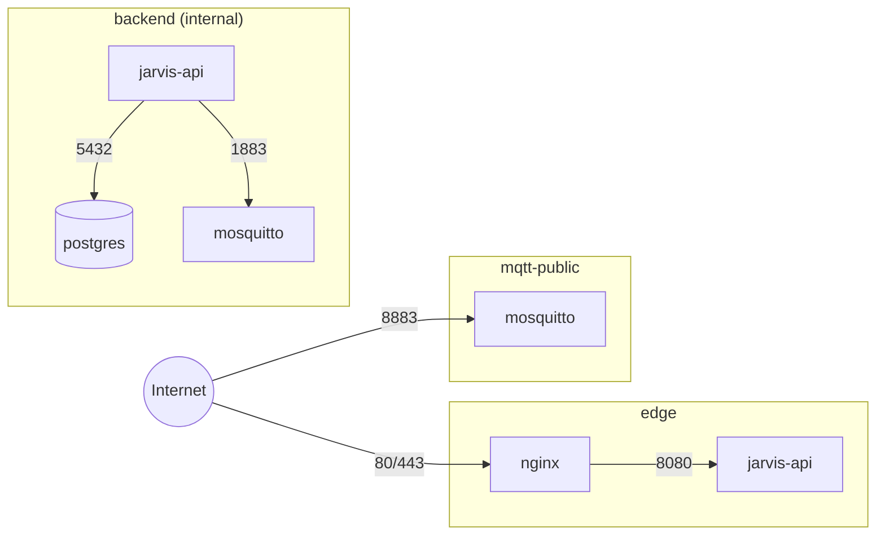

# Networking

> **Producción (ADR-011):** PostgreSQL y nginx son **nativos** en el host; Docker solo ejecuta `jarvis-api` (red del host, escucha en 127.0.0.1) y `mosquitto`. Ver [ADR-011](../08-decisions/ADR-011-native-postgres-nginx.md) y [Runbooks](runbooks.md). Las secciones que describen nginx/PostgreSQL en contenedores quedan como referencia del diseño original y siguen aplicando a desarrollo/pruebas.

## Puertos expuestos a Internet

| Puerto | Servicio | Protocolo | Motivo |
|---|---|---|---|
| 22/tcp | sshd (host) | SSH | Administración. Restringido por IP de origen si es posible; solo llave. |
| 80/tcp | nginx | HTTP | Desafío ACME y redirección a HTTPS. |
| 443/tcp | nginx | HTTPS / WSS | REST API, SignalR. |
| 8883/tcp | mosquitto | MQTT sobre TLS | Devices. |

**Nunca expuestos:** 5432 (PostgreSQL), 1883 (MQTT sin TLS), 8080 (API), métricas.

## Redes Docker

| Red | Tipo | Miembros | Propósito |
|---|---|---|---|
| `edge` | bridge | nginx, jarvis-api | nginx → API |
| `backend` | bridge, `internal: true` (sin salida a Internet) | jarvis-api, postgres, mosquitto | Datos y broker. Nada en esta red es alcanzable desde fuera. |
| `mqtt-public` | bridge | mosquitto | Solo para poder publicar 8883 en el host (una red `internal` no admite port publishing). |

(`API1`/`API2` y `MQ`/`MQ2` son el mismo contenedor en dos redes.)

Consecuencias:
- PostgreSQL no tiene ruta desde Internet ni desde nginx.
- nginx no puede hablar con PostgreSQL ni con Mosquitto.
- La API no tiene salida a Internet por `backend`, pero sí por `edge` (necesaria solo si en el futuro llama servicios externos; en MVP no los llama). Si se quiere bloquear egress de la API, `edge` puede declararse `internal` también y nginx conectarse además a una red pública (misma técnica que Mosquitto). **Decisión MVP:** `edge` no interna; egress bloqueado a nivel host es mejora post-MVP.

## Listeners de Mosquitto

| Listener | Bind | TLS | Auth | Uso |
|---|---|---|---|---|
| `8883` | `0.0.0.0` dentro del contenedor, publicado | Sí (certificado Let's Encrypt) | dynsec | Devices |
| `1883` | Todas las interfaces del contenedor, **no publicado** (alcanzable solo desde redes Docker del host) | No | dynsec (misma autenticación; un device no puede usarlo desde Internet) | Cloud client (`jarvis-cloud`) |

Mosquitto 2 exige `listener` explícitos y `allow_anonymous false` es el default; se declara igualmente. `per_listener_settings false` (dynsec es global).

## DNS

Un registro `A` (y `AAAA` si el VPS tiene IPv6) para `${JARVIS_DOMAIN}` → IP del VPS. TTL 300 s durante la puesta en marcha. Opcional: registro `CAA` limitando emisión a `letsencrypt.org`.

## Firewall y Docker

Docker inserta reglas iptables que **ignoran ufw** para puertos publicados. Controles:
1. Publicar solo 80, 443, 8883 (revisado en code review de `docker-compose.yml`).
2. Nunca `ports:` en postgres ni en la API.
3. Compose de desarrollo publica solo en `127.0.0.1`.
4. Verificación post-despliegue: `nmap` externo contra el VPS debe mostrar solo 22/80/443/8883 ([Acceptance Tests](../10-testing/acceptance-tests.md)).
