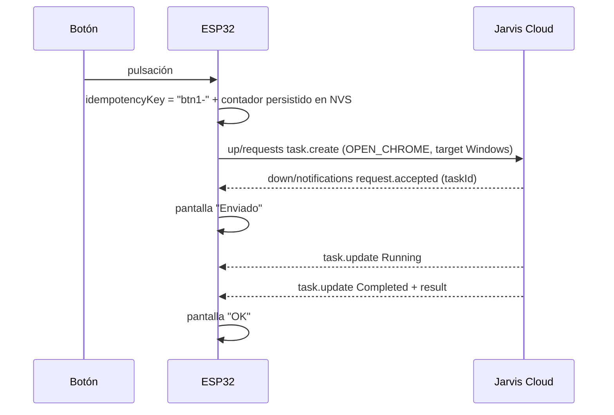

# ESP32 Contract

Contrato para el futuro firmware ESP32-S3 (ESP-IDF, Phase 6). El **ESP32 Simulator** del MVP implementa el mismo protocolo desde .NET.

Para el Cloud, un ESP32 es solo un `Device` de tipo `ESP32` con capabilities. No existe código específico de ESP32 en el Cloud.

## Stack previsto

| Aspecto | Tecnología |
|---|---|
| MCU | ESP32-S3 |
| Framework | ESP-IDF 5.x |
| Red | Wi-Fi (STA), reconexión automática |
| MQTT | Componente `esp-mqtt` (MQTT 5 o 3.1.1) sobre TLS (`mqtts://${JARVIS_DOMAIN}:8883`) |
| TLS | `esp-tls` con mbedTLS; CA embebidas **ISRG Root X1 y X2**; validación de hostname activa |
| JSON | `cJSON` |
| Tiempo | SNTP obligatorio antes de conectar MQTT (necesario para `ts`, validación de certificado y anti-replay) |
| Credencial | NVS cifrado (NVS encryption + flash encryption en producción) |
| OTA | Futuro: `esp_https_ota` desde una URL firmada; imágenes firmadas con Secure Boot v2 |

## Rol en el MVP

Capabilities típicas: `task-requester`, `buttons`, `display`. Normalmente **no** es `agent` (no ejecuta tareas del Cloud); si en el futuro ejecuta (p. ej. `SHOW_TEXT` en su pantalla, `PLAY_SOUND`), declara `agent` y `supportedTaskTypes`, y debe cumplir las mismas obligaciones W4-W8 del [Windows Agent Contract](windows-agent-contract.md) con un registro de `taskId` en NVS (ring buffer de los últimos 64).

## Flujo de un botón

- El contador de la `idempotencyKey` se incrementa y persiste **antes** de publicar, para que un reinicio no reutilice una key con contenido distinto.
- Si no llega `request.accepted` en 10 s → reintentar el **mismo** mensaje (misma key). El Cloud responde `duplicate: true` si ya lo había procesado.
- Si el ESP32 reinicia y quiere conocer el resultado de la última tarea: `task.get` con el `taskId` guardado.

## Restricciones de recursos

| Aspecto | Límite recomendado |
|---|---|
| Tamaño de mensaje entrante | Buffer de 8 KiB suficiente para `down/notifications` (el Cloud no envía `payload` de otras tareas al origen; `result` puede ser hasta 32 KiB → el firmware trunca/descarta `result` si excede su buffer y usa solo `status`) |
| Suscripciones | Una (`down/#`) |
| Conexiones TLS | Una (MQTT). No usa REST en MVP para evitar una segunda sesión TLS |
| Heartbeat | Cada 30 s (QoS 0) |

## Provisioning

MVP / Phase 6 inicial: el owner registra el device por REST, obtiene `deviceId` + secreto y los graba por puerto serie (herramienta de provisión local) en NVS cifrado.

Futuro (pairing): el ESP32 genera un código corto mostrado en su pantalla, el owner lo introduce en la UI y el Cloud entrega la credencial por un canal temporal. Requiere diseño propio (ADR futuro) para no introducir un endpoint anónimo explotable.

## Estados visibles al usuario

| Situación | Indicación sugerida |
|---|---|
| Sin Wi-Fi | LED ámbar |
| Auth rechazada (credencial revocada) | LED rojo fijo, backoff 5 min |
| Conectado | LED verde |
| Tarea en curso | Parpadeo |
| Resultado | Pantalla con `status` y `result.message` truncado |
