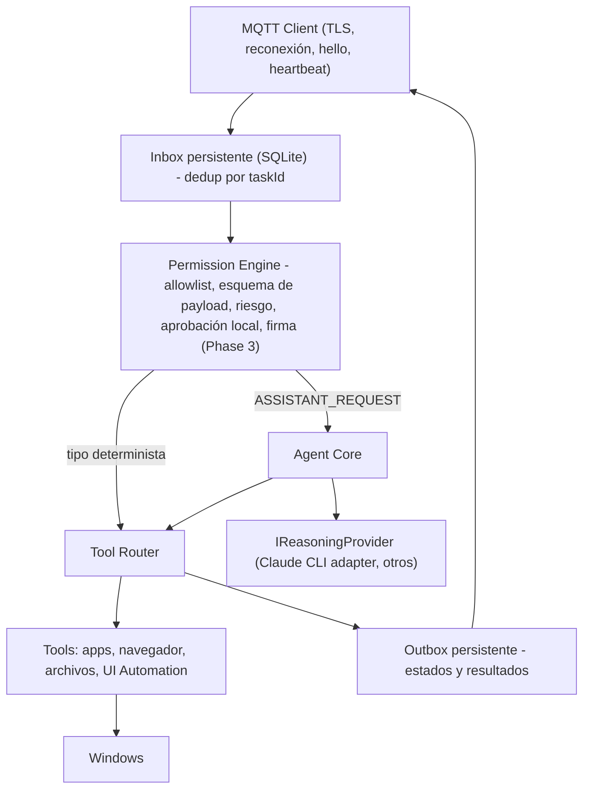

# Windows Agent Contract

Contrato entre Jarvis Cloud y el futuro `jarvis-windows-agent` (Phase 2+). El **Windows Simulator** del MVP implementa exactamente las mismas obligaciones de protocolo, sin ejecución real.

## Frontera de conocimiento

| El Cloud conoce | El Cloud **no** conoce |
|---|---|
| `deviceId`, tipo `Windows`, capabilities, `supportedTaskTypes` | Qué LLM/proveedor/modelo usa el agente |
| Estado y resultado de cada tarea | Prompts, razonamiento, planes |
| `softwareVersion` y `protocolVersion` reportados | Tools internas, Win32, UI Automation, procesos |
| | Políticas locales del Permission Engine |

Ningún campo del protocolo transporta prompts, nombres de modelo o tool calls. Si el agente quiere reportar detalles de ejecución, lo hace dentro de `result` (objeto opaco para el Cloud). Ver [ADR-010](../08-decisions/ADR-010-llm-independence.md).

## Arquitectura interna prevista (informativa)

## Obligaciones de protocolo (MVP y futuro)

| # | Obligación | Referencia |
|---|---|---|
| W1 | Conectar con `clientId = username = deviceId`, TLS con validación de certificado, clean start, keepalive 60 s, LWT `presence.offline` con `sessionId`. | [MQTT §5](../03-protocols/mqtt-protocol.md#5-conexión) |
| W2 | Suscribirse a `down/#` y enviar `presence.hello` con `openTaskIds`, `supportedTaskTypes`, capabilities (`agent`, …). | [MQTT §4.8](../03-protocols/mqtt-protocol.md#48-uppresence-y-downcontrol) |
| W3 | Heartbeat cada `heartbeatIntervalSeconds` con `busy`. | |
| W4 | Al recibir `task.dispatch`: si `taskId` ya es conocido → **no ejecutar**, reenviar último estado. Si `now > expiresAt` → `task.rejected EXPIRED_ON_ARRIVAL`. Si el tipo no está permitido → `task.rejected NOT_PERMITTED`. Si no → persistir y `task.ack`. | [ADR-006](../08-decisions/ADR-006-task-delivery-semantics.md) |
| W5 | Persistir antes de cada efecto: inbox → ack → "iniciando" → ejecutar → resultado en outbox → publicar. | [MQTT §7](../03-protocols/mqtt-protocol.md#7-entrega-duplicados-e-idempotencia) |
| W6 | Reenviar el último estado de cada tarea no *settled* tras reconectar, hasta recibir `task.update.ack` para estados terminales. | |
| W7 | Conservar el registro de `taskId` vistos ≥ 8 días. | |
| W8 | Atender `task.cancel`: detener si es posible y responder `task.cancelled`, o reportar el estado terminal real. | |
| W9 | Si una tarea queda en ejecución tras un reinicio del agente sin posibilidad de reanudar → `task.failed EXECUTION_ERROR` con mensaje "agent restarted" (nunca reejecutar automáticamente). | |
| W10 | Tratar el contenido del Cloud como no confiable: validar esquema por tipo, límites de tamaño, nunca interpretar `payload` como código o comando de shell. | [Threat Model T02, T05](../05-security/threat-model.md) |

## Permission Engine (responsabilidad del agente)

| Nivel de riesgo | Ejemplos | Política |
|---|---|---|
| Bajo | `SHOW_NOTIFICATION`, `OPEN_CHROME` con URL `https://` | Automático |
| Medio | Abrir aplicaciones de una allowlist, escribir en carpetas de trabajo | Automático con registro local; configurable |
| Alto | Ejecutar comandos, instalar software, borrar archivos, enviar mensajes | Aprobación local obligatoria (`task.approval_required` → `WaitingForApproval`) |
| Prohibido | Deshabilitar seguridad del SO, exfiltrar credenciales | Siempre `NOT_PERMITTED` |

La política vive **en la PC**, editable solo localmente. El Cloud no puede cambiarla (no existe mensaje de protocolo para ello, por diseño).

## Tipos de tarea

El Cloud no define un catálogo cerrado. Convención inicial:

| TaskType | Payload | Result | Fase |
|---|---|---|---|
| `OPEN_CHROME` | `{ "url": "https://..." }` (opcional) | `{ "outcome": "SUCCESS", "message": "..." }` | MVP (simulado) |
| `SHOW_NOTIFICATION` | `{ "title": "...", "body": "..." }` | `{ "outcome": "SUCCESS" }` | Phase 2 |
| `OPEN_APP` | `{ "appId": "vscode" }` (id de allowlist, nunca ruta) | idem | Phase 2 |
| `ASSISTANT_REQUEST` | `{ "text": "...", "locale": "es" }` | `{ "outcome": "...", "reply": "texto para el usuario", "actions": [...] }` | Phase 4 |

`ASSISTANT_REQUEST` es el punto de entrada del razonamiento: el Cloud lo transporta igual que cualquier otra tarea; qué modelo lo procesa es asunto del agente.

## Credencial en el agente

Guardada en Windows Credential Manager (o DPAPI con ámbito de máquina si corre como servicio). Nunca en archivos de configuración en texto plano.

## Uso de REST

Opcional. Si el agente necesita consultar tareas o su identidad, usa `POST /api/v1/auth/device-token` y endpoints con principal Device. En MVP el simulador no lo necesita.
