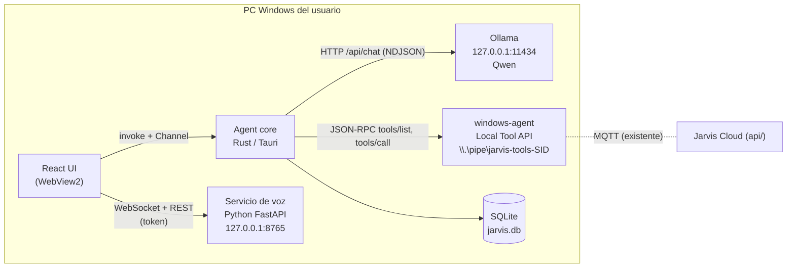
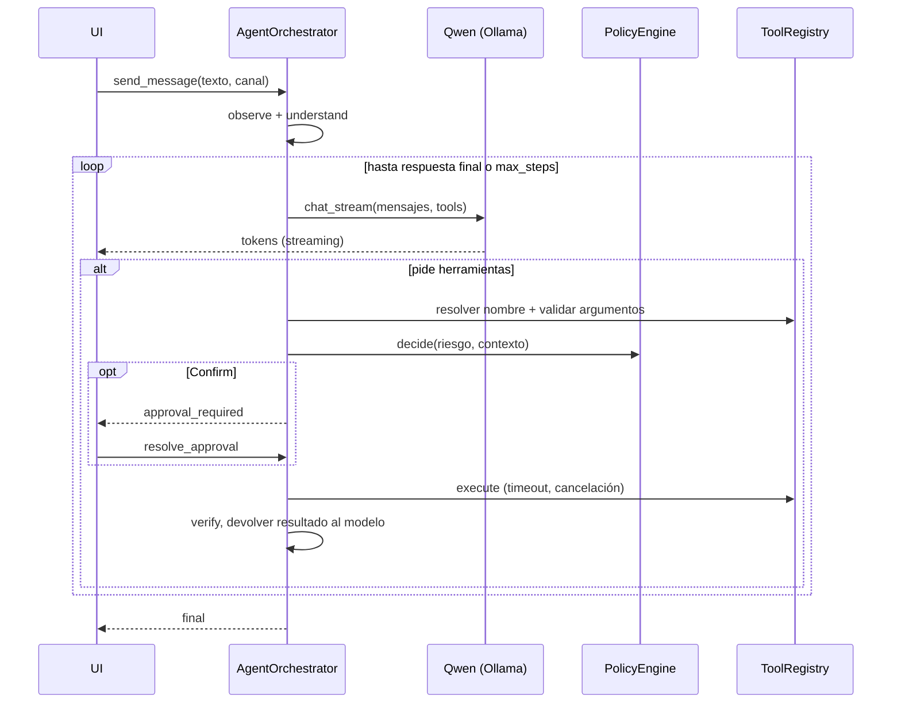
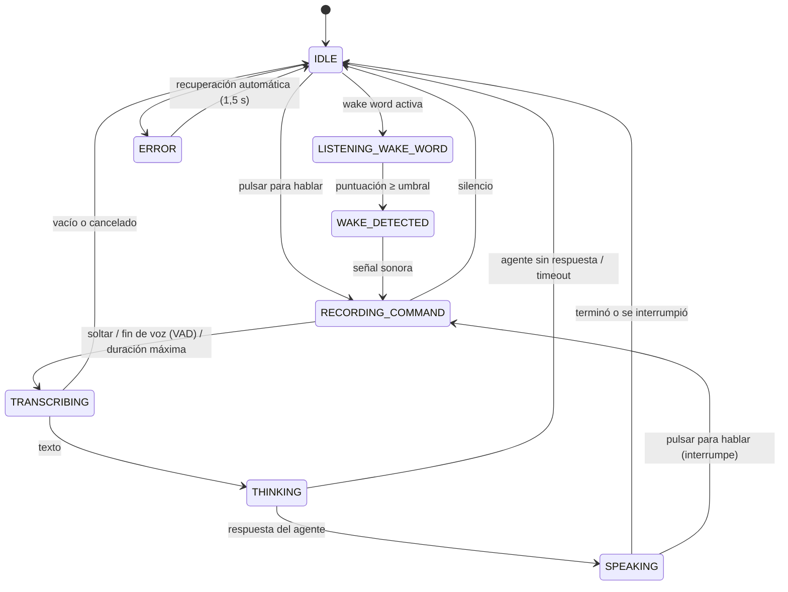

# Arquitectura de Jarvis (assistant)

## Contexto



Tres procesos locales con responsabilidades separadas:

| Proceso | Responsabilidad | No hace |
|---|---|---|
| **Agent core** (Tauri) | Razonar, planificar, autorizar, recordar, mostrar la UI | Llamar a Win32 para actuar (eso es del windows-agent) |
| **Servicio de voz** | Micrófono, VAD, wake word, STT, TTS, altavoz | Decidir qué hacer con lo que oye |
| **windows-agent** (existente) | Ejecutar herramientas con su política, locks, verificación y auditoría | Contener LLM o prompts |

## Ciclo del agente

Cada fase es un componente con su contrato en `src-tauri/src/core`:

| Fase | Componente | Contrato |
|---|---|---|
| OBSERVE | `DefaultObserver` | `trait Observer { fn observe() -> Observation }` |
| UNDERSTAND | `ContextBuilder` + `MemoryRetriever` | Un único mensaje `system` (personalidad + reglas + contexto + recuerdos), el historial y la instrucción |
| PLAN | `LlmPlanner` | `trait Planner { async fn next(...) -> PlanDecision }`: respuesta final o llamadas a herramientas |
| AUTHORIZE | `PolicyEngine` + `ApprovalGate` | `decide(spec, run) -> Allow / Confirm / Deny`; Confirm espera a la UI con plazo |
| EXECUTE | `DefaultExecutor` | Timeout y cancelación por herramienta |
| VERIFY | `DefaultVerifier` | `Passed / Failed / Inconclusive / NotApplicable` (usa la verificación del windows-agent si viene) |
| REMEMBER | `AgentOrchestrator::finish` | Historial, experiencia (verificada o no) y auditoría |



El modelo **nunca** ejecuta nada: propone llamadas que el backend valida.

## Seguridad

| Medida | Dónde |
|---|---|
| Toda acción pasa por `ToolRegistry` → `PolicyEngine` | `core/agent/orchestrator.rs` |
| DESTRUCTIVE siempre pide confirmación; nadie puede auto-aprobarla | `core/policies` (también al guardar la configuración) |
| Herramientas denegadas: ni se ofrecen al modelo ni se ejecutan | `ToolRegistry::llm_tools` + `decide` |
| Defensa ante prompt injection: si entró contenido externo, lo que no es READ_ONLY pide confirmación; la salida de las herramientas se marca como dato | `RunSecurity.tainted`, `SAFETY_RULES` |
| Las reglas de seguridad no salen del YAML de personalidad: se añaden siempre desde el código | `core/agent/personality.rs` |
| Validación de argumentos (tipos, requeridos, objetos cerrados) | `tools::validate_object` + el windows-agent con su esquema completo |
| Límite de pasos por instrucción y de llamadas por paso | `AgentConfig.max_steps`, `MAX_CALLS_PER_STEP` |
| Secretos: se redactan antes de guardar historial y auditoría; la memoria se niega a guardarlos | `memory/secrets.rs` |
| Servicios solo en 127.0.0.1; el de voz se niega a escuchar en otra IP sin `allow_remote` | `VoiceSettings.check_binding` |
| Token local entre app y voz (archivo en el perfil del usuario), comparación en tiempo constante | `config/security.py` |
| El WebSocket se autentica con el primer mensaje (el token no va en la URL) y comprueba el `Origin` | `api/ws.py` |
| CSP de la ventana: solo `self`, IPC y el servicio de voz local | `tauri.conf.json` |
| La ventana solo tiene los permisos `core:default` + los comandos propios | `capabilities/default.json` |
| Contra el windows-agent el principal es siempre `local:agent-core`, nunca el owner | Diseño del windows-agent (ADR-014) |

## Contratos

| Canal | Contrato | Tipos |
|---|---|---|
| UI ↔ Rust | Comandos Tauri + `Channel<AgentEvent>` | `packages/shared-types/src/{agent,domain}.ts`, `packages/agent-protocol/schemas/agent-event.schema.json` |
| UI ↔ voz | REST + WebSocket | `packages/shared-types/src/voice.ts`, `packages/agent-protocol/schemas/voice-ws.schema.json` |
| Rust ↔ Ollama | `/api/chat` nativo con `tools`, NDJSON | `infrastructure/llm/ollama.rs` |
| Rust ↔ windows-agent | JSON-RPC 2.0 `tools/list`, `tools/call` por named pipe | `infrastructure/windows/tool_api.rs`; `ToolResult jarvis.tool-result/1` |

## Correspondencia de riesgo con el windows-agent

| windows-agent | Jarvis | Por defecto |
|---|---|---|
| R0 observar | READ_ONLY | se ejecuta |
| R1 lectura sensible, R2 acción reversible | LOW_RISK | se ejecuta |
| R3 acción con impacto | SENSITIVE | pide confirmación (y el agente pide la suya) |
| R4 crítica / desconocido | DESTRUCTIVE | siempre confirma |

## Voz



- **Su propia voz:** mientras está en SPEAKING el micrófono no se procesa, y después hay 700 ms de enfriamiento antes de volver a buscar la palabra de activación.
- **Ruido:** VAD por energía con umbral `max(min_rms, piso_de_ruido × 2,5)`. El piso de ruido se aprende del audio de fondo mientras espera la palabra clave y en los silencios. faster-whisper aplica además Silero VAD al transcribir.
- **Respuestas por fragmentos:** el texto se divide en frases; mientras suena una se sintetiza la siguiente.
- **Respaldo:** si OpenVoice falla o no hay voz clonada activa, `FallbackTts` usa la voz de Windows.
- **Caché:** los audios se guardan por hash (motor, voz, velocidad, texto) con un límite de tamaño.

## Datos y memoria: Neural Memory Engine

Todo está en `src-tauri/src/memory/` y se usa a través de `MemoryEngine` (comandos de la UI, herramientas `save_memory`/`search_memory` y orquestador).

| Tipo | Almacén | Notas |
|---|---|---|
| Episódica | `messages`, `conversations` | Solo mensajes de usuario y respuestas finales |
| Semántica y entidades | `memories` + `memory_sources` | Cada recuerdo guarda su fuente, un hash del contenido, confianza y verificación |
| Grafo | `memory_relations` | Relaciones tipadas (`RELATED_TO`, `BELONGS_TO`, `DEPENDS_ON`, `CAUSED_BY`, `SOLVED_BY`, `LEARNED_FROM`, `USED_IN`) con procedencia y confianza; las inferidas nunca nacen verificadas |
| Procedimental | `skills` + `skill_versions` | Solo desde experiencias completadas **y** verificadas; versionadas |
| Experiencias | `experiences` | Deduplicadas por firma del objetivo |
| Auditoría de memoria | `memory_events` | Creación, uso en un turno (`MEMORY_RETRIEVED` con su `run_id`), cambios, importaciones |
| Vectores | `embedding_metadata` + caché en memoria | `qwen3-embedding:0.6b` por `/api/embed`; si no está, embeddings léxicos (la UI lo avisa) |

### Recuperación

```text
consulta → intención → embedding → similitud (top-k) → expansión por el grafo (vecinos fiables)
        → filtros (expirados, en duda, poca confianza) → ranking
        → contexto limitado por tokens → mensaje system → Qwen → memory_events
```

Ranking: `0,55·similitud + 0,15·léxico + 0,15·recencia + 0,15·confianza`, más un ajuste por verificación y una penalización a lo importado sin verificar. El bloque de recuerdos va **antes** de las reglas de seguridad, se presenta como datos y se sanea (sin bloques de código ni marcadores `[m:` falsos), de modo que un recuerdo con instrucciones no las impone.

### Eventos visuales

`MemoryEngine` publica `VisualEvent` en un canal `tokio::broadcast`; `lib.rs` los reenvía con `emit("jarvis://visual")` y la UI los aplica en `graphStore` (reductor puro, probado):

`MEMORY_CREATED` · `MEMORY_RETRIEVED` · `MEMORY_UPDATED` · `MEMORY_DELETED` · `MEMORY_CONNECTED` · `MEMORY_CONSOLIDATED` · `MEMORY_IMPORTED` · `SKILL_LEARNED` · `TASK_STARTED` · `TASK_COMPLETED`

### Neural Core

Es una vista del **grafo semántico de la memoria** (los pesos de Qwen no son accesibles). Cada punto es un recuerdo real; cada línea, una relación.

- 3D con React Three Fiber, cargado aparte: un `Points` con shader propio, un `LineSegments`, un `Points` para los pulsos y el núcleo. Buffers que solo se reconstruyen cuando cambia la topología.
- Disposición determinista agrupada por tipo y relajada con fuerzas; nodos nuevos junto a sus vecinos.
- Bajo consumo: render bajo demanda, `dpr` 1, sin rotación y vista de 150 nodos.
- Sin WebGL, o si se elige: Canvas 2D.
- El núcleo responde a la voz (escuchando, hablando con el nivel real del audio), a tareas en curso y a aprobaciones pendientes.

### Paquete de exportación `.jarvismem`

```text
"JARVISMEM1" | sal (16) | nonce (24) | m, t, p (u32 LE) | cifrado
cifrado = XChaCha20-Poly1305(clave = Argon2id(contraseña, sal), aad = cabecera)
         └─ tar: jarvis-memory/{manifest.json, memories.sqlite, skills/, attachments/, checksums.json}
```

- No incluye conversaciones, ajustes, tokens ni credenciales; los contenidos con secretos se excluyen.
- Al importar: contraseña → límites de Argon2 → integridad (AEAD + SHA-256 por archivo) → versión de esquema (más nueva = rechazo) → vista previa → selección por tipo → duplicados y conflictos (conservar el local, usar el importado o conservar ambos) → copia de seguridad previa → reembeddings si cambió el modelo. Las habilidades llegan desactivadas y marcadas para revisión.

## Decisiones

- [ADR-A01: Agent core sobre la Local Tool API del windows-agent](decisions/ADR-A01-agent-core-over-tool-api.md)
- [ADR-A02: Pulsar para hablar por defecto; wake word opcional](decisions/ADR-A02-push-to-talk-default.md)
- [ADR-A03: Voz en un proceso Python separado](decisions/ADR-A03-voice-separate-process.md)

## Elección de modelo

`qwen3:4b` es el valor por defecto por disco y VRAM (~2,6 GB). Con una GPU de 12 GB o más conviene uno mayor (`qwen3:8b`, `qwen3:14b` o la versión de Qwen más reciente que liste Ollama con capacidad *tools*). Se cambia en Configuración sin recompilar.
