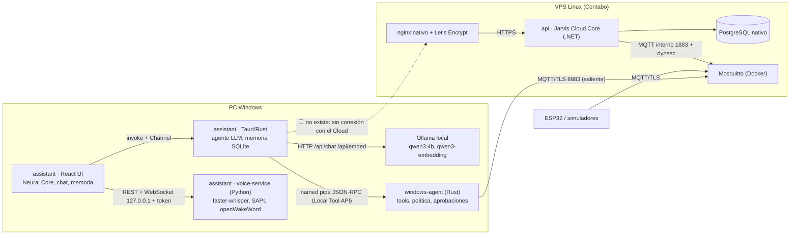

# Estado actual de Jarvis (auditoría)

Fecha: 2026-10-22. Alcance: la carpeta `ivi/` completa, inspeccionada antes de cambiar nada.

Leyenda de estado:

| Marca | Significado |
|---|---|
| ✅ | Implementado y verificado **hoy** ejecutando sus pruebas en esta auditoría |
| 📄 | Implementado según su propia documentación y pruebas, **no re-ejecutado** aquí (requiere Windows o Docker) |
| 🟡 | Implementado, sin verificar con el modelo, dispositivo o sistema real |
| 🎭 | Simulación o doble de prueba (no es la funcionalidad real) |
| ⬜ | No existe |

> **Estado de la refactorización:** los pasos de la sección 10 están implementados; ver [../PROGRESS.md](../PROGRESS.md). Este documento se conserva como fotografía de la auditoría inicial.

## 1. Hallazgo principal

El proyecto **no es un solo repositorio** sino tres componentes que ya se diseñaron para trabajar juntos:

| Carpeta | Qué es | Lenguaje | Tamaño | Pruebas |
|---|---|---|---|---|
| `api/` | **Jarvis Cloud Core ya existente** (Phase 1): identidad, devices, credenciales, tareas firmadas, MQTT, presencia, eventos, auditoría, tiempo real, despliegue en VPS | .NET 10, EF Core, PostgreSQL 17, Mosquitto, SignalR | ~12 100 líneas + 3 300 de pruebas | 183 (132 ✅ hoy; 51 de integración/E2E se omiten sin Docker) |
| `windows-agent/` | Agente residente en Windows: tools con política local, UI Automation, aprobaciones, firmas Ed25519, enlace MQTT con el Cloud, Local Tool API | Rust (7 crates) | ~21 400 líneas | 252 según su documentación 📄 |
| `assistant/` | App de escritorio (Tauri) con el agente LLM (Qwen/Ollama), memoria neuronal en SQLite, Neural Core 3D y servicio de voz | Rust + React + Python | ~17 700 líneas | 93 Rust + 29 UI + 43 voz ✅ |

Consecuencias para la refactorización:

1. **El Cloud Core no se crea desde cero**: se amplía `api/`. Su backend es .NET, no Rust; el requisito «no introducir otro lenguaje sin justificación» lleva a escribir los nuevos módulos (memoria, sincronización, habilidades, experiencias, worker) en .NET dentro de la misma solución.
2. **Ya existe un modelo de identidad completo** (owner, devices, credenciales con pepper, tokens de device, revocación, rotación). La sincronización debe reutilizarlo, no duplicarlo.
3. **Hay decisiones de arquitectura vigentes que chocan con el nuevo encargo** (sección 8). Se resuelven con ADR nuevos, no ignorándolas.
4. La estructura `jarvis/apps…/services/cloud-core` del encargo es orientativa; mover `api/` dentro de `assistant/` rompería sus rutas de CI, despliegue y documentación sin aportar nada. Se mantienen las tres carpetas y se documenta el sistema completo en `ivi/docs/`.

## 2. Mapa de dependencias

Lo que falta para el objetivo del encargo está en la línea punteada: **la app de escritorio no habla con el Cloud Core**. La memoria, las experiencias y las habilidades viven solo en el SQLite de una PC.

## 3. Inventario por módulo

### 3.1 Cloud Core (`api/`)

| Módulo | Ubicación | Estado | Depende de | Linux | GPU |
|---|---|---|---|---|---|
| Users, login, refresh con rotación y detección de reutilización, lockout | `Application/Auth`, `Domain/Users` | ✅ dominio · 📄 integración | PostgreSQL | Sí | No |
| Devices: registro (secreto `jdv_` mostrado una vez, HMAC con pepper), deshabilitar, revocar, rotar | `Application/Devices`, `Domain/Devices` | ✅ dominio · 📄 integración | PostgreSQL, Mosquitto dynsec | Sí | No |
| Token de device (`POST /auth/device-token`) | `AuthHandlers` | 📄 | — | Sí | No |
| Grants entre devices | `GrantHandlers` | 📄 | — | Sí | No |
| Tareas: máquina de estados T1–T17, idempotencia, despacho `SKIP LOCKED`, timeouts, expiración, cancelación | `Domain/Tasks`, `Application/Tasks` | ✅ dominio · 📄 E2E | PostgreSQL, MQTT | Sí | No |
| Firma end-to-end de tareas y aprobaciones (Ed25519) | ADR-012 | ✅ vectores compartidos con el agente | — | Sí | No |
| MQTT: procesador de entrada (7 reglas), publicador, sesión persistente | `Application/Mqtt`, `Infrastructure/Mqtt` | 📄 | Mosquitto 2.0 | Sí | No |
| Presencia (hello, heartbeat, LWT, barrido) | `Application/Presence` | 📄 | MQTT | Sí | No |
| Event log append-only + auditoría + retención | `Application/Events`, `RetentionService` | 📄 | PostgreSQL | Sí | No |
| Tiempo real (SignalR, solo users) | `Api/Realtime` | 📄 | — | Sí | No |
| Rate limiting, Problem Details, CORS, límites de tamaño, health, métricas | `Api/Http`, `Api/Health` | ✅ | — | Sí | No |
| Despliegue: Dockerfile chiseled, compose, `deploy.sh`, `provision.sql`, nginx, certbot, `backup.sh`, `monitor.sh` | `deploy/` | 🟡 nunca ejecutado en el VPS (su propio estado lo dice) | VPS | Sí | No |
| Simuladores ESP32 y Windows | `tools/Jarvis.Simulators` | 🎭 por diseño | MQTT | Sí | No |
| Memoria, conocimiento, experiencias, habilidades, sincronización, scheduler de jobs, inferencia | — | ⬜ (su roadmap las deja para P8–P10) | — | — | — |

### 3.2 Windows Agent (`windows-agent/`)

| Módulo | Estado | Específico de Windows | GPU |
|---|---|---|---|
| `jarvis-protocol` (MQTT v1 + contract tests contra la doc del Cloud) | 📄 | No | No |
| `jarvis-tooling` (Tool, ToolResult, executor, locks, verificación) | 📄 | No | No |
| `jarvis-policy` (`policy.toml`, riesgo R0–R4, principals) | 📄 | No | No |
| `jarvis-state` (SQLite: inbox, dedup, outbox, aprobaciones) | 📄 | No | No |
| `jarvis-windows` (Win32/COM, Credential Manager, named pipe, sesión, UI Automation) | 📄 | **Sí** | No |
| `jarvis-agent` (pipeline, Cloud Link MQTT/TLS, Local Tool API, CLI, updater) | 📄 | **Sí** | No |
| Tools: `open_app`, `close_app`, `is_app_running`, `list_running_apps`, `get_active_window`, `find_window`, `focus_window`, `read_file`, `list_directory`, `delete_file`, `run_command` (solo comandos con nombre definidos localmente), `show_notification`, UIA (`uia_find_all`, `uia_read`, `invoke_element`, `set_text`…) | 📄 | **Sí** | No |
| Control de mouse y teclado (`SendInput`) | ⬜ | — | — |
| PowerShell con políticas | 🟡 parcial: `run_command` ejecuta comandos con nombre de una allowlist local (ADR-008); no hay PowerShell genérico, a propósito | Sí | No |
| USB / Bluetooth | ⬜ | — | — |
| Navegador y visión (EPIC-17/18) | ⬜ fuera de su alcance | — | — |

El agente **no contiene IA** por diseño (ADR-014): el razonamiento vive en la app de escritorio, que usa las tools por la Local Tool API.

### 3.3 App de escritorio (`assistant/`)

| Módulo | Ubicación | Estado | Específico de Windows | GPU |
|---|---|---|---|---|
| UI React (7 pantallas, Neural Core 3D/2D, Memoria) | `apps/desktop/src` | ✅ vitest + capturas en Chromium | No | No (WebGL opcional) |
| Comandos Tauri y streaming por `Channel` | `src-tauri/src/commands` | ✅ tipos · 🟡 ventana Tauri no abierta en Windows | WebView2 | No |
| Agente OBSERVE→…→REMEMBER, permisos, aprobación, auditoría | `core/` | ✅ con LLM simulado | No | No |
| Proveedor Ollama (`/api/chat`, tools, streaming) | `infrastructure/llm/ollama.rs` | ✅ contra servidor simulado · 🟡 sin Ollama real | No | Recomendable |
| Proveedor alternativo (API compatible OpenAI) | — | ⬜ (el trait `LlmProvider` lo permite) | — | — |
| Cliente de la Local Tool API (named pipe) | `infrastructure/windows/tool_api.rs` | ✅ con agente falso · 🟡 pipe real | **Sí** | No |
| Neural Memory Engine (SQLite v2, grafo, recuperación, embeddings, experiencias, habilidades, export/import cifrado) | `src-tauri/src/memory` | ✅ | No | No |
| Embeddings `qwen3-embedding:0.6b` | `memory/embedding_provider.rs` | ✅ simulado · 🟡 real | No | No (CPU basta) |
| Embeddings léxicos de respaldo | `HashingEmbedder` | ✅ (respaldo real, no simulación) | No | No |
| Backend simulado de la UI (`npm run dev` en navegador) | `services/mockBackend.ts` | 🎭 | — | — |
| Voz: máquina de estados, VAD por energía, pulsar para hablar, interrupción | `services/voice-service/app/engine` | ✅ con audio simulado | No | No |
| STT faster-whisper | `app/stt/whisper.py` | ✅ simulado · 🟡 real (Hugging Face bloqueado en el entorno de pruebas) | No | Opcional |
| TTS voz de Windows (SAPI) | `app/tts/sapi.py` | 🟡 | **Sí** | No |
| TTS OpenVoice V2 | `app/tts/openvoice.py` | 🟡 adaptador sin ejecutar | No | Recomendable |
| **VibeVoice** | — | ⬜ **no existe en el código** | — | Sí (ver 5) |
| openWakeWord (`hey_jarvis`) | `app/wake_word/detector.py` | 🟡 opcional, desactivado | No | No |
| Captura y reproducción de audio (`sounddevice`) | `app/audio` | 🟡 sin micrófono en pruebas | No | No |
| Sincronización con el Cloud, outbox, identidad de device | — | ⬜ | — | — |

## 4. Comunicación actual

| Enlace | Transporte | Autenticación | Estado |
|---|---|---|---|
| UI ↔ núcleo Tauri | `invoke` + `Channel` + evento `jarvis://visual` | Proceso local | ✅ tipos/serialización · 🟡 Tauri real |
| UI ↔ servicio de voz | REST + WebSocket en `127.0.0.1` | Token local en `%LOCALAPPDATA%\Jarvis\voice-token` | ✅ |
| Núcleo ↔ Ollama | HTTP `127.0.0.1:11434` | Ninguna (local) | ✅ simulado |
| Núcleo ↔ windows-agent | Named pipe `\\.\pipe\jarvis-tools-<SID>`, JSON-RPC 2.0 | ACL del SID + principal `local:agent-core` | ✅ con doble · 📄 en el agente |
| windows-agent ↔ Cloud | MQTT 3.1.1/TLS 8883, conexión **saliente** | Secreto de device en Credential Manager | 📄 (14 escenarios WIN-E2E según su doc) |
| ESP32 ↔ Cloud | MQTT/TLS | Secreto de device | 🎭 simulador |
| Clientes ↔ Cloud | HTTPS REST `/api/v1` + SignalR | JWT de user o de device | 📄 |
| **Escritorio ↔ Cloud** | — | — | ⬜ |

## 5. Inferencia y GPU

| Carga | Dónde corre hoy | GPU | Nota |
|---|---|---|---|
| Qwen (chat + tools) vía Ollama | PC | Recomendable; `qwen3:4b` funciona en CPU, lento | Disco libre ~5 GB en la PC |
| `qwen3-embedding:0.6b` | PC | No | ~0,6 GB |
| faster-whisper `base` | PC | No (int8 en CPU) | |
| OpenVoice V2 | PC (opcional) | Recomendable | 3–5 GB |
| VibeVoice | — | Sí para fluidez | `VibeVoice-Realtime-0.5B`: MIT, **uso de investigación**, solo inglés de forma oficial (español «experimental»), sin clonación de voz, añade un aviso audible de IA y una marca de agua ([ficha del modelo](https://huggingface.co/microsoft/VibeVoice-Realtime-0.5B)). Microsoft retiró el código de los modelos TTS largos de su repositorio. **No se puede tratar como la voz principal en español**; se integra como proveedor opcional y se marca como experimental. |
| VPS | — | **Se desconoce** | El diseño del Cloud supone 4 vCPU / 8 GB / 100 GB sin GPU. Hay que verificarlo antes de decidir si aloja algún modelo (Fase 8). |

## 6. Datos sensibles y secretos

| Dato | Dónde | Protección actual | Observación |
|---|---|---|---|
| Secretos de desarrollo del Cloud (`jwt_signing_key`, `device_secret_pepper`, contraseñas de PostgreSQL y Mosquitto) | `api/.local-secrets/` en tu PC | Ignorados por `.gitignore`; no se copiaron en esta auditoría | Son de desarrollo. Los de producción se generan en el VPS (`/opt/jarvis/secrets`, 0400) |
| Secreto del windows-agent | Windows Credential Manager | `CredWriteW` + `zeroize` | ✅ |
| Token del servicio de voz | `%LOCALAPPDATA%\Jarvis\voice-token` | Archivo local | Solo 127.0.0.1 |
| Memoria (recuerdos, experiencias) | `%LOCALAPPDATA%\Jarvis\jarvis.db` | Sin cifrado en reposo; se rechazan/redactan secretos al guardar | Al sincronizar viajará al VPS: requiere TLS, autorización por device y no subir secretos |
| Paquetes `.jarvismem` | Documentos\Jarvis | Argon2id + XChaCha20-Poly1305 | ✅ |
| Muestras de voz clonada | `%LOCALAPPDATA%\Jarvis\voices` | Consentimiento registrado; nunca salen de la PC | Deben seguir siendo solo locales |
| Credenciales de proveedores de IA | — | — | El ADR-010 prohíbe guardarlas en el Cloud; si se añade un proveedor externo, la clave va al Credential Manager de la PC |

## 7. Pruebas existentes (ejecutadas en esta auditoría)

| Suite | Resultado hoy | Nota |
|---|---|---|
| `api`: `dotnet test` | 132 ✅ · 51 omitidas | Las 51 de integración/E2E usan Testcontainers y aquí no hay Docker. **Bloqueo encontrado:** la solución no compilaba con el SDK 10.0.402 porque `Microsoft.AspNetCore.SignalR.Common 10.0.12` tiene un aviso de seguridad alto (GHSA-334f-vvp4-7g6p) y los avisos son errores. Se corrigió subiendo los paquetes 10.0.12 → 10.0.13 |
| `windows-agent`: crates independientes de Windows (`protocol`, `tooling`, `policy`, `state`) | 62 ✅ · 4 ❌ en Linux | Los 4 fallos están en `jarvis-policy::files` y usan rutas `C:\…`, que en Linux no son absolutas: son pruebas que solo valen en Windows, no defectos. El resto (`jarvis-windows`, `jarvis-agent`) requiere Windows |
| `assistant`: Rust / vitest / pytest | 93 / 29 / 43 ✅ (1 omitida por modelo real en cada caso) | |

## 8. Conflictos entre el encargo y las decisiones vigentes

| Tema | Decisión vigente | Encargo nuevo | Resolución propuesta |
|---|---|---|---|
| Lenguaje del Cloud | `api/` en .NET (ADR-001) | «Mantén Rust si resulta adecuado según el código existente» | El código existente del Cloud es .NET → **los módulos nuevos se escriben en .NET**. Rust sigue en escritorio y agente |
| IA en el Cloud | ADR-010: el Cloud no conoce LLM, ni prompts, ni credenciales de IA | Inference Gateway; memoria con embeddings | **El gateway vive en el escritorio** (elige Ollama local, Ollama remoto o API compatible sin tocar el agente). El Cloud guarda vectores calculados por los devices, etiquetados con el modelo que los produjo: nunca ejecuta un modelo. Un Ollama remoto en el VPS es un despliegue opcional detrás de nginx, solo si la inspección del VPS lo permite. ADR nuevo que precisa ADR-010 |
| Memoria | Roadmap del Cloud: «servicio separado» con ADR de privacidad | Memory Service en el VPS | Módulo del mismo backend (monolito modular) en un **esquema PostgreSQL propio** y con ADR de privacidad. Evita un microservicio innecesario |
| Registro de devices | `POST /api/v1/devices` (lo hace el owner autenticado) | `POST /api/v1/devices/register` | Se reutiliza el endpoint existente; el escritorio se empareja iniciando sesión una vez como owner y registrándose a sí mismo |
| `GET /api/v1/tasks` | Ya existe: tareas entre devices (MQTT) | Estado de tareas programadas | Las tareas programadas del worker se exponen como **jobs** (`/api/v1/jobs`) para no mezclar dos conceptos distintos |
| Reasoning provider | Docs del Cloud mencionan Claude CLI | Qwen vía Ollama | Sin conflicto real: el Cloud es agnóstico; el escritorio ya usa Qwen |
| Voz | Escritorio: SAPI + OpenVoice opcional | VibeVoice | VibeVoice como proveedor opcional y experimental (sección 5) |

## 9. Ubicación recomendada

### LOCAL (PC Windows; debe funcionar sin Internet)

| Componente | Origen |
|---|---|
| UI Tauri/React, chat, dashboard, configuración, permisos, historial local, Neural Core | `assistant` |
| Agente LLM (planificación, permisos, aprobación, auditoría local) | `assistant` |
| Tools de Windows, UI Automation, procesos, archivos autorizados, comandos con nombre | `windows-agent` |
| Captura de micrófono, VAD, wake word, reproducción, dispositivos, interrupción | `assistant/services/voice-service` |
| faster-whisper, voz de Windows, OpenVoice/VibeVoice opcionales | `assistant/services/voice-service` |
| Ollama + Qwen locales, embeddings locales | PC |
| SQLite de memoria (fuente local), caché de recuerdos, historial reciente | `assistant` |
| **Nuevo:** outbox de sincronización, estado de sync por registro | `assistant` |
| Muestras de voz y perfiles clonados | PC (nunca se sincronizan) |
| Credenciales (device, proveedores de IA) | Windows Credential Manager |

### CLOUD (VPS; siempre encendido)

| Componente | Origen |
|---|---|
| Identidad, devices, sesiones, revocación | `api` (existente) |
| Tareas entre devices, MQTT, presencia, eventos, auditoría, SignalR | `api` (existente) |
| **Nuevo:** Memory Service (PostgreSQL + pgvector, versiones, tombstones) | `api` |
| **Nuevo:** Knowledge Graph en PostgreSQL (relaciones con procedencia) | `api` |
| **Nuevo:** Sync Service (push/pull incremental, conflictos, idempotencia) | `api` |
| **Nuevo:** Experience Engine (dedup, patrones, propuestas de habilidad) | `api` + worker |
| **Nuevo:** Skill Registry (catálogo, versiones, compatibilidad, verificación) | `api` |
| **Nuevo:** Scheduler y worker separado (jobs persistentes, reintentos, timeouts) | `api` (nuevo proceso `Jarvis.Worker`) |
| Backups de PostgreSQL y verificación | `api/deploy` (existente) + job de verificación nuevo |

### HÍBRIDO

| Componente | Reparto |
|---|---|
| Memoria (episódica, semántica, procedimental) | Escribe primero en SQLite local; se replica al Cloud; los otros devices la reciben por pull |
| Embeddings | Se calculan donde está el modelo (normalmente la PC) y se suben etiquetados con el modelo; cada device recalcula si usa otro modelo |
| Recuperación de contexto | Local primero; si hay conexión, se completa con búsqueda en el Cloud y los nodos remotos se muestran en el Neural Core |
| Inferencia | Gateway en el escritorio: Ollama local, Ollama remoto o API compatible |
| Habilidades | Catálogo en el Cloud; ejecución solo local, desactivadas hasta revisión |
| Experiencias | Se registran localmente; el Cloud las consolida y propone habilidades |
| Exportación/importación | Paquete cifrado local (existente) y exportación desde el Cloud |
| Eventos | Locales para la UI; los relevantes se registran también en el event log del Cloud |

## 10. Siguientes pasos (orden de implementación)

1. Habilitar las pruebas de integración del Cloud sin Docker (PostgreSQL y Mosquitto nativos) para poder verificar cada cambio.
2. Contratos versionados de sincronización (documento + JSON Schema + vectores de prueba compartidos por .NET y Rust).
3. Módulos de memoria, grafo y sincronización en el Cloud con su migración.
4. Outbox y cliente de sincronización en el escritorio; emparejamiento del device.
5. Skill Registry, Experience Engine, jobs y worker.
6. Inference Gateway en el escritorio y pantalla de Configuración.
7. Despliegue para Contabo (sin ejecutar nada en el VPS sin autorización).
8. Escenarios A–G automatizados.
