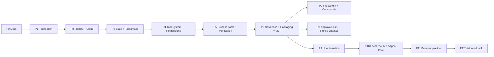

# Roadmap

## Cambios respecto al roadmap propuesto

| Cambio | Motivo |
|---|---|
| **Permisos (antes Phase 7) se adelantan a la fase del Tool System.** | Ninguna tool con efectos debe existir, ni siquiera en desarrollo, sin Permission Engine delante. Seguridad antes que capacidades. |
| **Verificación se fusiona con las Process Tools.** | La verificación es parte de la *Definition of Done* de cada tool, no una capa posterior; una tool sin verificación no está terminada. |
| **"Task receiving" incluye estado local.** | No se puede hacer `task.ack` sin persistir antes (obligación W5 del Cloud). SQLite llega junto con la recepción de tareas. |
| **Empaquetado y resiliencia forman parte del MVP.** | Un agente que no arranca solo ni sobrevive reinicios no es utilizable. |
| **Filesystem, comandos y aprobaciones completas quedan después del MVP.** | Superficies de mayor riesgo con su propia fase y pruebas de seguridad. |
| **La integración con Agent Core se implementa al final (P10), pero su boundary se fija en P4**: el Tool Host se diseña con dos frontends (Cloud y API local) desde el inicio ([ADR-014](../09-decisions/ADR-014-agent-core-boundary.md)). | Evita rehacer el Tool Host cuando llegue el Agent Core. |

## Fases

| Fase | Objetivo | Entregable | Depende de | No construir | Criterio de salida |
|---|---|---|---|---|---|
| **P0 Documentation** | Decisiones cerradas | `README.md` + `docs/**` | Cloud docs | Código | Revisión de consistencia hecha; decisiones pendientes asignadas |
| **P1 Foundation** | Proceso estable | Workspace Cargo, config TOML, logging `tracing`, CLI (`run`, `status`, `version`), instancia única, shutdown ordenado | P0 | MQTT, tools | `jarvis-agent run` arranca/para limpio; clippy/fmt/tests en CI |
| **P2 Identity + Cloud** | Presencia real en el Cloud | Credential Manager, `provision`, cliente MQTT TLS, hello/heartbeat/LWT, reconexión, estado de sesión | P1, Cloud Phase 1 | Ejecutar tareas | Device `Online` en el Cloud; LWT → `Offline`; revocación → backoff `AUTH_REJECTED` |
| **P3 State + Task intake** | Recibir tareas de forma idempotente | SQLite (WAL, migraciones), inbox/dedup, outbox, `task.ack`/`task.rejected`, recuperación de arranque | P2 | Tools reales (todo tipo desconocido → `UNSUPPORTED_TASK_TYPE`) | 100 redeliveries → 1 registro; outbox sobrevive reinicio |
| **P4 Tool System + Permissions** | Esqueleto seguro de ejecución | Contrato de tool, registro, mapeo TaskType, resultados/errores, execution engine (timeouts, cancelación), scheduler con locks, Permission Engine, riesgo, estado de aprobaciones, tool de prueba `noop` (solo builds de test) | P3 | Tools con efectos | Pipeline completo de extremo a extremo con `noop`; denegaciones y aprobaciones cubiertas por tests |
| **P5 Process Tools + Verification** | Capacidades del MVP | Catálogo de apps, `is_app_running`, `list_running_apps`, `get_active_window`, `open_app`, `close_app`, Verification Engine | P4 | Filesystem, comandos, UIA | Vertical slice `open_app(chrome)` verificado desde el Cloud |
| **P6 Resilience + Packaging** | **MVP** | Escenarios de fallo, hardening, redacción, `install`/`uninstall` (Scheduled Task), binario firmado, diagnóstico | P5 | Updater automático | [MVP](mvp.md) cumplido al 100 % |
| **P7 Filesystem + Commands** | Lectura segura y comandos con nombre | Sandbox de rutas, `list_directory`, `read_file`, catálogo de comandos, `run_command` (Job Objects), `focus_window` | P6 | Escritura/borrado de archivos, shell | Suite de seguridad de rutas y comandos verde |
| **P8 Approvals E2E + Updates** | Aprobaciones remotas firmadas y actualizaciones seguras | Mensaje `task.approval_decision` (requiere Cloud Phase 3), verificación de firmas Ed25519, updater firmado con rollback | P6, Cloud Phase 3 | UI de aprobaciones propia (la hace la Owner Console) | Aprobación falsificada rechazada; update con firma inválida rechazado |
| **P9 UI Automation** | Control de UI por semántica | Hilo STA UIA, `find_window`, `find_element`, `invoke_element`, `get_text`, `set_text` | P6 | Coordenadas, mouse/teclado crudo | Suite con apps de prueba (Notepad, calc) verde |
| **P10 Local Tool API** | Tools para Agent Core sin duplicar | IPC local (named pipe, JSON-RPC, descriptores JSON Schema compatibles con MCP), principal `local:agent-core` | P6 (P9 recomendado) | Razonamiento, prompts | Las mismas tools invocadas por Cloud y por API local con la misma política |
| **P11 Browser provider** | Navegador por DOM | Tool Provider externo con Playwright (proceso separado) | P10 | Control del navegador por mouse | Navegación/formularios verificados por DOM |
| **P12 Vision fallback** | Último recurso | Provider de visión + input crudo bajo aprobación | P9, P11 | Visión como primera opción | Solo se usa cuando UIA/DOM no aplican; siempre R3+ |

**Estado (2026-09-19):** P1–P10 implementadas; P11 y P12 quedan fuera del alcance de este proyecto (son providers en procesos separados). Detalle por historia en [Estado de implementación](../10-backlog/implementation-status.md).

Relación con el roadmap del Cloud: P1–P6 corresponden a **Cloud Phase 2 — Windows Agent Base**; P8 depende de **Cloud Phase 3**; P10 habilita **Cloud Phase 4 — Reasoning Loop**.
