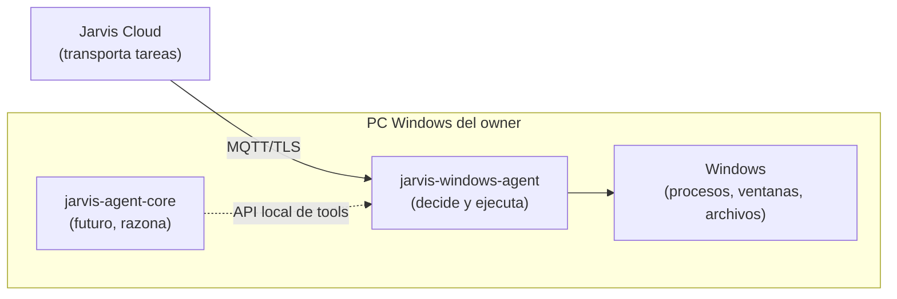

# Visión — jarvis-windows-agent

## Qué es

El brazo ejecutor de Jarvis en una PC Windows. Recibe **tareas estructuradas** del [Jarvis Cloud](../../../api/docs/00-overview/vision.md) por MQTT, decide **localmente** si puede ejecutarlas, las ejecuta con **Tools** acotadas, **verifica** el resultado observable y lo reporta.

## Qué problema resuelve

Sin este agente, "abrir Chrome desde un botón ESP32" requiere confiar en que quien envía el comando es legítimo y en que el comando es inofensivo. El agente elimina ambas suposiciones:

| Suposición peligrosa | Cómo la elimina el agente |
|---|---|
| "Si llegó por el Cloud, está autorizado" | Permission Engine local por identidad remota + riesgo; política editable solo en la PC |
| "El payload es seguro" | Tools tipadas, esquemas estrictos, catálogo de apps y comandos con nombre; nunca shell con texto remoto |
| "Si la API devolvió OK, funcionó" | Verification Engine: la tarea solo es `Completed` si la condición observable se cumple |
| "Un reintento es inofensivo" | Idempotencia por `taskId` persistida en SQLite: una tarea nunca se ejecuta dos veces |
| "Si se cortó la red, se perdió el resultado" | Outbox persistente: el resultado sobrevive reinicios y se publica al reconectar |

## Principios de diseño

1. **Autoridad local.** El Cloud solicita; el agente autoriza. Ver [ADR-004](../09-decisions/ADR-004-local-permission-authority.md).
2. **Verificación sobre ejecución.** Ver [ADR-007](../09-decisions/ADR-007-execution-vs-verification.md) y el principio textual en [Verification](../03-tools/verification.md).
3. **Tools como única superficie.** Todo efecto en Windows pasa por una Tool registrada con riesgo, permisos, recursos y timeouts declarados. Ver [ADR-003](../09-decisions/ADR-003-tool-abstraction.md).
4. **APIs nativas antes que simulación de usuario.** Native API → Win32 → UI Automation → integración específica → visión → mouse/teclado. Ver [ADR-002](../09-decisions/ADR-002-windows-integration-strategy.md).
5. **Mínimo privilegio y mínima exposición.** Usuario estándar, sesión interactiva, datos personales (títulos de ventana, rutas, contenidos) minimizados por defecto.
6. **Sin IA dentro.** El agente es determinista. El razonamiento vive en `jarvis-agent-core` (futuro) y consume tools por una API local. Ver [ADR-014](../09-decisions/ADR-014-agent-core-boundary.md).
7. **Bajo consumo y ejecución permanente.** Objetivo: < 30 MB RSS en reposo, ~0 % CPU en reposo, arranque < 1 s.

## Horizonte

| Fase | Capacidad |
|---|---|
| MVP | Procesos y ventana activa: `open_app`, `close_app`, `is_app_running`, `list_running_apps`, `get_active_window`, con permisos, verificación, idempotencia y recuperación |
| Siguiente | Filesystem de solo lectura en raíces permitidas, comandos con nombre, `focus_window`, aprobaciones |
| Futuro | UI Automation, navegador (Playwright como provider externo), API local para Agent Core, visión como último recurso |

Ver [Roadmap](roadmap.md).
