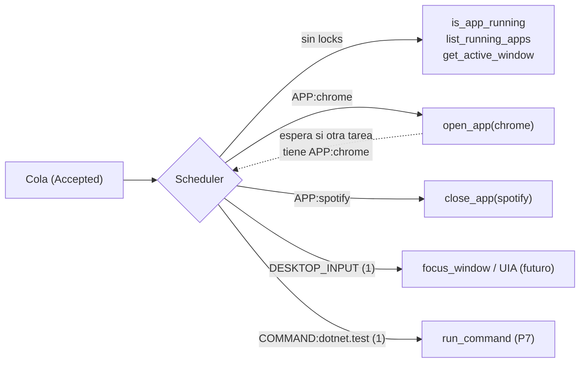

# Concurrency Model

## Objetivo

Permitir tareas en paralelo cuando no interfieren (observar mientras se abre una app) y **serializar** lo que compite por el mismo recurso físico o lógico (dos tareas no pueden pelear por el foco del escritorio).

## Resource locks

Cada tool declara, en función de su input, los recursos que necesita. El scheduler adquiere **todos** los locks de una invocación de forma atómica y en orden canónico (evita deadlocks) antes de marcarla `Running`.

| Lock | Modo | Quién lo usa | Motivo |
|---|---|---|---|
| `DESKTOP_INPUT` | Exclusivo | `focus_window`, tools UIA que invocan/escriben, futuras tools de mouse/teclado | Foco, teclado y mouse son un único recurso del usuario. En MVP se unifican los propuestos `WINDOW_FOCUS`, `KEYBOARD` y `MOUSE` en uno solo: dividirlos solo tendría sentido si una tool usara uno sin afectar a los otros, y en Windows el foco condiciona a ambos |
| `APP:<appId>` | Exclusivo | `open_app`, `close_app` | Evita abrir y cerrar la misma app a la vez y verificaciones cruzadas |
| `PROCESS:<pid>` | Exclusivo | Futuras tools sobre un PID concreto | — |
| `FS:<ruta canónica>` | Lectura compartida / escritura exclusiva | Tools de filesystem (P7+) | Lectores concurrentes, escritor único por ruta |
| `COMMAND:<commandId>` | Exclusivo (configurable `maxParallel`) | `run_command` | Evita dos `dotnet build` simultáneos del mismo proyecto |
| *(ninguno)* | — | `is_app_running`, `list_running_apps`, `get_active_window` | Solo observación |

## Límites globales

| Clase | Límite MVP | Notas |
|---|---|---|
| Ejecuciones en curso totales | 4 | Configurable (`executor.maxConcurrent`) |
| Tools con `DESKTOP_INPUT` | 1 | Por definición del lock |
| `run_command` (P7) | 2 | Protege CPU/IO de la PC del usuario |
| Cola de espera | 32 tareas | Excedido → la tarea espera en estado `Accepted` sin ejecutarse; el Cloud no reintenta porque ya hubo ack. Si el tiempo en cola supera el timeout efectivo → `Failed TOOL_TIMEOUT` |

## Reglas

1. **Orden FIFO por recurso**: una tarea que espera un lock no es adelantada por otra posterior que necesite el mismo lock.
2. **Sin locks anidados**: una tool no pide locks adicionales durante su ejecución.
3. **La verificación ocurre dentro del lock** de la ejecución (evita que otra tarea cambie el estado observado).
4. **`busy` en presencia** = hay al menos una ejecución en `Running`/`Verifying`.
5. **Agent Core (futuro)** usa el mismo scheduler: sus invocaciones compiten por los mismos locks que las tareas remotas.

## Qué no se hace en el MVP

Prioridades entre tareas, preempción, planificación por recursos de CPU. Se añadirán solo con evidencia de necesidad.
