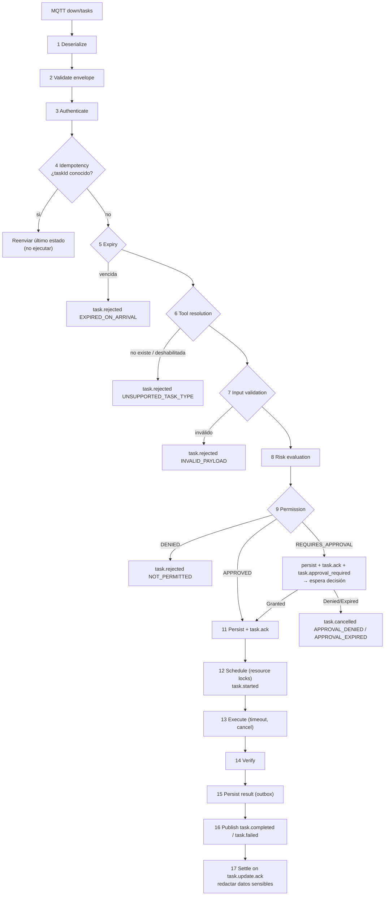
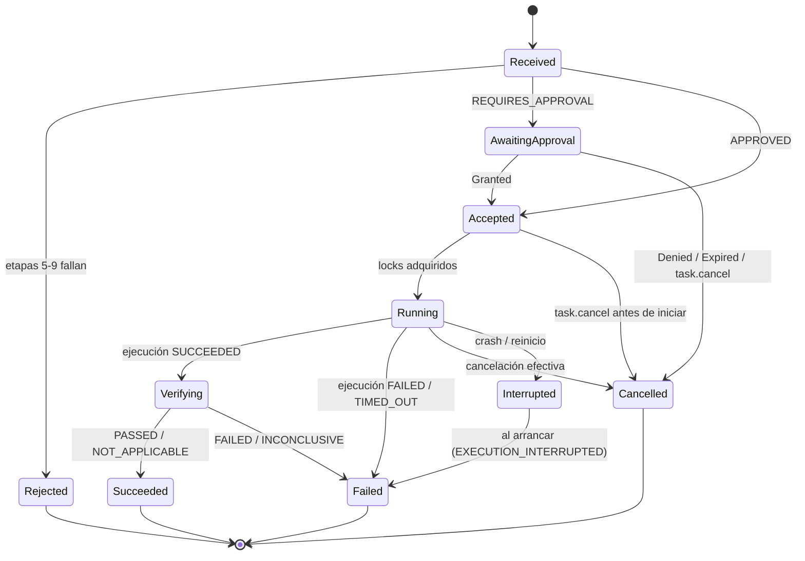
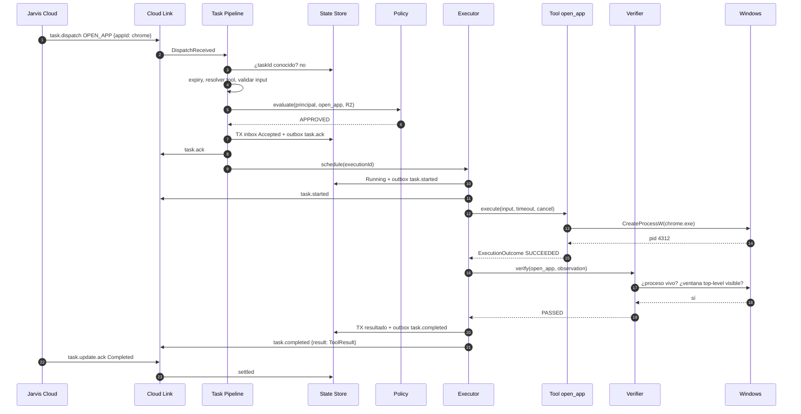

# Task Execution Pipeline

Cómo una `task.dispatch` del Cloud se convierte (o no) en un efecto en Windows. Implementa las obligaciones W1–W10 del [Windows Agent Contract del Cloud](../../../api/docs/07-integrations/windows-agent-contract.md).

## Etapas

| # | Etapa | Qué hace | Error | Mensaje al Cloud |
|---|---|---|---|---|
| 1 | Deserialize | JSON válido, ≤ 64 KiB, envelope con campos requeridos | `INVALID_ENVELOPE` | Ninguno si no hay `taskId` legible (no hay a quién responder); log `WARN`. Si `taskId` es legible pero `data` es inválido: `task.rejected INVALID_PAYLOAD` |
| 2 | Validate envelope | `v == 1`; topic `…/{self}/down/tasks`; `deviceId == self`; `type ∈ {task.dispatch, task.cancel, task.update.ack}` | `INVALID_ENVELOPE` / `SECURITY` | Ninguno; log `WARN` (posible manipulación) |
| 3 | Authenticate | El canal ya está autenticado (TLS con validación de certificado + ACL: solo `jarvis-cloud` publica en `down/#`). Si `signature` está presente o la política la exige (P8): verificar firma Ed25519 del principal | `SIGNATURE_INVALID` | `task.rejected NOT_PERMITTED` |
| 4 | Idempotency | Buscar `taskId` en State Store | — | Reenviar el último mensaje persistido (ack/started/terminal). **Nunca re-ejecutar** |
| 5 | Expiry | `nowCorregido > expiresAt` (ver [reloj](../02-cloud-integration/reconnection.md#reloj)) | `EXPIRED_ON_ARRIVAL` | `task.rejected` |
| 6 | Tool resolution | `type` → tool por [mapeo](../03-tools/tool-registry.md); tool habilitada en `config.toml` | `UNSUPPORTED_TASK_TYPE` | `task.rejected` |
| 7 | Input validation | Esquema estricto de la tool (tipos, rangos, longitudes, `deny_unknown_fields`) + validación semántica (p. ej. `appId` existe en el catálogo) | `INVALID_PAYLOAD` / `APP_NOT_FOUND` | `task.rejected INVALID_PAYLOAD` (el detalle en `message`) |
| 8 | Risk evaluation | Riesgo base de la tool + modificadores por input (`close_app.force` → R3) | — | — |
| 9 | Permission | [Permission Engine](../04-security/permission-engine.md) con principal `requestedBy` | `NOT_PERMITTED` | `task.rejected` |
| 10 | Approval | Si `REQUIRES_APPROVAL`: crear aprobación con expiración `min(expiresAt, now + approvalTtl)` | `APPROVAL_DENIED` / `APPROVAL_EXPIRED` | `task.ack` + `task.approval_required`; luego `task.started` o `task.cancelled` |
| 11 | Persist + ack | Transacción: inbox `Accepted` + mensaje `task.ack` en outbox; luego publicar | `SYSTEM_ERROR` (BD) | Si la BD falla: **no** se hace ack (el Cloud reintentará) |
| 12 | Schedule | Adquirir [resource locks](concurrency-model.md); marcar `Running` (persistido **antes** de ejecutar) | — | `task.started` |
| 13 | Execute | Tool con timeout efectivo y token de cancelación | `EXECUTION_FAILED`, `TOOL_TIMEOUT`, específicos (`APP_ELEVATED`…) | — |
| 14 | Verify | [Verifier](../03-tools/verification.md) con la condición de la tool | `VERIFICATION_FAILED` | — |
| 15 | Persist result | `ToolResult` + mensaje terminal en outbox (transacción) | `SYSTEM_ERROR` | — |
| 16 | Publish | `task.completed` (verificación `PASSED` o `NOT_APPLICABLE`) o `task.failed` | — | Reenvío desde outbox hasta `task.update.ack` |
| 17 | Settle | Marcar *settled*; redactar `result` si la tool lo declara sensible (se conserva hash y tamaño) | — | — |

El orden 4 → 5 es deliberado: una tarea **conocida** se responde con su estado aunque ya haya vencido; solo las **nuevas** se rechazan por expiración.

## Estados locales

| Estado local | Mensaje al Cloud | Estado en el Cloud |
|---|---|---|
| `Rejected` | `task.rejected` | `Failed` |
| `AwaitingApproval` | `task.ack` + `task.approval_required` | `WaitingForApproval` |
| `Accepted` | `task.ack` | `Delivered` |
| `Running`, `Verifying` | `task.started` (`task.progress` opcional) | `Running` |
| `Succeeded` | `task.completed` | `Completed` |
| `Failed` | `task.failed` | `Failed` |
| `Cancelled` | `task.cancelled` | `Cancelled` |

`Settled` es un indicador aparte (true tras `task.update.ack` de un estado terminal).

## Secuencia: caso normal

## Cancelación

`task.cancel { taskId, reason }` (W8):

| Estado local | Acción | Respuesta |
|---|---|---|
| Desconocido | Registrar `taskId` como `Cancelled` (rechaza un dispatch posterior) | `task.cancelled` |
| `AwaitingApproval`, `Accepted` | Cancelar sin ejecutar | `task.cancelled` |
| `Running` con tool cancelable | Disparar token; la tool se detiene de forma segura | `task.cancelled` si se detuvo; si la ejecución terminó antes, su estado terminal real |
| `Running` con tool **no** cancelable | Continuar | `task.progress { message: "cancellation not supported by tool" }` y luego el estado terminal real ([C12](../00-overview/cloud-compatibility.md)) |
| `Verifying` | La verificación se completa (es solo observación) | Estado terminal real |
| Terminal | — | Reenviar estado terminal |

Cada tool declara `cancellation`: `none`, `cooperative` (revisa el token entre pasos) o `kill` (termina el árbol de procesos con su Job Object, p. ej. `run_command`). Distinción interna: *cancellation requested* (token disparado) → *cancellation succeeded* (`task.cancelled`) o *cancellation unsupported* (progreso informativo).

## Timeouts

- Cada tool declara `defaultTimeout` y `maxTimeout` ([Tool Contract](../03-tools/tool-contract.md)).
- Timeout efectivo = `min(tool.maxTimeout, maxDurationSeconds del Cloud (si existe), input.timeoutMs (si la tool lo admite) o tool.defaultTimeout)`.
- Al vencer: se dispara la cancelación; resultado `executionStatus = TIMED_OUT`, error `TOOL_TIMEOUT`, `retryable` según la tool.
- La verificación tiene su propio presupuesto (`verification.timeout`, incluido dentro de `maxTimeout`).
- No existen tareas sin límite: `maxTimeout` es obligatorio y ≤ 24 h (límite del sistema del Cloud).

## Errores por etapa

Catálogo completo en [Tool Contract — Errores](../03-tools/tool-contract.md#errores). Regla: **nunca** se envían stack traces, rutas internas, nombres de usuario de Windows ni salida de comandos sin redactar.
