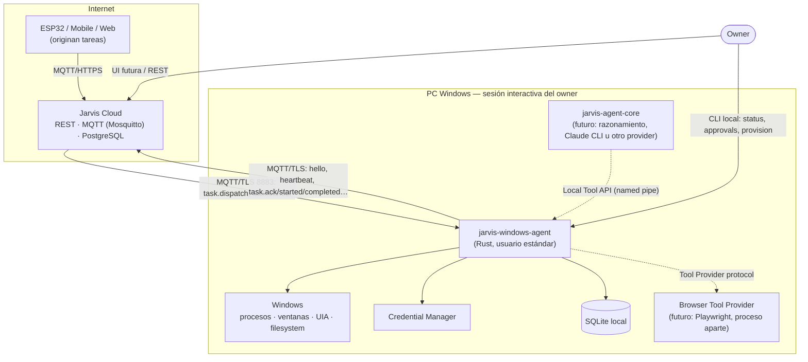

# System Context

| Elemento | Relación con el agente | Confianza |
|---|---|---|
| Jarvis Cloud | Entrega tareas y recibe estados por MQTT v1 | **Parcial**: autentica el canal, pero su contenido se valida y autoriza localmente |
| Originadores (ESP32, mobile, owner) | Aparecen como `requestedBy` en la tarea | Identidad afirmada por el Cloud (hasta firma end-to-end) |
| Windows | Único lugar donde el agente produce efectos | Aplica sus propias barreras (UAC, UIPI, ACLs) |
| Credential Manager | Almacena el secreto del device | Protegido por DPAPI con la cuenta del usuario |
| SQLite local | Idempotencia, outbox, aprobaciones | Local, mismo usuario |
| Owner local | Configura política, aprueba, diagnostica por CLI | Autoridad máxima (controla la PC) |
| Agent Core (futuro) | Invoca tools por API local | Principal local sujeto a la misma política |
| Browser provider (futuro) | Proceso separado que implementa tools de navegador | Proveedor registrado localmente |

El agente **no** conoce PostgreSQL, REST (salvo opcionalmente `device-token`), SignalR ni ningún LLM.
