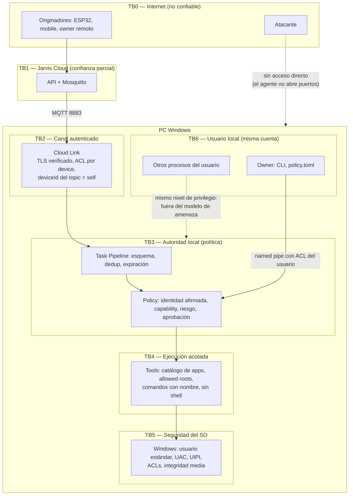

# Trust Boundaries

El modelo propuesto (Internet → Agent → Local Policy → Tools → OS) se amplía con dos fronteras que faltaban: el **boundary de identidad** (qué afirma el Cloud sobre el origen) y el **boundary del usuario local** (el owner y otros procesos en la misma cuenta).

| Frontera | Qué la cruza | Controles | Supuesto |
|---|---|---|---|
| TB0 → PC | Nada entrante | El agente **no escucha puertos de red**; solo conexiones salientes a 8883 | La PC no es alcanzable desde Internet por el agente |
| TB1 → TB2 | Mensajes MQTT `down/*` | TLS con validación de certificado y hostname; credencial por device; ACL del broker (solo `jarvis-cloud` publica en `down/#`) | El broker puede estar comprometido si el Cloud lo está |
| TB2 → TB3 | Tareas | Validación de envelope y esquema, dedup, expiración, límites de tamaño | **El contenido del Cloud es no confiable** |
| Identidad | `requestedBy` | Identidad **afirmada** por el Cloud; la política limita el auto-approve sin firma a R0–R2; firma Ed25519 en P8 | Un Cloud comprometido puede mentir sobre el origen |
| TB3 → TB4 | Invocaciones autorizadas | Decisión `APPROVED`, locks, timeouts | La política es la autoridad final |
| TB4 → TB5 | Llamadas Win32/COM | Sin shell; catálogo de apps; rutas canonicalizadas; comandos con nombre; proceso de integridad media | Windows impide lo que el usuario no puede hacer |
| TB6 → TB3 | CLI, edición de `policy.toml` | Named pipe con ACL del SID del usuario; `policy.toml` en el perfil del usuario | Quien controla la cuenta del usuario controla el agente (igual que controla la PC); fuera del modelo |

Consecuencia principal: **comprometer el Cloud solo permite pedir lo que la política local ya permite** a la identidad que el atacante afirme. Con la política por defecto eso excluye R3 sin aprobación local y todo R4. Ver [Threat Model](../04-security/threat-model.md).
