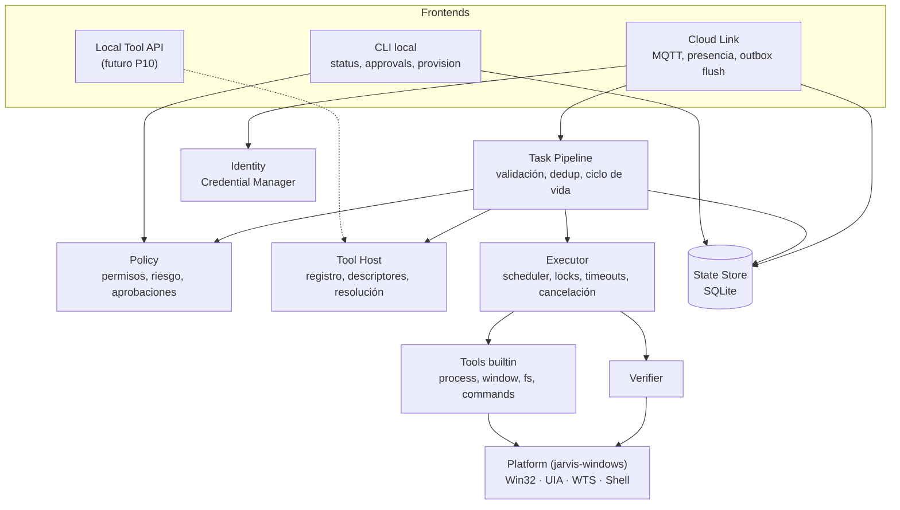

# Arquitectura del Windows Agent

## Análisis del stack

| Tecnología | Decisión | Ventajas | Problemas / riesgos | Alternativa evaluada |
|---|---|---|---|---|
| **Rust** | ✅ Runtime | Binario nativo pequeño (~5–10 MB), memoria estable sin GC, seguridad de memoria en código que toca APIs inseguras, alineado con Tauri (UI futura), sin runtime que instalar | Curva de aprendizaje; COM/UIA más verboso que en .NET; menos ejemplos de UIA | **.NET 10** (mismo stack que el Cloud, FlaUI para UIA, `Jarvis.Contracts` reutilizable). Descartado: ~60–80 MB self-contained, GC en proceso residente, sin afinidad con Tauri. Ver [ADR-001](../09-decisions/ADR-001-rust-agent-runtime.md) |
| **Tokio** | ✅ | Estándar de facto; timers, canales, cancelación cooperativa, integra con `rumqttc` | Las APIs Win32/COM son bloqueantes o requieren apartamentos COM: van en hilos dedicados (`spawn_blocking` o un hilo STA propio), nunca en el runtime | `async-std` (menor ecosistema) |
| **windows-rs** | ✅ | Bindings oficiales de Microsoft a Win32, COM y WinRT (UIA, `ApplicationActivationManager`, notificaciones) | API grande, `unsafe` en bordes → se encapsula en un crate `jarvis-windows` con API segura | `winapi` (sin mantenimiento activo) |
| **UI Automation** | ✅ (P9) | API de accesibilidad soportada por Windows; semántica (AutomationId, ControlType, Name) | Requiere sesión interactiva y apartamento STA; UIPI bloquea ventanas elevadas | Coordenadas/mouse (frágil, último recurso) |
| **Cliente MQTT: `rumqttc`** | ✅ | Rust puro, soporta MQTT 5 (`v5`) y 3.1.1, TLS con `rustls`, LWT, QoS 1, eventos de conexión explícitos | Debe manejarse el *event loop* con cuidado (poll continuo); PUBACK automático al recibir (aceptable: el agente persiste antes de `task.ack`, que es el ACK de aplicación) | `paho-mqtt` (binding C, dependencia nativa y distribución más compleja) |
| **TLS: `rustls` + `rustls-platform-verifier`** | ✅ | Valida contra el almacén de certificados de Windows (Let's Encrypt incluido), sin OpenSSL | — | `native-tls` (SChannel): viable; `rustls` da comportamiento uniforme y mejor control |
| **Serde / serde_json** | ✅ | Tipos del protocolo con `deny_unknown_fields` donde conviene y tolerancia a campos nuevos en el envelope | — | — |
| **tracing + tracing-appender** | ✅ | Logs estructurados JSON con spans (`taskId`, `executionId`) y rotación de archivos | Riesgo de loguear datos sensibles → capa de redacción y tipos `Sensitive<T>` | `log` + `env_logger` (sin spans) |
| **SQLite (`rusqlite`, feature `bundled`)** | ✅ **Obligatorio**, no opcional | Idempotencia y outbox deben sobrevivir reinicios (W5–W7 del Cloud); transacciones ACID, WAL, un archivo | Corrupción posible → estrategia de detección y *reset guard* ([Crash Recovery](../06-state/crash-recovery.md)) | JSON en disco (sin atomicidad), `sled` (sin mantenimiento), `sqlx` (async, más pesado; innecesario para un único escritor) |
| **Configuración TOML (`toml`)** | ✅ | Legible y comentable por el owner | — | JSON (sin comentarios), registro de Windows (opaco) |
| **Credential Manager** | ✅ | DPAPI por usuario, API estable (`CredWriteW`/`CredReadW`) | Accesible para cualquier proceso del mismo usuario (riesgo aceptado, ver [Credential Storage](../04-security/credential-storage.md)) | Archivo cifrado con DPAPI manual; TPM/CNG KSP (futuro con certificados) |
| **Python** | ❌ como runtime | — | Distribución, consumo, superficie | Puede existir como tool externa opcional en el futuro |

## Componentes

La lista propuesta tenía 14 componentes. Se consolidan en **9 módulos** para evitar sobrearquitectura:

| Propuesto | Decisión |
|---|---|
| Device Client + MQTT Client + Presence Manager | → **Cloud Link** (un módulo: conexión, presencia, envío/recepción) |
| Task Receiver + Task Dispatcher | → **Task Pipeline** (recepción, validación, ciclo de vida, mapeo a mensajes) |
| Tool Registry + Tool Router | → **Tool Host** (registro, resolución, descriptores; el "router" es una búsqueda por nombre) |
| Execution Engine + scheduler | → **Executor** (timeouts, cancelación, resource locks) |
| Verification Engine | → **Verifier** (se mantiene separado: es un principio de diseño) |
| Permission Engine | → **Policy** (permisos, riesgo, aprobaciones) |
| Local State | → **State Store** (SQLite) |
| Event Publisher | Absorbido por Task Pipeline + Cloud Link (los "eventos" son los mensajes `up/tasks`) |
| Credential Store | → parte de **Identity** (credencial + provisioning) |
| Windows Integration | → **Platform** (adaptadores Win32/UIA detrás de interfaces) |

Detalle de cada componente: [Component Model](component-model.md).

## Estructura de crates (workspace Cargo)

| Crate | Contenido | Depende de | Compila fuera de Windows |
|---|---|---|---|
| `jarvis-protocol` | Envelope, mensajes, topics del Cloud v1 (espejo de `Jarvis.Contracts`) | serde | ✅ |
| `jarvis-tooling` | Contrato de Tool, descriptores, `ToolResult`, errores, registro, Verifier, Executor (scheduler/locks) | protocol | ✅ |
| `jarvis-policy` | Modelo de política, evaluación, riesgo, aprobaciones | tooling | ✅ |
| `jarvis-state` | SQLite: migraciones, inbox, outbox, ejecuciones, aprobaciones | rusqlite | ✅ |
| `jarvis-windows` | Adaptadores Win32/COM/UIA/WTS/Credential Manager con API segura; implementa las interfaces de plataforma | windows-rs | ❌ (Windows) |
| `jarvis-agent` (bin) | Cloud Link, Task Pipeline, tools builtin, CLI, composición | todos | ❌ |

Motivo: todo lo que decide (protocolo, política, pipeline, estado, verificación) se prueba en CI Linux con plataformas falsas; solo `jarvis-windows` y las pruebas de integración Windows requieren un runner Windows.

## Procesos e hilos

- **Un proceso** en la sesión interactiva del usuario ([Startup Model](../05-windows/startup-model.md)).
- Runtime Tokio multihilo (2 workers) para red, pipeline y timers.
- Hilo dedicado **STA** para COM/UIA y activación de apps empaquetadas.
- Hilo dedicado para SQLite (un escritor; comandos por canal).
- Ventana oculta *message-only* para recibir `WM_WTSSESSION_CHANGE` (lock/unlock) y `WM_QUERYENDSESSION` (apagado ordenado).

## Directorios

| Ruta | Contenido |
|---|---|
| `%LOCALAPPDATA%\Programs\Jarvis\Agent\` | Binarios (instalación por usuario) |
| `%LOCALAPPDATA%\Jarvis\Agent\config.toml` | Configuración no sensible |
| `%LOCALAPPDATA%\Jarvis\Agent\policy.toml` | Política local |
| `%LOCALAPPDATA%\Jarvis\Agent\state\agent.db` | SQLite |
| `%LOCALAPPDATA%\Jarvis\Agent\logs\` | Logs JSON rotados |
| Credential Manager: `Jarvis/WindowsAgent/<deviceId>` | Secreto del device |

Ver [Local Configuration](../06-state/local-state.md#configuración-local).
