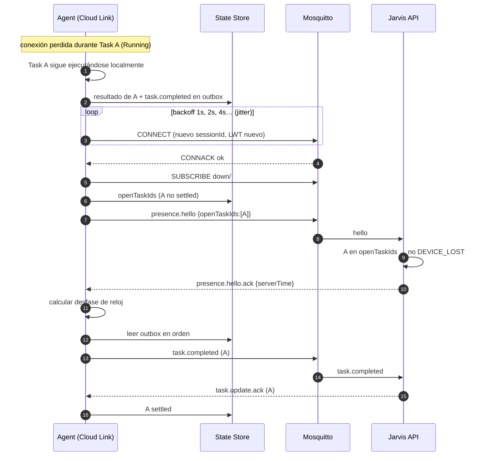

# Reconnection & Offline Behavior

## Backoff

Exponencial con jitter ±20 %: 1 s, 2 s, 4 s … máximo 60 s. Se reinicia tras un hello.ack exitoso. Eventos que disparan reconexión: pérdida de TCP, keepalive vencido, `DISCONNECT` del broker, reanudación tras suspensión (se fuerza reconexión inmediata al recibir `PBT_APMRESUMEAUTOMATIC`), cambio de red.

## Autenticación rechazada

`CONNACK` *Bad username or password* / *Not authorized* significa credencial revocada, rotada o device deshabilitado:

1. Estado de health `AUTH_REJECTED` (visible en `jarvis-agent status`).
2. Backoff fijo de **5 minutos** (evita martillar el broker y el lockout).
3. Log `WARN` una vez por hora (no en cada intento).
4. Las tareas pendientes en outbox se conservan; se publicarán si la credencial vuelve a ser válida.
5. Recuperación: el owner ejecuta `jarvis-agent provision` con el nuevo secreto; el agente reconecta de inmediato (el CLI lo notifica por el named pipe).

## Secuencia de reconexión

## Comportamiento offline

| Situación | Comportamiento |
|---|---|
| Cloud/broker caído o sin Internet | Tareas ya aceptadas **siguen ejecutándose**; resultados al outbox; nada se pierde |
| Tareas nuevas | No llegan (el Cloud las mantiene `Pending` y las despacha al reconectar) |
| `task.cancel` perdido | El Cloud lo reenvía cada 60 s mientras siga pendiente |
| Aprobación pendiente | Sigue pendiente localmente hasta su expiración |
| Reinicio de la PC | Al arrancar: recuperación ([Crash Recovery](../06-state/crash-recovery.md)) y luego reconexión con `openTaskIds` |

## Reloj

- En cada `hello.ack`: `offset = serverTime − horaLocalAlRecibir` (compensando la mitad del RTT del hello).
- `nowCorregido = horaLocal + offset` se usa para `expiresAt` y para decidir expiración de aprobaciones.
- `|offset| > 5 min` → health `CLOCK_SKEW` (`WARN`) y aviso en `status`; se sigue operando con la hora corregida.
- Sin `hello.ack` todavía (arranque offline) se usa la hora local; ninguna tarea nueva llega sin conexión, así que el riesgo se limita a la expiración de aprobaciones locales.
