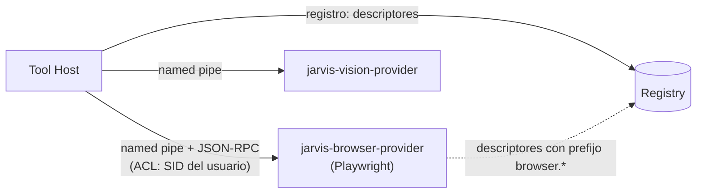

# Tool Registry

## Responsabilidad

El **Tool Host** mantiene el registro de tools disponibles y resuelve una invocación (`TaskType` o nombre de tool) a una implementación. Es la única fuente para `supportedTaskTypes` del `presence.hello` y para `jarvis-agent tools list`.

## Registro

| Aspecto | Decisión MVP | Futuro |
|---|---|---|
| Origen de tools | **Builtin**, compiladas en el binario (`jarvis-tooling` + implementaciones en `jarvis-agent`) | Providers externos por IPC (navegador, visión) |
| Momento | Al arrancar; el registro es inmutable durante la vida del proceso | Recarga de providers sin reiniciar |
| Habilitación | `config.toml` → `[tools] enabled = [...]`. Una tool no habilitada no se anuncia ni se ejecuta (`UNSUPPORTED_TASK_TYPE`) | Igual |
| Plugins dinámicos (DLL) | **No**. Cargar DLLs arbitrarias en el proceso del agente es inaceptable (mismo token, misma memoria) | Solo providers fuera de proceso, firmados y declarados |
| Validación al arrancar | Cada descriptor se valida: nombre único, `maxMs` definido, esquemas compilables, `verification.mode` coherente con el riesgo (R2+ ⇒ `required`) | Igual, también para providers |

Si un descriptor es inválido el agente **no arranca** (fallo en tiempo de desarrollo, no en producción).

## Mapeo TaskType ↔ tool

Regla ([ADR-015](../09-decisions/ADR-015-task-type-tool-mapping.md)): `tool = lower(TaskType)`, 1:1. Excepciones como **alias** explícitos:

| TaskType | Tool | Input resultante | Motivo |
|---|---|---|---|
| `OPEN_CHROME` | `open_app` | `{ "appId": "chrome" }` (el `url` opcional del contrato del Cloud se ignora: `open_app` no acepta URLs en MVP) | Compatibilidad con el catálogo inicial del Cloud ([C3](../00-overview/cloud-compatibility.md)) |

Los alias no tienen permisos propios: se evalúan los de la tool destino.

Un TaskType desconocido o de una tool deshabilitada → `task.rejected UNSUPPORTED_TASK_TYPE`.

## Catálogo de aplicaciones (`appId`)

Las tools de procesos no aceptan rutas de ejecutables desde el Cloud. Reciben un `appId` que se resuelve contra un catálogo local:

```toml
# policy.toml (ejemplo)
[apps.chrome]
display_name = "Google Chrome"
launch = { kind = "app_paths", name = "chrome.exe" }     # HKLM/HKCU\...\App Paths
process_names = ["chrome.exe"]
window_class_hint = "Chrome_WidgetWin_1"

[apps.notepad]
display_name = "Notepad"
launch = { kind = "aumid", id = "Microsoft.WindowsNotepad_8wekyb3d8bbwe!App" }
process_names = ["Notepad.exe"]

[apps.spotify]
display_name = "Spotify"
launch = { kind = "path", path = "%APPDATA%\\Spotify\\Spotify.exe" }
process_names = ["Spotify.exe"]
```

| `launch.kind` | Resolución | Notas |
|---|---|---|
| `app_paths` | Registro `App Paths` (HKCU primero, luego HKLM) | Preferido para apps Win32 instaladas |
| `aumid` | `IApplicationActivationManager::ActivateApplication` | Apps empaquetadas (MSIX/Store) |
| `path` | Ruta absoluta con variables de entorno expandidas; debe existir y no estar en una carpeta escribible por otros usuarios | Último recurso |

El catálogo viene con entradas por defecto (`chrome`, `edge`, `notepad`, `explorer`, `calculator`) y el owner lo extiende localmente. El Cloud **no** puede añadir entradas ([ADR-004](../09-decisions/ADR-004-local-permission-authority.md)).

## Providers externos (futuro)



- Un provider declara sus tools con el **mismo contrato**; el Tool Host aplica política, locks, timeouts y verificación exactamente igual.
- El provider no recibe credenciales del Cloud ni acceso al State Store.
- Si un provider cae, sus tools se marcan no disponibles y las ejecuciones en curso fallan con `EXECUTION_FAILED` (`provider_unavailable`).
- Ver [Browser Automation](../08-future/browser-automation.md) y [ADR-013](../09-decisions/ADR-013-browser-automation-boundary.md).

## Versionado

- `toolVersion` en cada `ToolResult`.
- Cambios compatibles (nuevos campos opcionales de output) → minor.
- Cambios incompatibles de input → nueva versión mayor; mientras el Cloud no negocie versiones de tool, se mantiene compatibilidad hacia atrás del input o se crea un TaskType nuevo.
