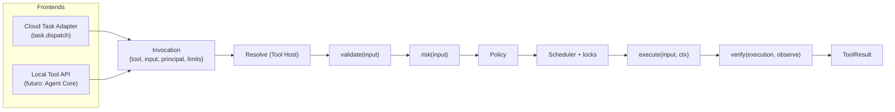

# Tool System

## Por qué tools

Toda capacidad del agente es una **Tool** con contrato explícito. Nada produce efectos en Windows fuera de una tool. Esto da:

1. **Una sola superficie de seguridad**: la política razona sobre tools, riesgo y permisos declarados, no sobre código arbitrario.
2. **Reutilización**: la misma tool sirve a una tarea remota del Cloud y, en el futuro, a una llamada del Agent Core (el LLM ve los mismos descriptores JSON Schema).
3. **Verificación obligatoria**: el contrato exige declarar cómo se comprueba el éxito.
4. **Extensibilidad**: providers externos (navegador, visión) implementan el mismo contrato en otro proceso.

## Flujo de una invocación

El frontend solo traduce su formato de entrada a una **Invocation** y el `ToolResult` a su formato de salida. Todo lo demás es común ([ADR-014](../09-decisions/ADR-014-agent-core-boundary.md)).

## Catálogo

| Tool | TaskType | Riesgo | Permiso | Recursos | Verificación | Fase |
|---|---|---|---|---|---|---|
| `is_app_running` | `IS_APP_RUNNING` | R0 | `windows.apps.read` | — | `NOT_APPLICABLE` (la observación es el resultado) | MVP |
| `list_running_apps` | `LIST_RUNNING_APPS` | R0 | `windows.apps.read` | — | `NOT_APPLICABLE` | MVP |
| `get_active_window` | `GET_ACTIVE_WINDOW` | R1 | `windows.window.read` (+ `windows.window.title` para el título) | — | `NOT_APPLICABLE` | MVP |
| `open_app` | `OPEN_APP` (+ alias `OPEN_CHROME`) | R2 | `windows.apps.open` | `APP:<appId>` | Proceso vivo + ventana visible | MVP |
| `close_app` | `CLOSE_APP` | R2 / R3 con `force` | `windows.apps.close` (+ `windows.apps.close.force`) | `APP:<appId>` | Ningún proceso de la app vivo | MVP |
| `focus_window` | `FOCUS_WINDOW` | R2 | `windows.window.focus` | `DESKTOP_INPUT` | La ventana es la de primer plano | P7 |
| `list_directory` | `LIST_DIRECTORY` | R1 | `filesystem.list` | `FS:<ruta>` (lectura) | `NOT_APPLICABLE` | P7 |
| `read_file` | `READ_FILE` | R1 | `filesystem.read` | `FS:<ruta>` (lectura) | `NOT_APPLICABLE` | P7 |
| `run_command` | `RUN_COMMAND` | R3 (o el que declare cada comando) | `commands.run` + `commands.run:<commandId>` | `COMMAND:<id>` | Código de salida esperado del comando | P7 |
| `show_notification` | `SHOW_NOTIFICATION` | R1 | `windows.notify` | — | La API acepta mostrarlo; sin verificación aparte ([ADR-017](../09-decisions/ADR-017-notification-mechanism.md)) | P7 |
| `write_file`, `create_file`, `move_file` | — | R3 | `filesystem.write` | `FS:<ruta>` (escritura) | Contenido/hash observado | Futuro |
| `delete_file` | — | R4 | `filesystem.delete` | `FS:<ruta>` (escritura) | La ruta ya no existe | Futuro |
| `find_window` | `FIND_WINDOW` | R1 | `windows.ui.read` | — | `NOT_APPLICABLE` | P9 |
| `find_element` | `FIND_ELEMENT` | R1 | `windows.ui.read` | — | `NOT_APPLICABLE` (error si el selector encaja con varios) | P9 |
| `get_text` | `GET_TEXT` | R1 (sensible) | `windows.ui.read` | — | `NOT_APPLICABLE` | P9 |
| `invoke_element` | `INVOKE_ELEMENT` | R2 / R3 si la acción parece destructiva | `windows.ui.act` | `DESKTOP_INPUT` | Cambio observable (estado del elemento, desaparición o ventana nueva) | P9 |
| `set_text` | `SET_TEXT` | R2 / R3 si la acción parece destructiva | `windows.ui.act` | `DESKTOP_INPUT` | `ValuePattern.Value` igual al texto pedido | P9 |

**No existe** `shell.execute` ni ninguna tool que reciba una línea de comandos libre ([ADR-008](../09-decisions/ADR-008-restricted-command-execution.md)).

## Documentos

- [Tool Contract](tool-contract.md) — campos obligatorios, `ToolResult`, errores.
- [Tool Registry](tool-registry.md) — registro, mapeo TaskType, providers.
- [Process Tools](process-tools.md) — MVP.
- [Filesystem Tools](filesystem-tools.md) — P7.
- [Command Execution](command-execution.md) — P7.
- [Verification](verification.md) — principio y motor.
