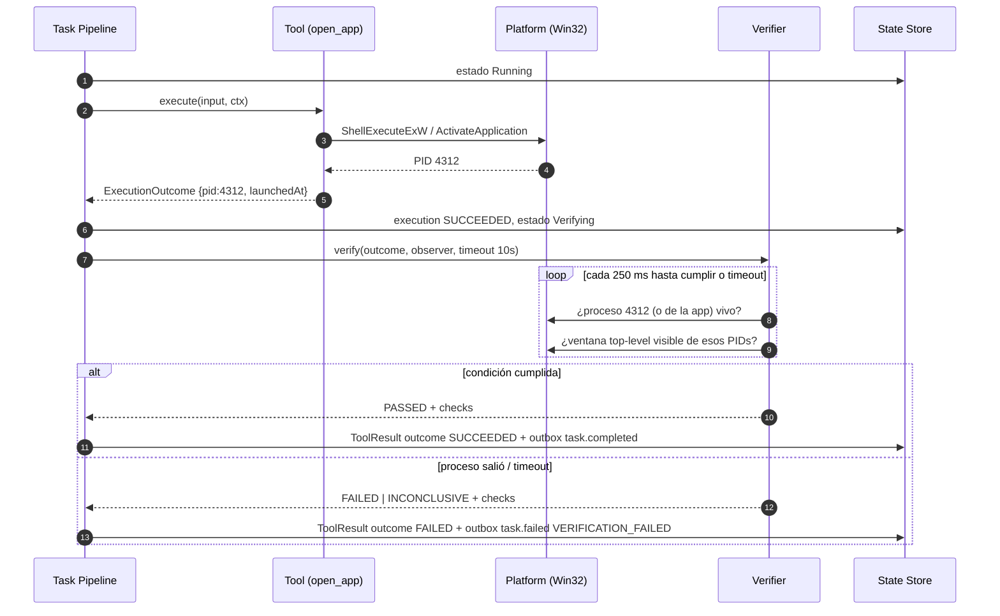

# Verification Engine

## Principio

> **Jarvis no considera una tarea completada porque la ejecución no produjo una excepción. Una acción se considera completada únicamente cuando el resultado observable satisface la condición de éxito definida por la Tool.**

Ver [ADR-007](../09-decisions/ADR-007-execution-vs-verification.md).

## Por qué

En Windows, "la API devolvió éxito" no significa que ocurrió lo que el usuario quería:

| Acción | La API dice | La realidad puede ser |
|---|---|---|
| `ShellExecuteExW` de una app | Éxito, PID devuelto | El proceso sale al instante (licencia, perfil corrupto, instancia única que reenvía a otra y termina) |
| `WM_CLOSE` a una ventana | `PostMessage` OK | La app muestra "¿Guardar cambios?" y sigue abierta |
| `SetForegroundWindow` | `TRUE` | Windows solo hace parpadear la barra de tareas (foreground lock) |
| `TerminateProcess` | OK | El proceso es relanzado por un watchdog/updater |
| Comando | Termina sin excepción | Código de salida 1, o escribió "error" y salió con 0 |

Reportar `Completed` en esos casos engaña al usuario y, en el futuro, al Agent Core, que planificaría sobre un estado falso.

## Separación de estados

| | Ejecución | Verificación | Resultado (`outcome`) |
|---|---|---|---|
| 1 | `SUCCEEDED` | `PASSED` | `SUCCEEDED` → `task.completed` |
| 2 | `SUCCEEDED` | `NOT_APPLICABLE` (tool de observación) | `SUCCEEDED` → `task.completed` |
| 3 | `SUCCEEDED` | `FAILED` | `FAILED` → `task.failed VERIFICATION_FAILED` |
| 4 | `SUCCEEDED` | `INCONCLUSIVE` | `FAILED` → `task.failed VERIFICATION_INCONCLUSIVE` |
| 5 | `FAILED` / `TIMED_OUT` | `SKIPPED` | `FAILED` → `task.failed <código de ejecución>` |
| 6 | `CANCELLED` | `SKIPPED` | `CANCELLED` → `task.cancelled` |

`INCONCLUSIVE` nunca se trata como éxito: si no se puede observar, no se afirma.

## Motor

- La verificación es una **fase separada** del pipeline (estado local `Verifying`), con su propio timeout dentro del timeout efectivo de la tarea.
- Recibe el `ExecutionOutcome` (PID lanzado, instante, ventanas señaladas) y un **Observer** de solo lectura (enumeración de procesos, ventanas, filesystem).
- Estrategia por defecto: **sondeo** (`pollIntervalMs`, por defecto 250 ms) hasta cumplir o agotar `timeoutMs`. En el futuro, eventos (`WinEvent` hooks, UIA events) para reducir latencia.
- Cada condición evaluada se registra como `check { name, passed, observed }` sin datos sensibles.
- Una verificación no reintenta la acción. El reintento es decisión del solicitante (`retryable: true` en el error).

## Métodos

| Método | Tools | Condición |
|---|---|---|
| `process_and_window` | `open_app` | Proceso de la app vivo **y** ventana top-level visible, no cloaked |
| `process_absent` | `close_app` | Ningún proceso de la app en la sesión |
| `foreground_is` | `focus_window` | `GetForegroundWindow()` pertenece al proceso/ventana objetivo |
| `exit_code_expected` | `run_command` | Código de salida en `expected_exit_codes` |
| `file_hash` | `write_file` (futuro) | Hash del archivo = hash del contenido enviado |
| `path_absent` | `delete_file` (futuro) | La ruta no existe |
| `uia_state` | UIA (P9) | Propiedad del elemento (valor, estado toggle, existencia) tras la acción |
| `none` | tools R0/R1 de observación | `NOT_APPLICABLE` |

## Secuencia

## Riesgos y trade-offs

| Riesgo | Mitigación |
|---|---|
| Falsos negativos (app lenta en crear ventana) | `timeoutMs` por entrada del catálogo; `retryable: true` |
| Falsos positivos (otra instancia previa de la app cumple la condición) | Preferir el PID lanzado; para instancia única exigir proceso creado después de `launchedAt` o ventana nueva |
| Coste del sondeo | Intervalo 250 ms, límite de verificaciones concurrentes = concurrencia de tareas |
| Verificación imposible (sesión bloqueada) | `INCONCLUSIVE` → fallo, nunca éxito |
