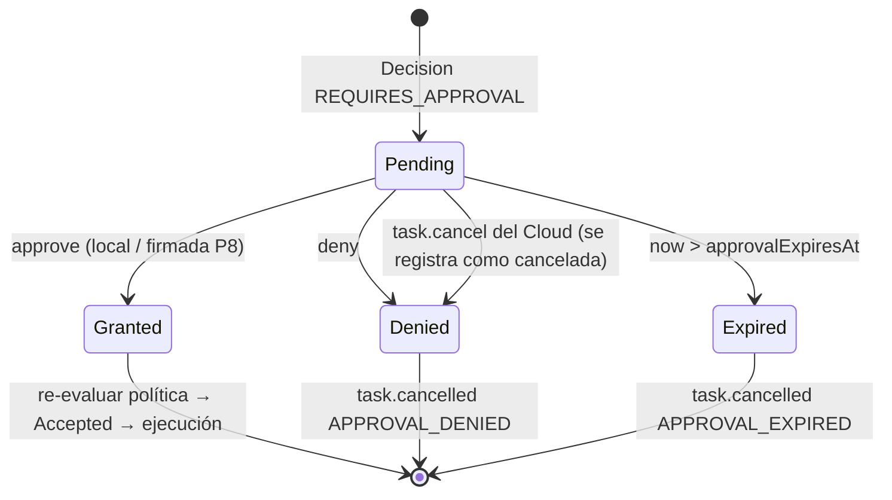

# Approvals

## Qué es

Una **Approval** es el registro local que permite ejecutar una tarea cuya decisión fue `REQUIRES_APPROVAL`. Estados: `Pending` → `Granted` | `Denied` | `Expired`.

## MVP: aprobación solo local

El Cloud v1 no tiene mensaje para transportar una decisión de aprobación ([C8](../00-overview/cloud-compatibility.md)). En el MVP:

- La decisión se toma **en la PC**, con la CLI: `jarvis-agent approvals list`, `approve <taskId>`, `deny <taskId>`.
- La CLI habla con el agente por el named pipe `\\.\pipe\jarvis-agent-<SID>` con ACL del usuario; principal `local:owner`.
- Opcional en MVP (EPIC-11): notificación toast "Jarvis quiere cerrar forzosamente Spotify — aprobar con `jarvis-agent approvals approve …`". Sin botones de acción hasta tener UI firmada (evita que otra app suplante la notificación para inducir clics).

Por qué no aceptar aprobaciones remotas sin firma: si el Cloud pudiera aprobar, un Cloud comprometido se aprobaría a sí mismo y R3 sería equivalente a R2.

## Aprobación remota firmada (implementada de extremo a extremo)

Mensaje `down/tasks` `task.approval_decision`, que el Cloud ya emite desde `POST /api/v1/tasks/{id}/approval` (HU-057). Reglas que aplica el agente: firma Ed25519 de una clave declarada en `[signatures] approver_keys`, decisión atada al **hash canónico del payload de esa tarea** (el mismo que publica el Cloud en sus [vectores](../../../api/docs/03-protocols/signature-vectors.json), para que el aprobador pueda reproducirlo), ventana de frescura de 5 minutos y `nonce` de un solo uso (una decisión capturada no se puede reenviar).

```json
{
  "type": "task.approval_decision",
  "data": {
    "taskId": "…",
    "decision": "GRANTED",
    "decidedBy": { "type": "User", "id": "…" },
    "decidedAt": "…",
    "nonce": "…",
    "signature": { "alg": "Ed25519", "keyId": "owner-phone-1", "value": "…" }
  }
}
```

- La firma la produce el **dispositivo del owner** (clave en el móvil/Owner Console con WebAuthn o clave local), no el Cloud. El agente conoce las claves públicas por provisión local.
- Firma sobre `taskId`, `decision`, hash del payload original, `nonce`, `decidedAt`: impide reutilizar la aprobación para otra tarea o con otro input.
- Sin firma válida → se ignora (log `WARN`), la aprobación sigue `Pending`.

## Ciclo de vida



| Regla | Detalle |
|---|---|
| Expiración | `approvalExpiresAt = min(task.expiresAt, now + approval_ttl_seconds)` (default 300 s) con reloj corregido |
| Re-evaluación | Al conceder, la política se evalúa otra vez (pudo cambiar). Si ahora es `DENIED` → `task.cancelled LOCAL_POLICY` |
| Vínculo con el input | La aprobación cubre **exactamente** ese `taskId` con ese payload (hash guardado). No hay aprobaciones genéricas ni "recordar mi decisión" en MVP |
| Persistencia | Tabla `approvals` en SQLite; sobrevive reinicios. Tras reiniciar, las `Pending` vencidas pasan a `Expired` |
| Tiempo de ejecución | El timeout efectivo empieza a contar al iniciar la ejecución, no al crear la aprobación |
| Cancelación | `task.cancel` sobre una tarea `AwaitingApproval` → `task.cancelled USER_REQUEST` |

## Estados en el Cloud

| Local | Mensaje | Cloud |
|---|---|---|
| Approval `Pending` | `task.ack` + `task.approval_required { reason }` | `WaitingForApproval` |
| `Granted` | `task.started` | `Running` |
| `Denied` | `task.cancelled APPROVAL_DENIED` | `Cancelled` |
| `Expired` | `task.cancelled APPROVAL_EXPIRED` ([C9](../00-overview/cloud-compatibility.md)) | `Cancelled` |

## Riesgos

| Riesgo | Mitigación |
|---|---|
| Fatiga de aprobaciones (aprobar todo sin leer) | Solo R3 pide aprobación; la CLI muestra tool, input resumido, riesgo y solicitante |
| Suplantación de la UI de aprobación | CLI por named pipe con ACL; sin botones en toast hasta tener UI firmada |
| Aprobación reutilizada (replay) | Vinculada a `taskId` + hash del payload; un `taskId` se ejecuta como máximo una vez |
