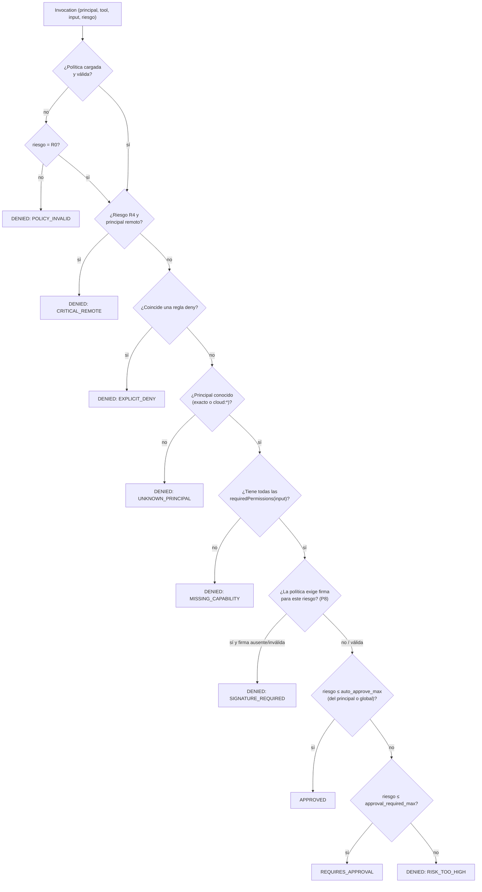

# Permission Engine

## Rol

Autoridad final sobre **qué se ejecuta** en la PC ([ADR-004](../09-decisions/ADR-004-local-permission-authority.md)). Evalúa `(principal, tool, input normalizado, riesgoEfectivo)` y devuelve una **Decision**:

| Decision | Significado | Efecto en el pipeline |
|---|---|---|
| `APPROVED` | Puede ejecutarse ya | `task.ack` → scheduling |
| `REQUIRES_APPROVAL` | Permitido solo con aprobación humana | `task.ack` + `task.approval_required` → [Approvals](approvals.md) |
| `DENIED` | No se ejecuta | `task.rejected NOT_PERMITTED` |

Cada decisión incluye `reason` (código + texto corto) y se persiste en el State Store con la regla que la produjo.

## Principals

| Principal | Origen | Confianza |
|---|---|---|
| `cloud:user:<userId>` | `requestedBy { type: "User" }` del Cloud | **Afirmada** por el Cloud (no verificable en v1) |
| `cloud:device:<deviceId>` | `requestedBy { type: "Device" }` (p. ej. el ESP32) | Afirmada |
| `cloud:*` | Comodín para cualquier solicitante remoto | Afirmada |
| `local:owner` | CLI local por named pipe con el SID del usuario | Alta (misma cuenta) |
| `local:agent-core` | Futura API local de tools ([Agent Core](../08-future/agent-core-integration.md)) | Media: sus decisiones vienen de un LLM |

Mientras el Cloud no firme (`signature = null`, [C10](../00-overview/cloud-compatibility.md)), `requestedBy` es una **identidad afirmada**: un Cloud comprometido puede afirmar cualquier principal. Por eso la política por defecto no concede a ningún principal remoto más de lo que es aceptable conceder al propio Cloud, y R3+ nunca se autoaprueba remotamente.

## Política (`policy.toml`)

```toml
version = 1

[risk]
auto_approve_max = "R2"
approval_required_max = "R3"
approval_ttl_seconds = 300

[[principals]]
id = "cloud:user:0192a6f0-0000-7aaa-8bbb-00000000000a"   # el owner vía Owner Console
capabilities = ["windows.apps.read", "windows.window.read", "windows.apps.open", "windows.apps.close", "windows.apps.close.force"]

[[principals]]
id = "cloud:device:0192a6f0-1111-7aaa-8bbb-000000000001"  # botón ESP32
capabilities = ["windows.apps.read", "windows.apps.open"]
auto_approve_max = "R2"

[[principals]]
id = "cloud:*"
capabilities = ["windows.apps.read"]

[[deny]]
principal = "cloud:*"
tool = "close_app"
when = { appId = "vscode" }       # nunca cerrar el editor remotamente
```

Reglas del archivo:
- Vive en `%LOCALAPPDATA%\Jarvis\Agent\policy.toml`, ACL solo del usuario. El Cloud **no** puede leerlo ni modificarlo; no existe mensaje de protocolo que lo cambie.
- Se valida al arrancar y al recargar (`FileSystemWatcher` equivalente con `ReadDirectoryChangesW`, o `jarvis-agent policy reload`). Inválido → se conserva la última política válida; si no hay ninguna, modo **fail-closed** (solo R0) y health `POLICY_INVALID`.
- Sin archivo → política por defecto: solo `local:owner`, ningún principal remoto. Es decir, un agente recién instalado **no obedece al Cloud** hasta que el owner lo decide (`jarvis-agent provision` ofrece crear la regla del owner).

## Capabilities

| Capability | Concede |
|---|---|
| `windows.apps.read` | `is_app_running`, `list_running_apps` |
| `windows.window.read` | `get_active_window` sin título |
| `windows.window.title` | Título de la ventana activa (redactado según reglas) |
| `windows.window.focus` | `focus_window` |
| `windows.apps.open` | `open_app` |
| `windows.apps.close` | `close_app` graceful |
| `windows.apps.close.force` | `close_app force=true` |
| `windows.notify` | `show_notification` |
| `filesystem.list` / `filesystem.read` | `list_directory` / `read_file` (además de allowed roots) |
| `filesystem.write` | Futuro |
| `commands.run` + `commands.run:<commandId>` | `run_command` de ese comando |
| `windows.ui.read` / `windows.ui.act` | UIA (P9) |

No existe `shell.execute`, ni comodines de capability (`windows.*`) en v1: conceder todo debe ser explícito, capability por capability.

## Algoritmo de evaluación



Propiedades:
- **Deny wins**: una regla `deny` gana a cualquier concesión.
- **Resolución de principal**: regla exacta primero; si no existe, `cloud:*`. Las capabilities **no** se suman entre la regla exacta y el comodín (evita sorpresas).
- **Determinista y puro**: mismo input → misma decisión; sin IO salvo leer la política en memoria. Testeable con tablas.
- **Explicable**: `jarvis-agent policy check --principal cloud:device:… --tool close_app --input '{"appId":"chrome","force":true}'` muestra la decisión y la regla.

## Cambios de política con tareas en curso

| Estado de la tarea | Efecto de una nueva política |
|---|---|
| `AwaitingApproval`, `Accepted` (en cola) | Se **re-evalúa** antes de ejecutar; si ahora es `DENIED` → `task.cancelled LOCAL_POLICY` |
| `Running`, `Verifying` | No se interrumpe (la decisión ya se tomó); queda registrado |

## Mensajes al Cloud

`task.rejected NOT_PERMITTED` con `message` que nombra la capability o el motivo (`missing capability windows.apps.close`, `risk R4 is never allowed remotely`) pero **no** revela la política completa ni otras reglas.
