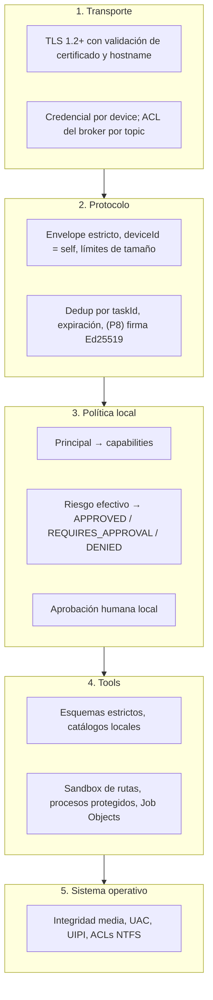

# Security Architecture

## Premisa

El agente corre con la cuenta del usuario en su PC personal y recibe órdenes desde Internet. Es, por definición, un **canal de control remoto**. La arquitectura parte de asumir que cualquier eslabón remoto puede fallar:

- El Cloud puede estar comprometido (RCE en la API, credencial de admin robada, base de datos manipulada).
- Una cuenta de usuario del Cloud o un device originador (ESP32, móvil) puede estar comprometido.
- La red puede estar controlada por un atacante (Wi-Fi pública).

Objetivo: que **ninguno** de esos compromisos permita más de lo que el owner ya autorizó localmente, y que lo autorizado por defecto sea de bajo impacto.

## Principios

| # | Principio | Cómo se aplica |
|---|---|---|
| S1 | **El Cloud solicita, el agente decide** | Permission Engine local, `policy.toml` fuera del alcance del Cloud ([ADR-004](../09-decisions/ADR-004-local-permission-authority.md)) |
| S2 | **Deny by default** | Sin regla que conceda → `DENIED`. Tools deshabilitadas no se anuncian |
| S3 | **Sin ejecución de texto remoto** | Catálogo de apps por `appId`, comandos con nombre, sin shell ([ADR-008](../09-decisions/ADR-008-restricted-command-execution.md)) |
| S4 | **Mínimo privilegio** | Usuario estándar, integridad media, nunca admin permanente ([Privilege Model](privilege-model.md)) |
| S5 | **Sin superficie de red entrante** | Solo conexión saliente MQTT/TLS a 8883; ningún puerto en escucha |
| S6 | **Secretos fuera de archivos** | Credential Manager (DPAPI) ([Credential Storage](credential-storage.md)) |
| S7 | **Riesgo explícito** | Cada invocación tiene riesgo efectivo R0–R4; umbrales de aprobación ([Risk Model](risk-model.md)) |
| S8 | **Humano en el bucle para lo impactante** | R3 requiere aprobación; R4 nunca remoto ([Approvals](approvals.md)) |
| S9 | **Privacidad por diseño** | Títulos redactados, presencia sin hostname/IP, redacción post-settle, logs sin contenido |
| S10 | **Verificable y auditable** | Cada decisión y ejecución queda en el State Store con motivo; logs estructurados |
| S11 | **Fallar cerrado** | Política inválida → el agente solo ejecuta R0 y lo reporta en health (`POLICY_INVALID`) |

## Capas de defensa

Cada capa asume que la anterior puede fallar. Aunque el broker entregara un mensaje de otro device (fallo de ACL), la capa 2 lo descarta por `deviceId`; aunque el Cloud afirme un `requestedBy` falso, la capa 3 limita lo autoaprobable; aunque una tool tuviera un bug de validación, la capa 5 impide tocar procesos elevados o archivos de otros usuarios.

## Fuera del modelo

| Escenario | Por qué queda fuera | Mitigación parcial |
|---|---|---|
| Malware con la cuenta del usuario | Tiene el mismo privilegio que el agente: puede leer su BD, usar la CLI, editar `policy.toml` o leer la credencial | Named pipe con ACL del SID, logs; la defensa real es el antivirus/EDR |
| Administrador local malicioso | Controla la máquina | — |
| Acceso físico con sesión desbloqueada | Equivale al usuario | Bloqueo de sesión; `SESSION_UNAVAILABLE` para tools interactivas |

## Documentos

- [Threat Model](threat-model.md): 14 amenazas con mitigación y riesgo residual.
- [Permission Engine](permission-engine.md) · [Risk Model](risk-model.md) · [Approvals](approvals.md)
- [Credential Storage](credential-storage.md) · [Privilege Model](privilege-model.md)
- [Trust Boundaries](../01-architecture/trust-boundaries.md)
- [Security Tests](../11-testing/security-tests.md)
