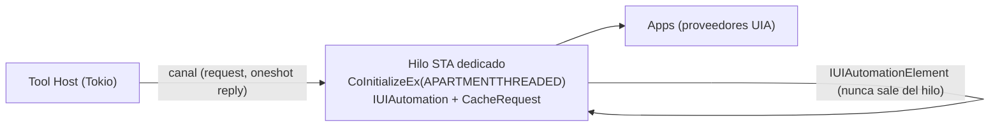

# Windows UI Automation (P9, implementado)

Implementado en EPIC-15. Decisión en [ADR-012](../09-decisions/ADR-012-ui-automation-strategy.md); estado por historia en [Estado de implementación](../10-backlog/implementation-status.md).

| Pieza | Dónde |
|---|---|
| Host STA con `IUIAutomation` | `crates/jarvis-windows/src/uia.rs` |
| Tools (`find_window`, `find_element`, `get_text`, `invoke_element`, `set_text`) | `crates/jarvis-agent/src/tools/ui_automation.rs` |
| Contrato de selectores y elementos | `crates/jarvis-tooling/src/platform.rs` (`UiSelector`, `UiElement`) |

Las cinco tools están **deshabilitadas por defecto**: el owner las añade a `[tools] enabled` y concede `windows.ui.read` / `windows.ui.act` en `policy.toml`.

## Por qué UIA

UI Automation expone la UI como un **árbol de elementos con semántica** (tipo, nombre, id, estado, patrones de interacción), el mismo que usan los lectores de pantalla. Permite actuar y **verificar** sin coordenadas.

```text
Window "Untitled - Notepad"           ControlType=Window
 ├── MenuBar                          ControlType=MenuBar
 │    └── MenuItem "File"             ControlType=MenuItem  (ExpandCollapsePattern)
 ├── Document                         ControlType=Document, AutomationId=RichEditD2DPT  (ValuePattern / TextPattern)
 ├── Button "Save"                    ControlType=Button, AutomationId=SaveButton  (InvokePattern)
 └── List "Tabs"                      ControlType=List  (SelectionPattern)
```

## Selectores

Orden de preferencia (el primero disponible y único gana):

1. `AutomationId` (estable entre idiomas y versiones, si el desarrollador lo definió)
2. `ControlType` + `Name`
3. `ControlType` + `ClassName`
4. Ruta estructural (`Window > Pane[2] > Button`), frágil, con advertencia
5. **Nunca** coordenadas

```json
{
  "window": { "appId": "notepad", "titleContains": null },
  "element": { "automationId": "SaveButton", "controlType": "Button" },
  "scope": "descendants",
  "timeoutMs": 3000
}
```

Un selector que coincide con **más de un** elemento es un error (`ELEMENT_AMBIGUOUS`), no se elige el primero.

## Tools previstas

| Tool | Riesgo | Lock | Patrón UIA | Verificación |
|---|---|---|---|---|
| `find_window` | R1 | — | — | `NOT_APPLICABLE` |
| `focus_window` | R2 | `DESKTOP_INPUT` | `SetFocus` / `SetForegroundWindow` | `foreground_is` |
| `find_element` | R1 | — | — | `NOT_APPLICABLE` |
| `get_text` | R1 (sensible) | — | `ValuePattern` / `TextPattern` / `Name` | `NOT_APPLICABLE` |
| `invoke_element` / `click_element` | R2 (R3 si el elemento está en una lista de acciones destructivas: "Delete", "Send", "Pay") | `DESKTOP_INPUT` | `InvokePattern`, `TogglePattern`, `SelectionItemPattern`, `ExpandCollapsePattern` | Cambio observable del estado (toggle, selección, ventana nueva, elemento desaparece) |
| `set_text` | R2 / R3 | `DESKTOP_INPUT` | `ValuePattern.SetValue` | `ValuePattern.Value == texto` |

`click_element` **no** hace clic con el mouse: usa el patrón adecuado. Solo si el elemento no tiene patrón y la política lo permite, P12 recurre a `SendInput` sobre el `BoundingRectangle` (R3).

## Arquitectura



- Los objetos COM de UIA son de apartamento: viven y mueren en un único hilo STA. El resto del agente solo recibe DTOs (`ElementRef { runtimeId, automationId, controlType, name, bounds }`).
- `CacheRequest` para traer propiedades en lote (UIA cruza procesos: cada propiedad sin cache es una llamada IPC).
- Timeouts por llamada: una app colgada bloquea las llamadas UIA a ella. `UIA_TransactionTimeout`/`ConnectionTimeout` + timeout propio; si el hilo STA queda bloqueado, se recrea y la tool falla con `TOOL_TIMEOUT`.
- Eventos UIA (`StructureChanged`, `PropertyChanged`) en el futuro para verificar sin sondeo.

## Diferencias con el diseño original

| Tema | Qué se implementó |
|---|---|
| Ruta estructural (`Window > Pane[2] > Button`) | **No** se acepta: era el selector más frágil y no había forma honesta de verificarlo. Quedan `automationId`, `controlType`, `name` y `className` |
| `find_element` | Devuelve **un** elemento: si el selector encaja con varios es `ELEMENT_AMBIGUOUS`, nunca se elige el primero |
| Verificación de `invoke_element` | `observable_change`: cambia el estado del elemento (valor, marcado, selección), desaparece, o cambia el número de ventanas. Si no cambia nada, la tarea termina en `VERIFICATION_FAILED` aunque el patrón haya aceptado la acción |
| Acciones destructivas | El riesgo sube a R3 cuando el nombre o el `automationId` contienen palabras como *delete*, *eliminar*, *send*, *pay* o *transfer* |
| Elementos sin patrón de acción | Error explícito; **no** hay recurso a `SendInput` ni a coordenadas |

## Limitaciones

| Limitación | Efecto |
|---|---|
| UIPI | No se automatizan apps elevadas desde integridad media (salvo `uiAccess=true` firmado e instalado en Program Files: descartado) |
| Sesión bloqueada | UIA no accede a la UI → `SESSION_UNAVAILABLE` |
| Apps sin accesibilidad (juegos, algunas apps Qt/Java/Electron antiguas) | Árbol vacío o genérico → caer a provider específico o visión (P12) |
| Idioma | `Name` depende del idioma; preferir `AutomationId` |
| Privacidad | `get_text` puede leer cualquier texto visible (incluidos mensajes); R1 con redacción y nunca en logs |
