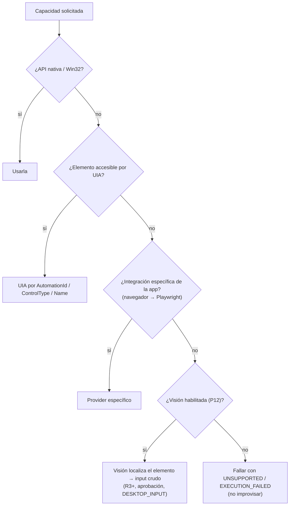

# Windows Integration Strategy

## Jerarquía

Para cada capacidad se usa el **mecanismo más alto disponible** de esta lista. Bajar un nivel requiere justificarlo en la tool ([ADR-002](../09-decisions/ADR-002-windows-integration-strategy.md)).

| # | Nivel | Ejemplos | Propiedades |
|---|---|---|---|
| 1 | **Native API** (APIs de alto nivel del SO y WinRT) | `IApplicationActivationManager`, `Windows.Management.Deployment.PackageManager`, notificaciones toast, Shell (`IShellWindows`) | Semántica, estable, soportada |
| 2 | **Win32** | `CreateProcessW`, `ShellExecuteExW`, Toolhelp32/`EnumProcesses`, `EnumWindows`, `GetForegroundWindow`, `WM_CLOSE`, `TerminateProcess`, Job Objects, WTS | Precisa, rápida, sin depender de la UI |
| 3 | **Windows UI Automation** | `IUIAutomation`, `AutomationId`, `ControlType`, patrones `Invoke`/`Value`/`Toggle` | Semántica sobre la UI; funciona con la mayoría de apps accesibles |
| 4 | **Application-specific** | Playwright/CDP para navegadores, COM de Office, CLI oficial de la app (`code --goto`), APIs locales | La mejor para su app, pero una integración por app |
| 5 | **Computer Vision** | OCR, detección de elementos en capturas | Funciona con cualquier cosa visible; frágil, costosa, privacidad |
| 6 | **Raw mouse/keyboard** | `SendInput` en coordenadas | Último recurso |

## Por qué mouse/teclado crudo es el último recurso

1. **No verificable por sí mismo**: `SendInput` devuelve el número de eventos inyectados, no qué hizo la app. Sin otro mecanismo de observación no se cumple el [principio de verificación](../03-tools/verification.md).
2. **Frágil**: depende de resolución, DPI, tema, idioma, posición de ventanas, animaciones y del foco en el instante exacto.
3. **Interfiere con el usuario**: mueve su cursor, escribe en la ventana que tenga el foco. Si el usuario toca el teclado a mitad, el texto va a otro sitio (¡incluida una contraseña a un chat!).
4. **Peligroso por foco equivocado**: un clic en coordenadas sobre la ventana incorrecta puede confirmar un diálogo destructivo.
5. **Limitado por Windows**: UIPI bloquea input a ventanas de mayor integridad; el Secure Desktop (UAC, Ctrl+Alt+Supr) no recibe input inyectado; no funciona con la sesión bloqueada.
6. **Difícil de autorizar**: la política no puede razonar sobre "clic en (812, 440)"; sí puede sobre "invocar el botón `SaveButton` de Notepad".

Por eso: fuera del MVP, sin fase propia, y en P12 solo como fallback de visión, siempre R3+, con lock `DESKTOP_INPUT` y aprobación.

## Fallback entre niveles

El fallback **no es automático en tiempo de ejecución** en el MVP: cada tool está implementada con un nivel concreto. El árbol describe cómo se diseña una tool nueva y, en el futuro (P12), cómo el Agent Core elige tool.

## Módulo Platform (`jarvis-windows`)

- Único crate con `unsafe` y llamadas a `windows-rs`. Expone interfaces seguras (`ProcessApi`, `WindowApi`, `SessionApi`, `CredentialApi`, `LaunchApi`) que las tools usan.
- Cada interfaz tiene un **fake** para tests unitarios de las tools sin Windows real.
- Todos los handles se envuelven en tipos RAII (`OwnedHandle`) para no filtrarlos.
- COM se inicializa por hilo: MTA para el runtime general; un hilo STA dedicado para UIA (P9) ([UI Automation](ui-automation.md)).
- Llamadas bloqueantes de Win32 se ejecutan en `spawn_blocking` para no bloquear el runtime Tokio.

## Documentos

- [Process Management](process-management.md) · [Active Window](active-window.md)
- [UI Automation](ui-automation.md) (P9) · [Session Model](session-model.md) · [Startup Model](startup-model.md)
