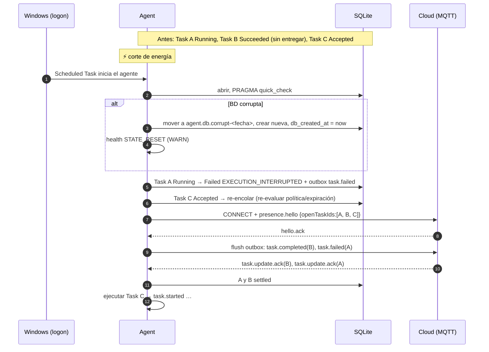

# Crash Recovery

## Principio

Tras cualquier parada no ordenada (crash, kill, corte de energía, BSOD, update forzado de Windows), el agente reconstruye su estado **solo desde SQLite** y aplica una regla simple: **lo que estaba ejecutándose no se re-ejecuta**. Una acción a medias no es verificable de forma segura y repetirla puede duplicar efectos.

## Recuperación de arranque

Se ejecuta antes de conectar al Cloud:

| Estado local encontrado | Acción | Mensaje (vía outbox) |
|---|---|---|
| `Received` (sin decisión persistida) | Se descarta el registro: nunca se envió `task.ack`, así que el Cloud reintentará el dispatch y entrará como nueva | — |
| `AwaitingApproval` | Si la aprobación expiró → `Cancelled`; si no, sigue pendiente | `task.cancelled APPROVAL_EXPIRED` o nada |
| `Accepted` (en cola, no iniciada) | Se vuelve a encolar, con re-evaluación de política y expiración (`maxDurationSeconds` desde la entrega) | — (`task.started` al ejecutarse) |
| `Running` / `Verifying` | `Failed` con `EXECUTION_INTERRUPTED` (`retryable: true`). **No** se re-ejecuta ni se intenta verificar a posteriori | `task.failed EXECUTION_INTERRUPTED` ([C6](../00-overview/cloud-compatibility.md)) |
| Terminal no *settled* | Nada; el outbox lo reenviará | Mensaje terminal existente |
| Terminal *settled* | Nada | — |

Por qué no verificar a posteriori una tarea `Running`: la verificación de `open_app` podría dar `PASSED` porque el usuario abrió la app manualmente después; reportar éxito sería falso. `EXECUTION_INTERRUPTED` con `retryable` deja la decisión al solicitante.

## Secuencia

## Corrupción de SQLite

| Paso | Detalle |
|---|---|
| Detección | `PRAGMA quick_check` al arrancar; `SQLITE_CORRUPT`/`SQLITE_NOTADB` en operación |
| Acción | Detener la ingesta, renombrar a `agent.db.corrupt-<timestamp>` (conservar para diagnóstico), crear BD nueva |
| Guardia | `db_created_at` nuevo → tareas anteriores rechazadas (`STATE_RESET`, [Idempotency](idempotency.md#reinicio-de-la-base-de-datos)) |
| Pérdidas | Resultados no entregados de la BD corrupta. Se intenta recuperar el outbox con `.recover` de SQLite en un paso posterior manual (`jarvis-agent diagnostics --recover-outbox`), nunca automáticamente |
| Visibilidad | Health `STATE_RESET` hasta que el owner lo reconozca en `status` |

Mitigación de probabilidad: WAL + `synchronous=FULL`, un único escritor, sin acceso concurrente de otros procesos, backups antes de migrar.

## Crash loop

Si el agente cae 3 veces en 10 minutos, el siguiente arranque entra en **modo seguro**: conecta, publica presencia y resultados pendientes, pero rechaza tareas nuevas con `task.rejected` (código `NOT_PERMITTED`, mensaje `agent in safe mode`) hasta que el owner ejecute `jarvis-agent status --clear-safe-mode` o pase 1 hora sin caídas. Evita que una tarea "envenenada" (que tumba el proceso) se reciba en bucle.

Una tarea que estaba `Running` en dos crashes consecutivos queda marcada como sospechosa en diagnóstico.
