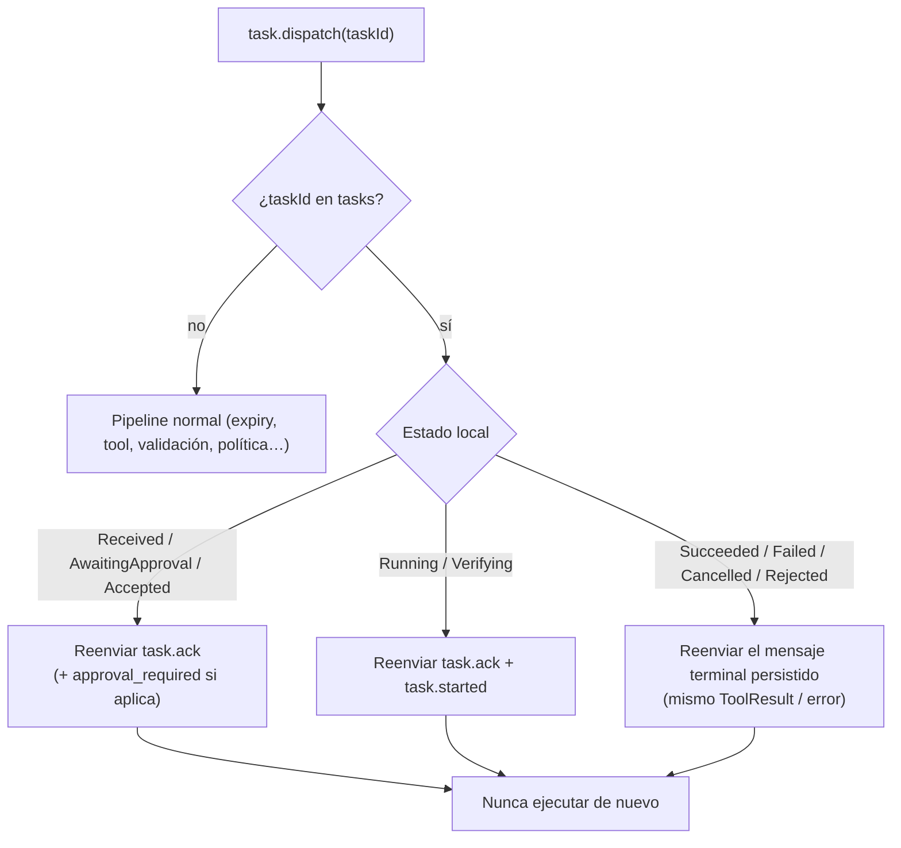

# Idempotency

## Problema

MQTT QoS 1 es **at-least-once**. El Cloud además reintenta el dispatch si no recibe `task.ack` (W5). Un mismo `task.dispatch` puede llegar varias veces:

```text
Task A → Windows ejecuta → conexión perdida → el Cloud reintenta Task A
```

El agente debe reconocer que *Task A ya fue ejecutada* y **devolver el resultado previo**, nunca ejecutar otra vez. Ver [ADR-006](../09-decisions/ADR-006-task-idempotency.md).

## Identificadores

| Id | Quién lo genera | Alcance | Uso |
|---|---|---|---|
| `taskId` | Cloud (UUIDv7) | Global, estable entre reintentos | **Clave de deduplicación** del agente |
| `envelope.id` | Emisor de cada mensaje | Un mensaje MQTT | Trazabilidad; no sirve para dedup de tareas (cada reintento del Cloud puede tener otro `id`) |
| `executionId` | Agente (UUIDv7) al pasar a `Running` | Una ejecución | Diferencia "la tarea" de "el intento de ejecutarla". Como hay **0 o 1** ejecución por `taskId`, aparece en el `ToolResult` para trazabilidad y para el futuro Agent Core |
| `correlationId` | Cloud | Flujo de negocio | Logs |
| `Idempotency-Key` | Cliente del Cloud (REST) | Creación de tareas en el Cloud | **No llega al agente**: el Cloud ya la traduce a un único `taskId`. El agente no necesita otra clave |

## Algoritmo de recepción



- El reenvío usa el envelope **persistido** en el outbox (mismo contenido; nuevo `envelope.id` solo si el protocolo lo exige: el Cloud deduplica por `taskId` + tipo de mensaje).
- Si la tarea está *settled* y el resultado se redactó, se reenvía el `ToolResult` redactado (hash y tamaño presentes, contenido sensible no). Es aceptable: el Cloud ya lo tenía.

## Garantías

| Garantía | Mecanismo |
|---|---|
| Máximo una ejecución por `taskId` | `executions.task_id UNIQUE` + estado `Running` persistido **antes** de ejecutar |
| El ack implica persistencia | `task.ack` sale del outbox después del commit con `synchronous=FULL` |
| El resultado se entrega al menos una vez | Outbox reenviado en cada conexión hasta `task.update.ack` |
| No hay exactly-once | Correcto: el Cloud puede recibir dos veces el mismo `task.completed` y lo deduplica (su lado del contrato) |

## Reinicio de la base de datos

Si `agent.db` se pierde o se recrea (corrupción, reinstalación con `--purge`), el agente perdería la memoria de dedup y podría re-ejecutar una tarea antigua reenviada. Guardia:

- `meta.db_created_at` se registra al crear la BD.
- Tras una recreación, toda tarea con `createdAt < db_created_at − 60 s` se rechaza con `task.rejected EXPIRED_ON_ARRIVAL` (motivo `STATE_RESET` en el mensaje). El margen de 60 s existe porque el reloj del sistema no es monótono: sin él, una tarea creada justo después de la base podía parecer anterior y se rechazaba por error (observado al implementar). Una tarea realmente vieja lo es por minutos o días.
- Coste: tareas legítimas pendientes en el momento de la recreación se pierden (el solicitante las repite). Preferible a una doble ejecución.

## Retención

| Registro | Retención | Motivo |
|---|---|---|
| `tasks` + `executions` *settled* | **8 días** tras `settled_at` | El Cloud garantiza que no reenvía un `taskId` después de su expiración máxima (W7: el agente debe recordar `taskId` ≥ 8 días). 8 días cubre `expiresAt` máximo + reintentos + margen |
| Contenido sensible del `ToolResult` | Hasta *settled* | Luego se redacta (se conserva hash y tamaño) |
| `outbox` con `acked_at` | 24 h | Solo diagnóstico |
| `tasks` terminales **no** *settled* | Indefinida (hasta ack) con alerta de health `OUTBOX_STUCK` si > 7 días | No se puede borrar lo no entregado |
| `approvals` | Igual que su tarea | — |

Limpieza: tarea periódica (cada hora, y al arrancar) en lotes pequeños para no bloquear al escritor único; `VACUUM` incremental semanal.

## Casos límite

| Caso | Comportamiento |
|---|---|
| Dispatch duplicado mientras la tarea está en cola esperando locks | Reenviar `task.ack`; sigue en cola una sola vez |
| Dispatch con mismo `taskId` pero **payload distinto** | Se ignora el nuevo payload (el primero manda); log `WARN` con ambos hashes (indica Cloud defectuoso o manipulado) |
| `task.cancel` de un `taskId` desconocido | Se registra la tarea como `Cancelled` (tombstone) y se responde `task.cancelled`; si luego llega el dispatch, no se ejecuta |
| `task.update.ack` de un `taskId` desconocido | Ignorar |
