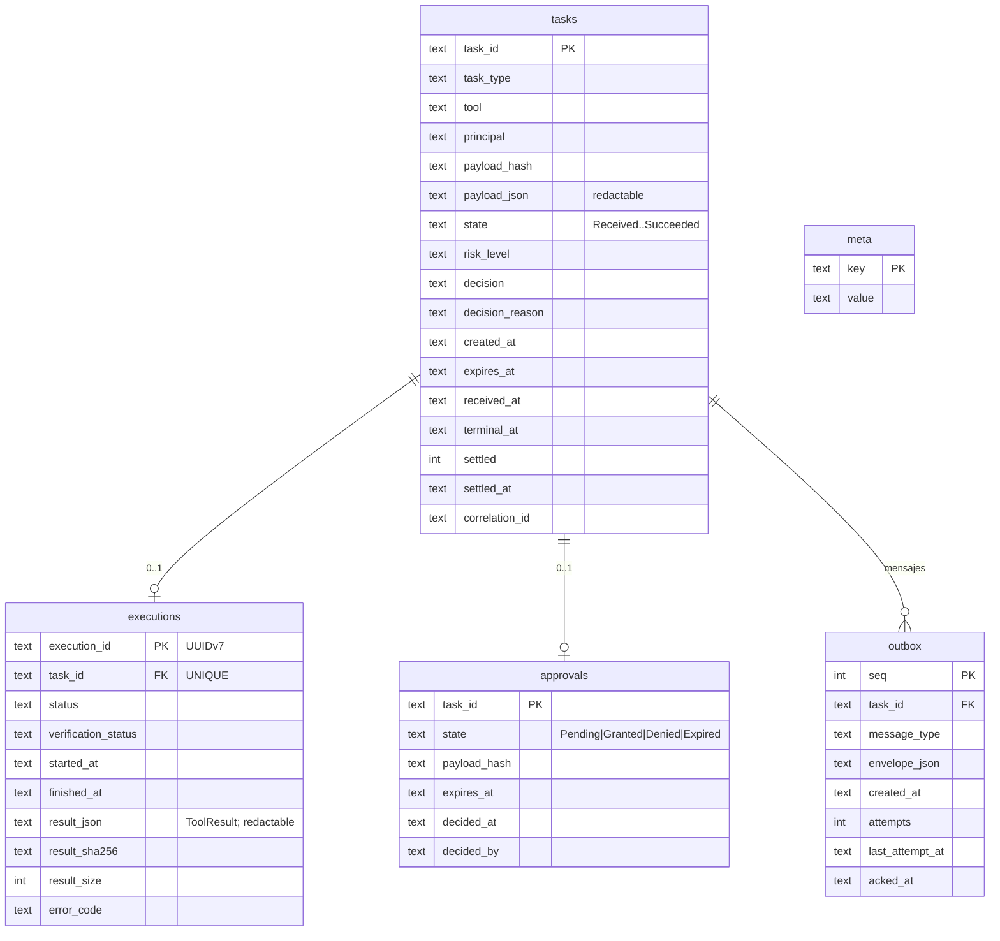

# Local State

## ¿Hace falta SQLite?

Sí. Es obligatorio, no opcional ([ADR-005](../09-decisions/ADR-005-sqlite-local-state.md)).

| Dato | ¿Persistir? | Dónde | Por qué |
|---|---|---|---|
| Tareas recibidas (dedup) | ✅ | SQLite `tasks` | Sin esto, un redelivery tras reinicio re-ejecuta la acción (W5/W7 del Cloud) |
| Resultados pendientes de entregar | ✅ | SQLite `outbox` | El resultado debe sobrevivir cortes y reinicios (W6) |
| Ejecuciones | ✅ | SQLite `executions` | Detectar ejecuciones interrumpidas por crash (W9) |
| Aprobaciones | ✅ | SQLite `approvals` | Una aprobación pendiente no debe perderse ni duplicarse tras reinicio |
| Configuración local | ❌ en SQLite | `config.toml` | Editable por humanos, versionable, revisable |
| Políticas de tools | ❌ en SQLite | `policy.toml` | Igual; además debe poder revisarse con un editor |
| Credenciales | ❌ | Credential Manager | [Credential Storage](../04-security/credential-storage.md) |
| Logs | ❌ | Archivos rotados | [Logging](../07-observability/logging.md) |
| Metadatos (versión de esquema, `db_created_at`, último `clockOffset`) | ✅ | SQLite `meta` | Migraciones, guardia de reinicio de BD |

Alternativas descartadas: archivos JSON por tarea (sin atomicidad entre "estado" y "mensaje en outbox", corrupción parcial en cortes de energía), sled/redb (menos maduros y sin herramientas de inspección), registro de Windows (no es una base de datos).

## Ubicación y configuración de SQLite

- `%LOCALAPPDATA%\Jarvis\Agent\state\agent.db` (ACL heredada del perfil: solo el usuario y SYSTEM/Administrators).
- `journal_mode=WAL`, `synchronous=FULL` (durabilidad ante corte de energía: un `task.ack` implica que la tarea está en disco), `foreign_keys=ON`, `busy_timeout=5000`.
- **Un único escritor**: una tarea dedicada del runtime serializa las escrituras (canal de comandos). Lecturas concurrentes permitidas.
- Migraciones versionadas embebidas en el binario (`user_version`), solo hacia adelante y aditivas entre versiones menores.
- `rusqlite` con feature `bundled`: versión de SQLite controlada, sin depender de DLLs del sistema.

## Esquema



| Restricción | Motivo |
|---|---|
| `executions.task_id UNIQUE` | Garantía estructural de **máximo una ejecución por `taskId`** |
| `outbox` ordenado por `seq` | Los mensajes de una tarea se publican en orden (ack → started → terminal) |
| Estado y mensaje de outbox en la **misma transacción** | Nunca "estado Succeeded sin mensaje" ni "mensaje sin estado" |

## El caso crítico

```text
Task completed → MQTT disconnected → result not delivered → PC reboot → agent starts → result must still be published
```

1. Al terminar, en **una transacción**: `executions` (resultado), `tasks.state = Succeeded`, `outbox += task.completed`. `synchronous=FULL` → en disco.
2. La publicación falla (sin conexión); la fila sigue en `outbox` sin `acked_at`.
3. Reinicio. Recuperación de arranque ([Crash Recovery](crash-recovery.md)): nada que hacer con esa tarea (ya es terminal).
4. Conexión: `presence.hello.openTaskIds` incluye el `taskId` (terminal no *settled*) → el Cloud no la marca perdida.
5. Flush del outbox → `task.completed` → `task.update.ack` → `settled = 1`, `outbox.acked_at`, redacción si es sensible.

## Configuración local

Separación estricta entre **configuración no sensible** (archivos TOML) y **credenciales** (Credential Manager).

`%LOCALAPPDATA%\Jarvis\Agent\config.toml`: cómo funciona el agente.

```toml
[device]
device_id = "0192a6f0-2222-7aaa-8bbb-000000000002"   # identificador, no secreto

[cloud]
broker_url = "mqtts://jarvis.example.com:8883"
# password/secret: NO aquí → Credential Manager "Jarvis/WindowsAgent/<deviceId>"

[mqtt]
keepalive_seconds = 60
max_inflight = 16

[tools]
enabled = ["is_app_running", "list_running_apps", "get_active_window", "open_app", "close_app"]

[executor]
max_concurrent = 4
queue_capacity = 32

[logging]
level = "info"            # trace|debug|info|warn|error
retention_days = 14
max_file_mb = 20

[update]                  # actualizador firmado (P8); apagado por defecto
enabled = false
manifest_url = "https://updates.example.com/windows-agent/stable.json"
channel = "stable"        # stable|beta

[tool_api]                # Local Tool API para el Agent Core (P10); apagada por defecto
enabled = false
max_calls_per_minute = 60
```

`%LOCALAPPDATA%\Jarvis\Agent\policy.toml`: **qué** está permitido (principals, capabilities, riesgo, catálogo de apps, allowed paths, comandos, privacidad). Ver [Permission Engine](../04-security/permission-engine.md), [Tool Registry](../03-tools/tool-registry.md), [Filesystem Tools](../03-tools/filesystem-tools.md), [Command Execution](../03-tools/command-execution.md).

| Mapeo del ejemplo conceptual | Archivo |
|---|---|
| `device`, `cloud`, `mqtt`, `tools`, `logging` | `config.toml` |
| `permissions`, `allowedPaths`, catálogo de apps y comandos | `policy.toml` |
| `credentials` | Credential Manager |

Por qué dos archivos: la política es la frontera de seguridad y tiene otro ciclo de vida (se revisa con más cuidado, se recarga en caliente, su validez decide si el agente opera o entra en fail-closed). Mezclarla con ajustes operativos invita a editarla sin cuidado.

Reglas comunes:
- TOML con validación estricta (claves desconocidas = error, con número de línea).
- Si `config.toml` contiene una clave con nombre sospechoso (`password`, `secret`, `token`), el agente **se niega a arrancar** y lo explica: evita que alguien "arregle" la conexión pegando el secreto en el archivo.
- `jarvis-agent diagnostics` incluye ambos archivos (no contienen secretos).
