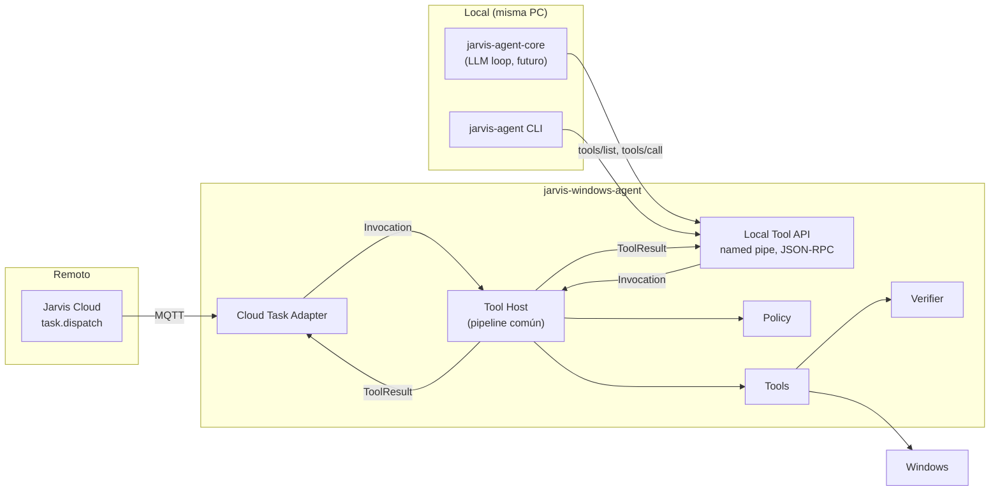
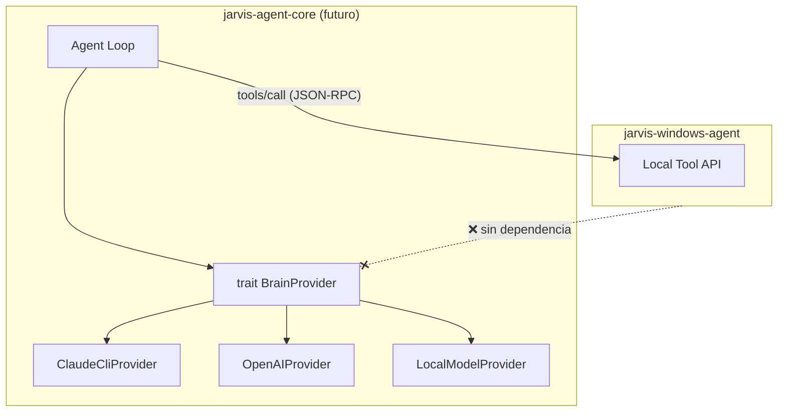

# Agent Core Integration (P10)

No se implementa IA en este proyecto: lo implementado es el **lado del agente** del boundary, la Local Tool API. Decisión en [ADR-014](../09-decisions/ADR-014-agent-core-boundary.md).

## Estado de implementación

| Pieza | Estado |
|---|---|
| Named pipe `\\.\pipe\jarvis-tools-<SID>` con ACL del usuario | ✅ `crates/jarvis-agent/src/tool_api.rs` |
| JSON-RPC 2.0 con `tools/list` y `tools/call` | ✅ descriptores con `inputSchema`/`outputSchema`, riesgo y permisos |
| Principal `local:agent-core` | ✅ **siempre** ese; por este canal nadie puede actuar como `local:owner` |
| Presupuesto de llamadas por minuto | ✅ `[tool_api] max_calls_per_minute` (60 por defecto) |
| Idempotencia por `invocationId` | 🟡 en memoria del proceso (últimas 64 invocaciones), no en la tabla de dedup: tras un reinicio del agente, el Agent Core debe consultar el estado por sus propios medios |
| Canal habilitado por defecto | ❌ apagado: `[tool_api] enabled = true` lo enciende |

El `ToolResult` que devuelve `tools/call` es **el mismo** que recibe el Cloud (`jarvis.tool-result/1`), con su verificación y sus checks. Una tool que falla viaja como error JSON-RPC con el resultado completo en `data`, para que el llamante pueda razonar sobre el motivo.

## Relación prevista

```text
User Goal → jarvis-agent-core → Claude CLI / LLM → Tool Call → Tool Router → Windows Tool → ToolResult → jarvis-agent-core
```

- **`jarvis-agent-core`** (proyecto futuro, proceso separado): bucle de razonamiento, planificación, memoria, prompts, selección de tools. Usa un **BrainProvider**.
- **`jarvis-windows-agent`** (este proyecto): ejecuta tools con política, verificación y auditoría. **No** contiene razonamiento, prompts ni clientes de LLM.
- Las tools pueden ejecutarse **sin Claude**: una tarea remota del Cloud, la CLI o un test las invocan igual.

## Una tool, dos frontends



| Aspecto | Cloud Task Adapter | Local Tool API |
|---|---|---|
| Transporte | MQTT (`task.dispatch`) | Named pipe `\\.\pipe\jarvis-tools-<SID>` con ACL del usuario |
| Protocolo | Envelope v1 del Cloud | JSON-RPC 2.0, métodos `tools/list` y `tools/call`, forma compatible con MCP (descriptores con `inputSchema`) |
| Principal | `cloud:user:*`, `cloud:device:*` | `local:agent-core`, `local:owner` |
| Idempotencia | `taskId` | `invocationId` opcional del llamante (misma tabla de dedup, espacio de nombres `local:`) |
| Resultado | `ToolResult` dentro de `task.completed` | El mismo `ToolResult` |
| Política, locks, timeouts, verificación, auditoría | **Idénticos** | **Idénticos** |

Lo que ya está preparado en el MVP:
- El pipeline interno trabaja con `Invocation` y `ToolResult`, no con envelopes MQTT.
- Los descriptores de tool tienen `description`, `inputSchema` y `outputSchema` en JSON Schema: lo que un LLM necesita para llamar tools.
- `ToolResult` incluye `verification.checks`: el LLM puede razonar sobre por qué algo falló.
- `executionId` distinto de `taskId`.
- Principals `local:*` ya existen en el modelo de política.

## Seguridad del Agent Core

Un LLM es un **principal de confianza media**: sus llamadas vienen de un modelo que puede ser manipulado por prompt injection (una web o un documento leído por una tool puede contener instrucciones).

| Regla | Motivo |
|---|---|
| `local:agent-core` tiene su propia regla de política, no hereda de `local:owner` | El owner decide qué puede hacer el LLM |
| R3 requiere aprobación humana también para el Agent Core | Prompt injection no debe poder cerrar forzosamente apps ni ejecutar comandos de riesgo |
| Presupuesto de invocaciones (rate limit por principal) | Evita bucles del LLM |
| Las salidas de tools sensibles se marcan como tales en el `ToolResult` | El Agent Core decide si pueden enviarse al LLM remoto |

## BrainProvider boundary



- El Windows Agent **nunca** importa ni depende de `BrainProvider` ni de sus implementaciones (ni crates, ni DLLs, ni procesos hijos de LLM, ni API keys de LLM).
- La dependencia es unidireccional: Agent Core → Local Tool API (contrato JSON versionado).
- Consecuencia: se puede cambiar de Claude a OpenAI o a un modelo local sin tocar ni redistribuir el Windows Agent, y el Windows Agent puede auditarse sin entender de LLMs.

## Riesgos

| Riesgo | Mitigación |
|---|---|
| Duplicar lógica de tools en el Agent Core "por comodidad" | Contrato: el Agent Core solo llama a la Local Tool API |
| Latencia de named pipe para bucles rápidos | Despreciable frente a la latencia del LLM |
| Evolución del contrato | `tools/list` devuelve versiones; `ToolResult` versionado (`jarvis.tool-result/1`) |
