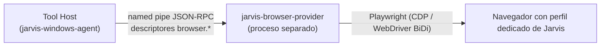

# Browser Automation (P11, futuro)

No se implementa ahora. Decisión en [ADR-013](../09-decisions/ADR-013-browser-automation-boundary.md).

## Principio

No controlar el navegador con mouse/teclado si puede evitarse. El navegador tiene un modelo semántico propio y rico, el **DOM**, accesible con protocolos de automatización. Se usará **Playwright** para:

- DOM (consultar y leer elementos por selector/rol/texto),
- navegación (URLs, historial, esperas de carga),
- formularios (rellenar, seleccionar, enviar),
- pestañas (abrir, listar, cambiar, cerrar),
- automatización general del navegador.

## Tool Provider separado

| Decisión | Motivo |
|---|---|
| **Proceso separado**, no dentro del agente | Playwright requiere Node.js (o su port a otros runtimes) y descarga navegadores; no se mete ese runtime en el binario Rust del agente (la regla "sin Python runtime" aplica igualmente a no arrastrar runtimes al core). Un crash del navegador no tumba el agente |
| Mismo contrato de tool | Política, riesgo, locks, verificación y `ToolResult` los aplica el Tool Host ([Tool Registry](../03-tools/tool-registry.md#providers-externos-futuro)) |
| **Perfil dedicado** del navegador, no el perfil personal del usuario | No exponer cookies, sesiones bancarias ni contraseñas guardadas del usuario a la automatización. Iniciar sesión en sitios con el perfil de Jarvis es una decisión explícita del owner |
| Lock propio `BROWSER:<profile>` | Las acciones sobre el navegador automatizado no compiten con `DESKTOP_INPUT` (no usan input real) |

## Tools previstas

| Tool | Riesgo | Verificación |
|---|---|---|
| `browser.open_url` | R2 (dominios permitidos) | URL final y estado de carga |
| `browser.get_text` / `browser.query` | R1 (sensible) | `NOT_APPLICABLE` |
| `browser.fill` | R2 | Valor del campo leído del DOM |
| `browser.click` | R2 / R3 (botones de envío, pago, borrado) | Navegación o cambio del DOM esperado |
| `browser.tabs` | R1 / R2 | Lista de pestañas |

## Riesgos

| Riesgo | Mitigación |
|---|---|
| Prompt injection desde contenido web hacia el futuro Agent Core | El contenido leído se marca como no confiable en el `ToolResult`; acciones R3 con aprobación |
| Exfiltración mediante navegación a URLs con datos | Lista de dominios permitidos por política |
| Compras/envíos accidentales | Heurística de acciones destructivas → R3 |
