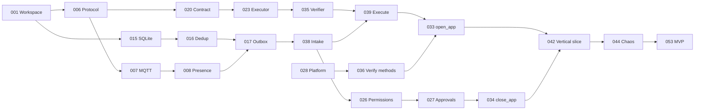

# Implementation Order

Orden recomendado. Respeta todas las dependencias declaradas en las HUs y entrega algo demostrable al final de cada fase del [Roadmap](../00-overview/roadmap.md).

## Secuencia

| # | Fase | HUs (en orden) | Demostrable al terminar |
|---|---|---|---|
| 1 | P1 Foundation | 001 → 002 → 003 → 004 → 005 | `jarvis-agent run` / `status` / `stop`; logs JSON; CI verde |
| 2 | P2 Identity + Cloud | 006 → 012 → 007 → 008 → 009 → 010 → 011 → 013 → 014 | Device `Online` en el Cloud con credencial real; LWT; `AUTH_REJECTED` |
| 3 | P3 State + Task intake | 015 → 016 → 017 → 038 → 018 | Cualquier tarea → `Rejected UNSUPPORTED_TASK_TYPE` de forma idempotente y durable; outbox sobrevive reinicios |
| 4 | P4 Tool System + Permissions | 020 → 021 → 022 → 023 → 035 → 039 → 019 → 040 → 024 → 025 → 026 → 027 → 041 | Pipeline completo con `noop`: éxito, fallo, timeout, cancelación, denegación y aprobación |
| 5 | P5 Process Tools + Verification | 028 → 029 → 036 → 030 → 031 → 032 → 033 → 034 → 037 → 042 | **Vertical slice**: `OPEN_APP chrome` desde el Cloud con `verification PASSED` |
| 6 | P6 Resilience + Packaging | 043 → 045 → 048 → 047 → 050 → 051 → 052 → 046 → 044 → 049 → 053 | **MVP completo** |
| 7 | P7 | 054 → 055 → 056 → 057 → 058 → 059 → 060 | Filesystem y comandos con suites de seguridad |
| 8 | P8 | 061 → 062 → 063 (requiere Cloud Phase 3) | Firmas, aprobación remota, updater |
| 9 | P9 | 064 → 065 → 066 | UIA |

## Camino crítico del MVP

## Primera HU: HU-WIN-001

**Por qué es la primera**:
1. Todas las demás dependen de ella: define dónde vive cada pieza (crates) y fija la frontera más importante del diseño, que todo lo que decide sea portable y solo `jarvis-windows` toque Win32 con `unsafe`.
2. Pone en marcha la CI (Linux + Windows, clippy, fmt, deny) antes de escribir lógica: cada HU posterior se valida automáticamente desde el primer commit.
3. Es de bajo riesgo y alto apalancamiento: sin decisiones abiertas, pequeña y verificable.
4. Materializa las decisiones de [ADR-001](../09-decisions/ADR-001-rust-agent-runtime.md) (toolchain y lints) antes de que haya código que migrar.

## Paralelización

Con dos personas, a partir de HU-WIN-001:
- **Línea A (conectividad)**: 006 → 007 → 008 → 009 → 010 → 011 → 012 → 013 → 014.
- **Línea B (núcleo)**: 015 → 016 → 020 → 022 → 023 → 024 → 025 (portables, testeables sin Cloud).
- Se unen en 017/038 (necesitan Cloud Link y State Store).

## Riesgos de secuencia

| Riesgo | Mitigación |
|---|---|
| El runner interactivo de Windows no está listo al llegar a P5 | Prepararlo durante P3 (máquina self-hosted con auto-logon) |
| Cambios en el Cloud durante P2–P5 | Contract tests de HU-WIN-006 contra fixtures del Cloud; revisar [Cloud Compatibility](../00-overview/cloud-compatibility.md) al inicio de cada fase |
| P8 bloqueada por Cloud Phase 3 | P7 y P9 no dependen de ella y pueden adelantarse |
